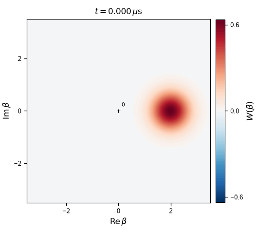
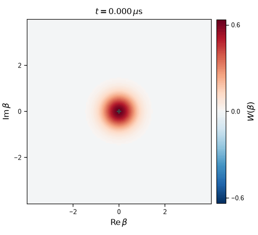
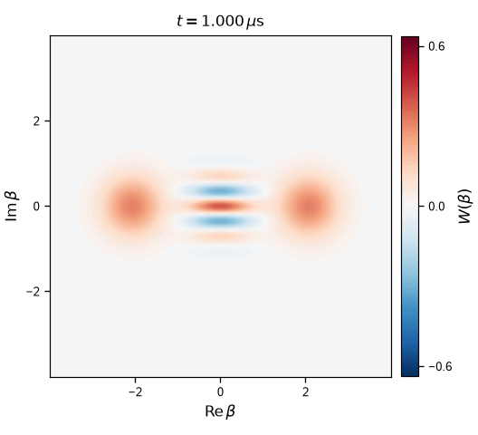

# Stabilizing and preparing a cat qubit

**DuQuantum 2026 · Alice & Bob challenge · Introductory Track**

Team: Pranav

Completed: **Tasks 1.0(a–c), 1.1, 1.2 and 1.3(a–c)**. [Challenge prompt](docs/challenge_prompt_v4.md) · [Model, parameters and numerical checks](TECHNICAL.md)

The memory stores the state; the lossy buffer provides two-photon stabilization. Their annihilation operators are $a$ and $b$, and their mean photon numbers are $\langle n_a\rangle=\langle a^\dagger a\rangle$ and $\langle n_b\rangle=\langle b^\dagger b\rangle$. We use the supplied target amplitude $\alpha=2.1$, corresponding to $\alpha^2=4.41$ photons. The coupling $g_2$ exchanges two memory photons with one buffer photon; $\epsilon_d$ drives the buffer; $\kappa_a$ and $\kappa_b$ are single-photon loss rates.

Time is in µs; rates use the challenge's angular-frequency convention, with quoted frequencies multiplied by $2\pi$. A cutoff $N$ retains photon-number (Fock) states $\lvert0\rangle$ through $\lvert N-1\rangle$. We use $N=30$ for the single-mode calculations and $(N_a,N_b)=(32,12)$ for memory and buffer unless stated otherwise.

## 1.0 — Add dissipation one ingredient at a time

Here $n=a^\dagger a$ is the single-mode photon-number operator. Parts (a) and (b) start from the coherent state $\lvert\alpha_0=2\rangle$, with four photons on average; part (c) starts from vacuum. In (a), the loss rate and Hamiltonian detuning are both $2\pi$ µs⁻¹. In (b,c), the nominal two-photon loss rate is $\kappa_{2,0}=4g_2^2/\kappa_b$.

| Task | Prediction | Numerical result |
|---|---|---|
| **(a) Single-photon loss** | $\langle n(t)\rangle=4e^{-2\pi t}$ | Maximum absolute error $9.72\times10^{-12}$. The coherent-state Wigner function contracts while rotating. |
| **(b) Two-photon loss** | $\lvert0\rangle$ and $\lvert1\rangle$ cannot lose another photon pair. Even photon numbers decay to $\lvert0\rangle$ and odd ones to $\lvert1\rangle$, giving $\langle n\rangle_\infty=(1-e^{-8})/2$. | $\langle n\rangle_\infty=0.49983227$, with final probabilities $p_0=0.50016773$ and $p_1=0.49983227$. |
| **(c) Two-photon stabilization** | From vacuum, occupation approaches $\alpha^2=4.41$ and the Wigner function develops two lobes with interference. | At the nominal rate, $\langle n\rangle=4.404$ at 2 µs. |

Here $p_0$ and $p_1$ are the probabilities of zero and one photon. The two-photon-loss plateau is set by the initial even/odd probabilities, because removing pairs preserves parity.

For $\kappa_2/\kappa_{2,0}=1/4,1,4$, the times to reach 90% of each run's occupation at 2 µs are **0.610, 0.155 and 0.040 µs**, respectively. Increasing the two-photon rate therefore speeds up stabilization. The curves nearly coincide when plotted against $\kappa_2t$: this scaling would be exact at $\kappa_a=0$, while the fixed memory-loss rate produces small differences.


**Effective-model stabilization.** Occupation versus (a) time and (b) scaled time. Colors identify $\kappa_2/\kappa_{2,0}$; the dotted line marks $\alpha^2$. [Decay checks and Wigner snapshots](notebooks/01_task_1_0_warmup.ipynb).

| Single-photon loss | Two-photon stabilization |
|:---:|:---:|
|  |  |

**Wigner evolution.** Left: coherent-state decay over 0–1 µs. Right: cat formation at nominal $\kappa_2$ over 0–2 µs. The Wigner function $W(\beta)$ displays the state over the complex amplitude coordinate $\beta$; a coherent state's center gives its amplitude. Red and blue denote positive and negative values; all animations share the fixed scale $[-2/\pi,2/\pi]$ and display simulated time. [Static panels](notebooks/01_task_1_0_warmup.ipynb).

## 1.1 — Inflate the memory in the full two-mode model

Starting from vacuum in both modes, the memory occupation overshoots its target and oscillates before settling. The effective single-mode model instead rises smoothly. Replacing the buffer by an instantaneous two-photon dissipation channel requires $\kappa_b\gg g_2,\epsilon_d$; the supplied parameters do not satisfy this condition:

$$g_2/\kappa_b=0.293,\qquad \epsilon_d/\kappa_b=1.294.$$

The buffer fills and exchanges photon pairs with the memory before dissipating them, producing the overshoot and ringdown. We simulate 0–3 µs; peaks below are sampled every 0.01 µs, and the late-time occupation is averaged over 2.81–3 µs.

| Quantity | Result |
|---|---:|
| Sampled memory peak | 6.894 photons at 0.23 µs; 56.3% above $\alpha^2$ |
| Sampled buffer peak | 1.992 photons at 0.13 µs |
| Time after which occupation stays within 1% of $\alpha^2$ through 3 µs | 1.07 µs |
| Late-time memory occupation | 4.4026 photons |


**Two-mode inflation.** (a) Memory and buffer occupations at $(32,12)$, with the memory at $(24,6)$ (start) dashed and the effective model dotted. The horizontal line marks $\alpha^2$. (b) Top-level probabilities in percent: $p_a^{(2)}$ sums the probabilities of memory levels $N_a-2$ and $N_a-1$; $p_b^{(1)}$ is the probability of buffer level $N_b-1$. Solid curves use $(32,12)$ and dashed curves $(24,6)$. The dotted line marks our **0.1% tolerance**, chosen for the convergence study. The $(24,6)$ buffer reaches **4.62%** at level 5; both $(32,12)$ monitors remain below the tolerance throughout inflation. At $N_b=12$, the monitored buffer level is 11.

The occupation ringdown persists under tighter tolerances, smaller integration steps and an independent solver, supporting its physical origin. Tiny late-time fluctuations in the supplementary log-scale probabilities are numerical residuals; [numerical audit](figures/task_1_1_numerical_checks.png).


**Memory phase-space evolution.** The reduced memory state at $(32,12)$ evolves from vacuum into two lobes with interference over 0–3 µs, with a fixed color scale. [Static snapshots](figures/task_1_1_wigner.png).

## 1.2 — Check semiclassical agreement and convergence

The reference calculation at $(40,14)$ gives a late-time occupation of **4.4026**, only **0.167% below** $\epsilon_d/g_2=4.41$. This agreement persists as the cutoffs increase. The remaining small difference is consistent with the finite-loss quantum model; steady occupation is much less sensitive to truncation than the transient peak.

We test $N_a=16,20,24,28,32,40$ and $N_b=4,6,8,10,12,14$. Both the trajectory sweeps and the occupation-convergence plot hold the other cutoff at its largest tested value: vary $N_a$ at **$N_b=14$**, then vary $N_b$ at **$N_a=40$**. Relative errors are absolute differences divided by the corresponding $(40,14)$ reference value. The steady estimate averages 2.81–3 µs; the peak is the largest saved memory occupation over 0–3 µs.


**Cutoff dependence during inflation.** (a,c) Sweep $N_a$ at $N_b=14$; (b,d) sweep $N_b$ at $N_a=40$. Upper and lower rows show memory and buffer occupations. Colors identify the varied cutoff; black dashes show $(40,14)$ and horizontal dotted lines mark $\alpha^2$. The first 1.2 µs of each 3 µs trajectory is shown.

| Observable | Relative tolerance | Smallest tested $N_a$ at $N_b=14$ | Smallest tested $N_b$ at $N_a=40$ |
|---|---:|---:|---:|
| Steady occupation | 0.1% | **16** | **4** |
| Transient peak | 0.5% | **24** | **10** |

Each minimum must pass together with all larger cutoffs in its sweep. Thus $N_a=16$ or $N_b=4$ suffices for steady occupation only when the other cutoff is held at its reference value. During inflation, both modes occupy higher Fock levels: the buffer briefly holds about two photons with a substantial tail, and the memory overshoots to about 6.9 photons. Capturing that transient requires larger cutoffs in both modes.


**Observable convergence.** Peak occupation $n_{a,\mathrm{pk}}=\max_t\langle n_a(t)\rangle$ and late-time mean $\bar n_{a,\mathrm{ss}}$, averaged over 2.81–3 µs, for the same two sweeps. Dotted lines mark $\alpha^2$.

**Occupation agreement alone does not establish state convergence.** We compare all **36 cutoff pairs** with $(40,14)$ using trace distance, which includes both populations and coherence. The reduced memory state $\rho_a$ is the density matrix obtained by tracing out the buffer. We add zero rows and columns to place smaller states in the reference's 40-level memory basis. We compare them using

```math
D_{\max}=\max_t\frac{1}{2}\left\lVert\rho_a(t)-\rho_{a,\mathrm{ref}}(t)\right\rVert_1.
```

Here $\rho_{a,\mathrm{ref}}$ is the $(40,14)$ reference state. The trace norm $\lVert\cdot\rVert_1$ sums the absolute eigenvalues of the density-matrix difference. A trace distance of 1% bounds any memory measurement's probability difference from the reference by one percentage point, up to solver error. The reference is a finite calculation, so this is a comparison with $(40,14)$ rather than an exact error bound.

We require maximum trace distance $`D_{\max}\leq1\%`$, relative peak and steady errors at most 0.5% and 0.1%, respectively, and both monitored top-level probabilities staying at most 0.1% throughout 0–3 µs. All these conditions must also hold for every tested pair with both cutoffs at least as large. **$(28,12)$ is the passing pair with the smallest dimension $N_aN_b$**, with $`D_{\max}=0.848\%`$. We use **$(32,12)$ throughout Tasks 1.1 and 1.3** for additional margin, with $`D_{\max}=0.310\%`$. The state-distance test covers vacuum inflation at the supplied parameters; it does not certify different initial states or drives.


**Joint memory-state convergence.** Axes give the retained memory and buffer dimensions $N_a$ and $N_b$; blue shading shows $D_{\max}$. Lighter shades mean smaller differences. The color bar is logarithmic in percent; values at or below 0.1% share the lightest shade. Small circles mark computed pairs. The black curve marks $`D_{\max}=1\%`$; its upper-right side passes this state-distance test, with the other criteria checked separately. The ring marks $(32,12)$ and the star marks reference $(40,14)$, whose self-distance is zero. Background and contour use the same shape-preserving interpolation; cutoff decisions use computed values. Each maximum covers 301 saved times from 0 to 3 µs.

## 1.3(a) — Identify the prepared state and its decay

**Inflation from vacuum prepares a partially decohered even cat.** The ideal target, in the absence of memory single-photon loss, is the coherent superposition

```math
\lvert C_+\rangle=\frac{\lvert\alpha\rangle+\lvert-\alpha\rangle}{\sqrt{2(1+e^{-2\alpha^2})}},\qquad \alpha=2.1.
```

The reason is **conservation of memory photon-number parity**, $\Pi=(-1)^{a^\dagger a}$. Two-photon exchange changes the memory photon number by two, while the buffer drive and buffer loss leave its parity unchanged. Vacuum has even parity, so stabilization selects the even superposition. In our simulation, memory single-photon loss acts during inflation as well: each loss flips parity, mixing even and odd cats and reducing coherence.

We quantify $\rho_a$ using even-cat fidelity $F_+=\langle C_+\rvert\rho_a\lvert C_+\rangle$, purity $\mathcal{P}=\mathrm{Tr}(\rho_a^2)$, and inter-lobe coherence $C=2\lvert\langle\alpha\rvert\rho_a\lvert-\alpha\rangle\rvert$. Fidelity is the overlap with the target state; purity equals one for a pure state and falls below one for a mixed state:

| Time (µs) | $\langle\Pi\rangle$ | $F_+$ | $\mathcal{P}$ | $C$ |
|---:|---:|---:|---:|---:|
| 1 | 0.629 | 0.811 | 0.692 | 0.626 |
| 6 | 0.0483 | 0.524 | 0.501 | 0.0484 |

**At 1 µs, coherence between the lobes is still substantial:** $C=0.626$ and the Wigner function has interference fringes. For comparison, an equal incoherent mixture of $\lvert+\alpha\rangle$ and $\lvert-\alpha\rangle$ has $C=2e^{-2\alpha^2}\approx0.00030$, with fidelity and purity both approximately 0.5. The measured purity of 0.692 also shows that the prepared state is already partially mixed. By 6 µs, the diagnostics approach those of the incoherent mixture.

**The coherence-decay timescale is about 1.95 µs.** Fitting parity over 1–6 µs gives $\Gamma=0.5135$ µs⁻¹, consistent with the photon-loss prediction $2\kappa_a\langle n_a\rangle_{\mathrm{ss}}=0.5146$ µs⁻¹. Thus $\tau=1/\Gamma=1.95$ µs is the time for parity, and approximately the inter-lobe coherence, to fall by a factor of $e$ after inflation. Coherence fades continuously; it does not disappear at a single time.



**Interference decay.** Reduced-memory Wigner evolution over 1–6 µs at $(32,12)$. The fixed color scale makes the declining fringe contrast directly comparable. [Static snapshots](figures/task_1_3a_wigner_fading.png) · [Diagnostic curves](figures/task_1_3a_cat_diagnostics.png).

## 1.3(b) — Prepare a definite logical state

Task 1.3(a) establishes that inflation creates a superposition of the two logical codewords. **To initialize a chosen computational-basis value, we must also be able to prepare one codeword:** $\lvert0_L\rangle\equiv\lvert+\alpha\rangle$ or $\lvert1_L\rangle\equiv\lvert-\alpha\rangle$. Stabilization supports both signs equally, so starting from symmetric vacuum gives no preference for either. A memory displacement supplies that preference; stabilization then brings the amplitude toward the selected codeword.

**We propose to displace the memory first, then stabilize it into $\lvert0_L\rangle\equiv\lvert+\alpha\rangle$.** We introduce $\beta$ for the dimensionless amplitude of the initial coherent state $\lvert\beta\rangle$, whose mean photon number is $\lvert\beta\rvert^2$. The target amplitude remains $\alpha=2.1$. The demonstrated procedure is:

1. Start with the memory and buffer in vacuum, with two-photon stabilization disabled.
2. Apply a resonant memory pulse, phased along the positive real axis set by the stabilization pump, to prepare $\lvert\beta=1.5\rangle_a\lvert0\rangle_b$, giving an initial memory occupation of 2.25 photons.
3. Switch off the memory pulse and enable the two-photon exchange pump and buffer drive at the supplied parameters, targeting $\alpha=2.1$. Keep stabilization on to bring the memory toward $\lvert+\alpha\rangle$.

The choice $\beta=1.5$ tests whether stabilization can correct a displacement smaller than the target $\alpha=2.1$. The initial fidelity with $\lvert+\alpha\rangle$ is **69.77%**; the full two-mode simulation gives **99.878% at 2 µs**, with fidelity remaining above 99% from **0.41 µs** through the end of the simulation. Applying the displacement before inflation lets it select the sign without a continuing memory drive competing with stabilization. Buffer-only control preserves the sign symmetry and cannot perform this selection from vacuum. The displacement is modeled as an initial coherent state; these times exclude the pulse duration.

For comparison, we also test a resonant memory drive with Hamiltonian $i\varepsilon_1(a^\dagger-a)$ during the first 0.1 µs of inflation, starting from vacuum. Here $\varepsilon_1$ is the drive amplitude in µs⁻¹; this phase pushes the memory toward positive real amplitude. The orthogonal drive $\varepsilon_1(a+a^\dagger)$ pushes along the imaginary axis and serves as a control. It does not favor either real-amplitude state.

We report fidelity $F_\alpha=\langle\alpha\rvert\rho_a\lvert\alpha\rangle$ and normalized mean amplitude $\mathrm{Re}\langle a\rangle/\alpha$, which is near $+1$ for the desired state and zero for an equal, symmetric occupation of the two signs. The time $t_{99}$ is the first saved time after which fidelity stays above 0.99 through 2 µs.

| Protocol | $F_\alpha$ at 2 µs | $\mathrm{Re}\langle a\rangle/\alpha$ at 2 µs | $t_{99}$ (µs) |
|---|---:|---:|---:|
| **Proposed: displace first**, $\beta=1.5$ | **0.99878** | 0.99679 | **0.41** |
| Drive during inflation, $\varepsilon_1=20$ µs⁻¹ | 0.99681 | 0.99290 | 0.67 |
| Orthogonal drive, $\varepsilon_1=10$ µs⁻¹ | 0.49999 | 0 | — |

All simulations include memory single-photon loss and use $(N_a,N_b)=(32,12)$.


**Logical-state preparation.** (a) Fidelity from real displaced starts. (b) Stabilized fidelity at 2 µs versus the initial overlap for $\beta=\alpha e^{i\phi}$, where $\phi$ is the initial phase error relative to the positive target amplitude. Dotted guides mark 0.99. (c) Mean amplitude under the finite-duration drive; shading marks its 0–0.1 µs interval, and legend values give $\varepsilon_1$ in µs⁻¹.

## 1.3(c) — Cost of preparation

- **Control:** a resonant memory drive, with its phase referenced to the stabilization pump. It can reuse a suitable existing memory-drive line; otherwise an additional line is needed. The model does not specify the available hardware.
- **Calibration:** the displacement amplitude and phase must be controlled. At fixed initial amplitude $\lvert\beta\rvert=\alpha=2.1$, a tested phase error of 30° gives **99.51%** fidelity after 2 µs of stabilization, compared with **30.68%** before stabilization. At 45°, the final fidelity is 97.27%, below 99%. These are sampled phase errors, not a precisely located tolerance boundary.
- **Dynamics and time:** displace first, then stabilize so the memory pulse has ended before inflation. The $\beta=1.5$ example requires the pulse duration plus 0.41 µs of stabilization to reach 99% fidelity. Applying the tested $\varepsilon_1=20$ µs⁻¹ drive during inflation instead raises the sampled memory peak to 8.51 photons, versus 6.89 from vacuum without the memory drive.

## Reproduce the results

```bash
pip install -r requirements.txt
./run_all.sh
python -m unittest discover -s tests -v
```

The commands regenerate the main results and figures. To reproduce the independent integration audit as well, install `qutip==5.3.1` and run `python -m tasks.task_1_1_checks`.

The full cutoff grid resumes cached calculations. Redraw its figures with `python -m tasks.task_1_2 --plot-only`. [Notebooks](notebooks/) provide one walkthrough per task; notebooks 03 and 05 load saved results by default. [Figure captions](figures/CAPTIONS.md) accompany all 15 PNG/PDF pairs and four animated GIFs. The task scripts regenerate the GIFs from solved states; static panels remain available at the links above. Reported values are stored in [results/](results/).

## AI use

Claude assisted with background and the initial implementation. Codex assisted with validation, convergence analysis and figure/report preparation. The [independent Gemini review](reviews/gemini-20261024-1632.md) and [technical record](TECHNICAL.md#5-ai-use) document review findings and numerical checks.
