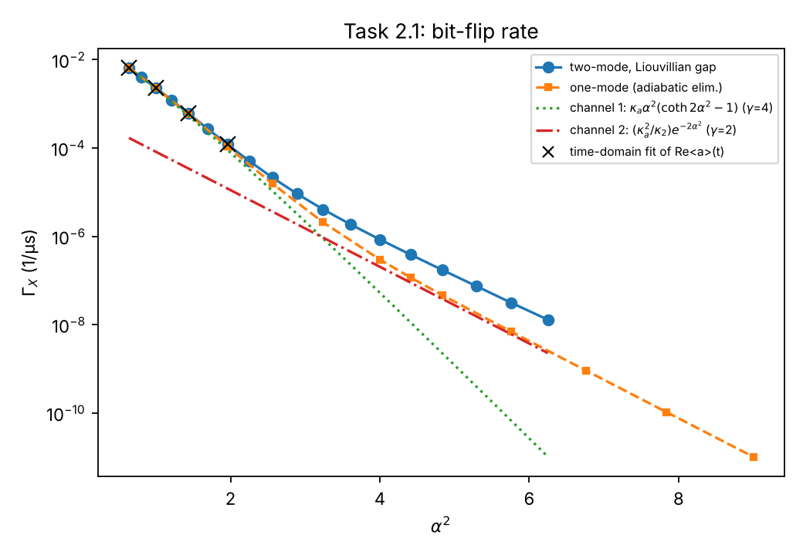
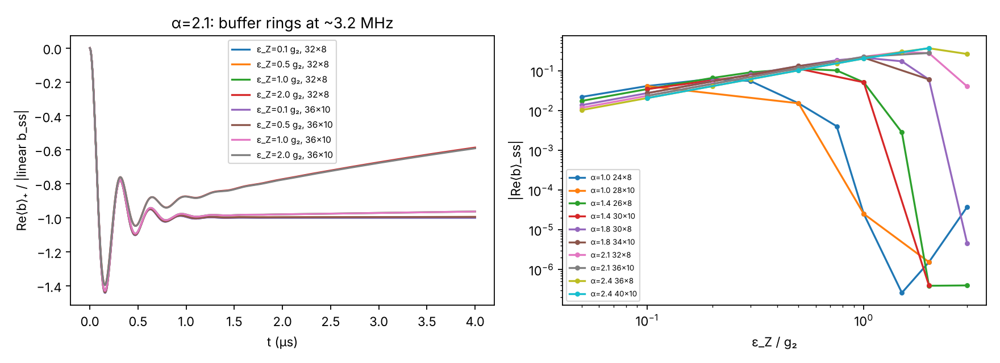
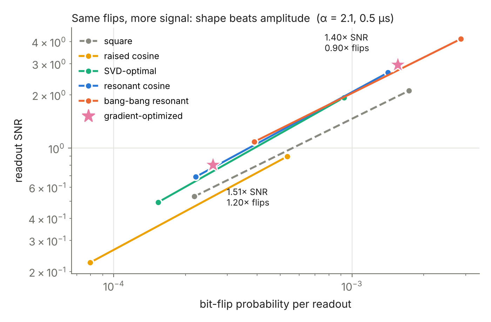

# Cat qubits: bit flips, phase flips and a better readout

**DuQuantum 2026 · Alice & Bob challenge · Standard Track**
Team: Pranav Reddy, Harshit Aggarwal, Halo Kwok, Xuanyu Zhu

> **Two layers.** This README and the figures are the human layer: plain words, the main results, and pictures.
> The detailed layer for judges, reviewers and AI agents (every claim, the number behind it, the file that produced it, and how we checked it) is [`docs/SECTION2.md`](docs/SECTION2.md) for the Standard-track tasks and [`TECHNICAL.md`](TECHNICAL.md) for the Section 1 groundwork.

## The idea in one minute

A normal qubit can fail in two ways: its 0 and 1 can swap (a **bit flip**), or the sign of a superposition can flip (a **phase flip**). Error correction has to fight both, which costs a lot of hardware.

Alice & Bob store a qubit in a microwave resonator as one of two "blobs" of light, at **+α** and **−α**. A carefully designed leak removes and adds photons **only in pairs**, which turns the resonator into two valleys that trap the light. Jumping between valleys (a bit flip) becomes exponentially rare, so only phase flips are left to correct. This is a **cat qubit**.

The Standard track asks four questions about this qubit. Here they are in plain words.

- **How rarely does it bit-flip? (2.1)** Think of a ball in one of two valleys. Tiny random kicks (lost photons) almost never carry it over the hill. "Almost never" here means seconds, which is far too long to simulate step by step. So we don't wait for the ball. Every way the system can relax has its own fixed rate, like a guitar string has its own notes, and the slowest one *is* the bit-flip rate. We compute that note directly, then check it against brute-force simulation where both are possible. We also found that the ball escapes in two different ways, which is why the textbook scaling law bends.
- **How often does it phase-flip? (2.2)** Every lost photon flips the cat's "even/odd" label. More photons means more losses, so phase flips grow in proportion to the photon number, exactly as predicted.
- **How do you read it? (2.3)** Nudge the memory gently. It pushes on the buffer, and the buffer's leaking light tells you which valley the ball is in. Memory and buffer act like two coupled springs, so the signal *rings* at 3.2 MHz before it settles.
- **How do you read it better? (2.4)** Push a swing at its own rhythm and a small push goes a long way. A readout drive at the ring frequency gets more signal for the same disturbance, and a gradient optimizer improves it further. We also simulated the real circuit and found that the pump must be retuned by 23 MHz, or the photons don't pair up.

Each time, we predicted the answer by hand first and then checked it numerically, at two or more simulation sizes.

## What we found: Section 2 (Standard track)

Our one idea: every decay rate is an **eigenvalue** of the Lindblad equation, so we compute bit-flip times of seconds in about a minute instead of simulating for seconds, and check them against direct simulation where that is possible.

| Task | What we did | What we found |
|---|---|---|
| **2.1** Bit-flip rate Γ_X | The prompt's method (fit the decay of Re⟨a⟩) at α ≤ 1.4, and the slowest eigenvalue of the "odd" half of the Lindblad matrix up to α = 2.5 | The two methods agree to 2e-8. Γ_X falls from 2.3e-3 to 3.1e-8 per µs (α = 1.0 to 2.4; 2.6 s between flips at α = 2.1). Fitted **γ = 2.30**, but it is not one number: it drifts from 3.1 to 1.9, reaching the deck's γ ≲ 2 only at large α, because **two flip mechanisms** take turns. The naive Golden Rule estimate gives γ = 4 and describes only the first; a κ_a sweep proves the hand-over (slope 1.06 → 2.05). |
| **2.2** Phase-flip rate Γ_Z | Parity decay from the even cat (the prompt's method) and the slowest nonzero eigenvalue of the "even" half | Slope 0.991 × 2κ_a; at α = 2.1, Γ_Z = 0.5146 per µs. The two methods agree to 5 digits. |
| **2.3** Readout through the buffer | Drive the memory, watch the buffer field | The signal matches our linear formula to 1% and **rings at 3.2 MHz** (the same oscillator as the Task 1.1 overshoot); it settles in 1 µs. |
| **2.4** Better readout | Expanded the circuit Hamiltonian term by term and simulated it without the rotating-wave shortcut; measured flip cost vs signal; compared pulse shapes; optimized the pulse with gradients through the simulator | (a) The pump amplitude must be 0.037, not 0.035, and the pump must be **retuned by −23 MHz**: at the nominal frequency, Stark shifts stop the photon-pair conversion in our circuit simulation. (b) Signal and extra bit flips both grow as ε_Z², so turning up the drive buys nothing per unit of information; only the pulse's *shape* helps. (c, d) A drive at the 3.2 MHz ring frequency cuts the readout error 1.7× (1.12% → 0.65% in 2 µs); a gradient-optimized pulse gives **40% more signal with 10% fewer bit flips** than a square pulse at α = 2.1, and 1.3–1.7× more signal per bit flip in all 9 converged cases we ran (α = 1.4–2.1, two pulse lengths, two amplitudes). |


*Task 2.1. Bit-flip rate against cat size (α² is the photon number). Blue: our full model, computed as an eigenvalue. Crosses: brute-force time simulation where it is still feasible; they land on the blue curve. The two straight lines are the two escape routes over the hill: green (γ = 4, the naive Golden Rule answer) wins for small cats, red (γ = 2) for large ones, which is why the blue curve bends. The simplified one-mode model (orange) underestimates the flips by about 3× at α = 2.1.*


*Task 2.3. Left: the buffer signal after the readout drive switches on (α = 2.1), divided by the linear prediction. It overshoots and rings at 3.2 MHz, then settles on the prediction (−1) within about 1 µs; two simulation sizes overlap. At ε_Z = 2 g₂ the signal drifts away because the drive itself starts flipping the qubit. Right: the steady-state signal grows in proportion to the drive, then collapses once the drive is strong enough to flip the qubit.*


*Signal vs bit-flip cost for each readout pulse shape at α = 2.1 (0.5 µs pulse). Up and to the left is better. The square pulse (dashed) is never the best choice.*

## Groundwork: Section 1

| Step | What we did | What we found |
|---|---|---|
| **1.0** Warm-up | One resonator: add photon leakage, then pair leakage, then pair pumping | Photon loss and pair loss match the hand formulas to 10⁻¹¹ or better; pair pumping settles within 0.5% of the prediction. Pair leakage stalls at 0.4998 photons, because pairs can never remove the last odd photon. |
| **1.1** Real circuit | Add the second "buffer" resonator that creates the pair leak in hardware | The photon number **overshoots by ~56%** before settling, because the buffer is too slow for the simple model's shortcut. It still settles at the right value (4.40 photons). |
| **1.2** Can we trust it? | Make the simulation bigger, one resonator at a time, until the answer stops changing | The starter settings get the final value right but **miss the overshoot by 11%**. The buffer needs **10+ levels** instead of 6, because it briefly holds ~2 photons. |
| **1.3a** What did we make? | Track parity, fidelity, purity and coherence | We made the **even cat** (both valleys at once, not one or the other). Photon loss fades it toward a plain mixture with a **1.95 µs** lifetime (predicted 1.94 µs); by 6 µs it is essentially a mixture. |
| **1.3b/c** One definite state | Give the memory a short push toward +α before the pump turns on | Lands in the **+α** valley: above **99%** fidelity within 0.4–0.5 µs, and **99.9%** by 2 µs. The stabilization forgives a sloppy push: a 30° aiming error still gives 99.5% (the push alone would give 31%), and the 99% limit is about ±35°. Pushing in the wrong direction picks no valley at all. |


*Left: the memory photon number overshoots, then settles at α² = 4.41 (grey line). The simple one-mode model (dotted) rises smoothly. The starter simulation size (dashed) underestimates the overshoot. Right: how much population leaks into the highest levels the computer keeps. Smaller is better.*


*The final value (orange) doesn't care about simulation size. The overshoot peak (blue) needs about 24 memory levels and about 10 buffer levels.*


*Left: starting from a displaced state, the memory settles into |+α⟩. Middle: with stabilization (blue) the result barely depends on the push's aiming error; the push alone (orange) would need to be almost perfect. Right: pushing during inflation also works if the push is strong; the wrong drive direction (dashed) picks no valley.*

## Run it yourself

```bash
pip install -r requirements.txt
./run_all.sh              # every figure and number, ~30-40 min on a 4-core laptop
```

Section 2 results are all saved as JSON, so checking a claim needs no re-run. `python -m research.s2.summarize` rebuilds every Section 2 table and figure from them in about a minute. The commands for re-running each kind of computation are in [`docs/SECTION2.md`](docs/SECTION2.md#reproduce).

For Section 1, you can also open the notebooks, one per task, in order: [`notebooks/`](notebooks/). Each one explains the task in plain words, runs the same code as `run_all.sh`, and shows the results. The convergence sweep (Task 1.2) is the only slow step, so its notebook loads saved results by default.

## How we used AI

We used AI assistants to learn the background, plan the project, and write much of the code in `src/`, `tasks/` and `research/s2/` (Claude), and to run the cloud batches on Vultr. Claude Code did most of the implementation. Vultr VMs ran the large batches of JAX/dynamiqs simulations. The Gemini API served as an independent physics checker of the code and, through its multimodal input, of the plots, until the free tier was exhausted overnight. Cursor and a Groq-powered bot were used for the product layer (the Lab site), and Codex for a Section 1 cleanup. Every tool use, with its cost, is logged in [`docs/tools-log.md`](docs/tools-log.md). Every number we report is produced by the scripts in this repo and checked against a hand prediction or a convergence test. We can explain each one. For Section 2, every rate was checked two independent ways (eigenvalue vs time-domain fit, agreeing to 2e-8), every headline number at two or more truncations, and every claim in the write-up against its JSON. That self-check caught real mistakes before submission, for example a pulse result quoted next to the wrong drive amplitude. We also ran an independent AI code review focused on physics mistakes (missing 2π, signs, convergence) with [`tools/ai_review.py`](tools/ai_review.py). Details are in [`TECHNICAL.md`](TECHNICAL.md#ai-use).

## Repo map

**Human layer** (start here)
```
README.md          you are here: plain-language story and main results
figures/           every figure; figures/s2/slide_*.png are the presentation figures
notebooks/         one notebook per Section 1 task, with plain-language explanations
```

**Detailed layer** (for judges, reviewers and AI agents: every claim, its number, its file, its check)
```
docs/SECTION2.md   Section 2 write-up: methods, numbers, convergence, reproduce commands
TECHNICAL.md       Section 1 claims table, convergence study, AI-use and review log
results/           every reported number as JSON; results/s2/SUMMARY.md has all Section 2 tables
research/s2/       Section 2 code (eigen-solver, readout, pulses, optimizer, circuit simulation)
src/, tasks/       shared model code and the Section 1 task scripts
research/          Section 1 stretch studies; research/LOG.md lists every research run
cloud/             Vultr batch launcher and the job lists we ran
docs/tools-log.md  every external tool and service used, with cost
reviews/           independent AI code and figure reviews
docs/              also the original challenge prompt
```
