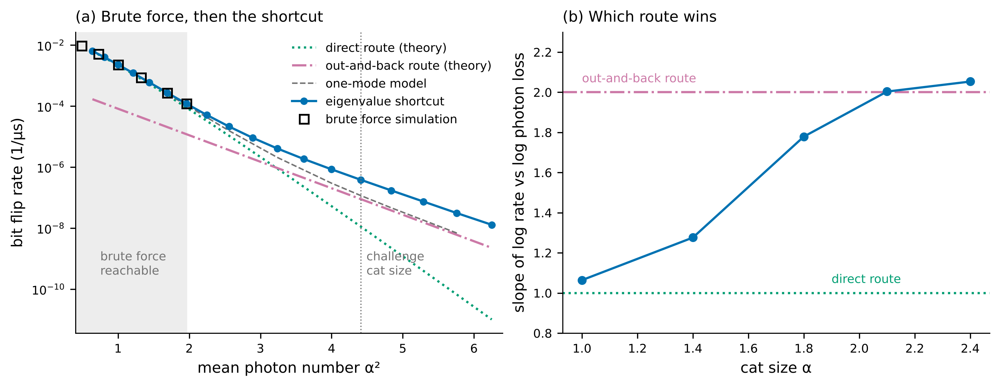
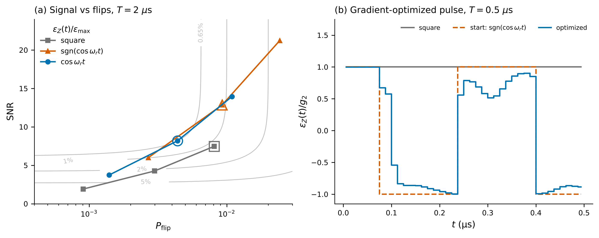

# Cat qubits: bit flips, phase flips and a better readout

**DuQuantum 2026 · Alice & Bob challenge · Standard track**
Team: Pranav Reddy, Harshit Aggarwal, Halo Kwok, Xuanyu Zhu

A cat qubit stores information in light trapped in one of two "valleys" in a microwave resonator. A bit flip is rare, so only the other error type, a phase flip, needs active correction. We simulated how often each error happens and how to read the qubit out with fewer errors.

**Our approach:** a bit flip takes seconds, far too long to simulate step by step. Instead we compute each error rate directly as the slowest "note" of the system, then confirm it with brute force simulation wherever that is still possible. The two methods agree to better than one part in ten million.

## Results

| Task | Result |
|---|---|
| **2.1 Bit flips** | About one bit flip every 2.6 seconds at the challenge's cat size. Bigger cats flip exponentially less often, but the trend bends because two different escape routes take turns. |
| **2.2 Phase flips** | Grow in direct proportion to the number of photons, matching the textbook prediction to within 1%. |
| **2.3 Readout** | The readout signal rings for about 1 µs before settling, for the same reason the cat overshoots when it is created. |
| **2.4 Better readout** | Driving at the ringing frequency cuts readout errors 1.7×. A pulse shaped by a gradient optimizer gives 40% more signal with 10% fewer bit flips than a plain square pulse. In the real circuit, the pump must also be retuned by 23 MHz or the photon pairing stops working. |
| **Section 1** | Every warm up task done: the cat forms, the simulation size is verified, and we prepare a definite logical state with 99.9% fidelity. |

## The cat qubit, step by step

| The cat forms | It forms in the real two-resonator circuit | Photon loss fades it |
|:---:|:---:|:---:|
|  |  |  |

*Phase space pictures of the light in the resonator. Red and blue are positive and negative values. The two blobs are the qubit's two states, and the stripes between them show that it is in both at once.*


*Preparing one definite state: a short push before the stabilization turns on lands the qubit in the chosen valley, even if the push is aimed badly.*

## Section 2 in two pictures


*(a) Bit flip rate against cat size: brute force simulation (squares) reaches small cats only; the eigenvalue shortcut (line) matches it and carries on to the challenge cat size. (b) Small cats flip through one photon loss, large cats need two.*


*(a, b) The real circuit needs the pump retuned by 23 MHz. (c) Driving at the ringing frequency cuts readout errors 1.7×. (d) The gradient-optimized pulse.*

## Run it

```bash
pip install -r requirements.txt
./run_all.sh          # Section 1 tasks (~30 min), then rebuilds every Section 2 table from saved results
```

Every number is saved as JSON in `results/`, so checking a claim does not require re-running anything.

## Repo map

| Path | What it is |
|---|---|
| [`docs/TECHNICAL.md`](docs/TECHNICAL.md) | Methods, key numbers, convergence checks, how to reproduce |
| `research/s2/`, `src/` | Section 2 code; shared model code |
| `notebooks/` | One short notebook per task: 01–05 Section 1, 06–09 Section 2 (load saved results, no re-run) |
| `tasks/` | Section 1 scripts |
| `results/`, `figures/` | Every number (JSON) and every figure |
| `cloud/` | Vultr batch launcher and the job lists we ran |
| `tests/` | Unit tests (`python -m unittest discover -s tests`) |

## How we used AI and tools

- **Claude Code** did most of the implementation and drafted the write ups, under our direction.
- **Codex** helped with Section 1 validation, convergence analysis, figures and the brute force Task 2.1/2.2 simulations.
- **Gemini** checked the physics in the code and validated the plots (`tools/ai_review.py`; log in [`reviews/`](reviews/)).
- **Vultr** ran our large simulation batches in the cloud for about 5 USD in total.
- **Cursor** and a **Groq**-powered bot are used for the product layer.

We checked every result against a hand prediction or a second method. Each tool use and its cost is logged in [`docs/tools-log.md`](docs/tools-log.md).
