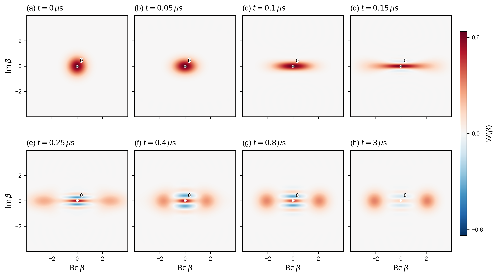
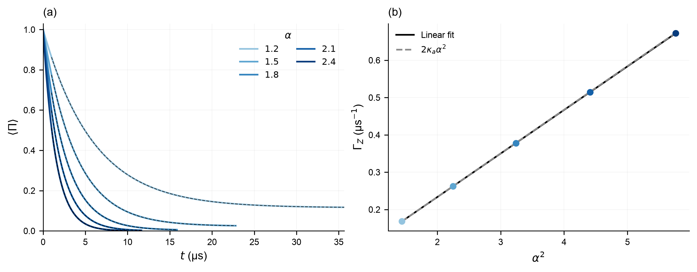

# Cat qubits: bit flips, phase flips and a better readout

**DuQuantum 2026 · Alice & Bob challenge · Standard track · 3rd place overall across all challenges**
Team: Pranav Reddy, Xuanyu Zhu, Harshit Aggarwal, Halo Kwok, 

<p align="center"></p>
<p align="center"><sub>A cat qubit forms from vacuum: two lobes at α = 2.1 in under 1 µs.</sub></p>

## The challenge

| | Write-up |
|---|---|
| **Task 1**: stabilize a cat qubit, check convergence, prepare a logical state | [docs/task_1.md](docs/task_1.md) |
| **Task 2**: bit flips, phase flips, buffer readout, a better readout | [docs/task_2.md](docs/task_2.md) · [notebooks 06–09](notebooks/) |
| **Cat Qubit Academy**: an interactive course built on these results | code on branch [`integrated`](https://github.com/pkarakala/duquantum-cat-qubit/tree/integrated) |

## Results

<table>
<tr>
<td width="50%" align="center"><a href="docs/task_2.md#21--measure-bit-flip-relaxation"></a><br><sub><b>2.1 Bit flips</b> get exponentially rarer as the cat grows: 1/Γ<sub>X</sub> = 2.6 s at α = 2.1.</sub></td>
<td width="50%" align="center"><a href="docs/task_2.md#22--measure-phase-flip-relaxation"></a><br><sub><b>2.2 Phase flips</b> grow in a straight line with cat size: Γ<sub>Z</sub> = 2κ<sub>a</sub>α².</sub></td>
</tr>
<tr>
<td width="50%" align="center"><a href="docs/task_2.md#23--read-the-memory-bit-through-the-buffer"></a><br><sub><b>2.3 Readout:</b> the two cat states give opposite buffer signals, ringing at 3.14 MHz.</sub></td>
<td width="50%" align="center"><a href="docs/task_2.md#24--improve-readout-without-sacrificing-memory-protection"></a><br><sub><b>2.4 Better readout:</b> a 2 µs pulse tuned to the 3.14 MHz ring cuts estimated readout error from 1.12% to 0.65%.</sub></td>
</tr>
</table>

## Run it

```bash
pip install -r requirements.txt
./run_all.sh      # every number is also saved as JSON in results/
```

## How we used AI and tools

- **Claude Code** did most of the implementation and drafted the write ups, under our direction.
- **Codex** helped with Section 1 validation, convergence analysis, updating figures/ scales, Task 2.1/2.2 time evolution, and the Task 2.4 enlargement study and submission review.
- **Gemini** checked the physics in the code and validated the plots (`tools/ai_review.py`; log in [`reviews/gemini-20261024-1632.md`](reviews/gemini-20261024-1632.md)).
- **Vultr** ran our large simulation batches in the cloud ([tools log](docs/tools-log.md)).
- **Cursor** and a **Grok**-powered bot built most of the Academy (branch `integrated`).

The notebooks record analytic comparisons, independent numerical checks and the limits of each result.
