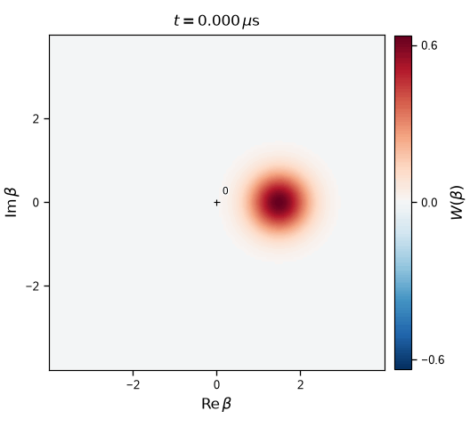

# Stabilizing and characterizing a cat qubit

**DuQuantum 2026 · Alice & Bob challenge · Introductory and Standard Tracks**

Team: Pranav

Completed: **Tasks 1.0(a–c), 1.1, 1.2, 1.3(a–c), 2.1, 2.2 and 2.3**. [Challenge prompt](docs/challenge_prompt_v4.md) · [Model, parameters and numerical checks](TECHNICAL.md)

The memory stores the state; the lossy buffer provides two-photon stabilization. Their annihilation operators are $a$ and $b$, and their mean photon numbers are $\langle n_a\rangle=\langle a^\dagger a\rangle$ and $\langle n_b\rangle=\langle b^\dagger b\rangle$. We use the supplied target amplitude $\alpha=2.1$, corresponding to $\alpha^2=4.41$ photons. The coupling $g_2$ exchanges two memory photons with one buffer photon; $\epsilon_d$ drives the buffer; $\kappa_a$ and $\kappa_b$ are single-photon loss rates.

Time is in µs; rates use the challenge's angular-frequency convention, with quoted frequencies multiplied by $2\pi$. A cutoff $N$ retains photon-number (Fock) states $\lvert0\rangle$ through $\lvert N-1\rangle$. We use $N=30$ for the single-mode calculations and $(N_a,N_b)=(32,12)$ for memory and buffer unless stated otherwise.

## 1.0 — Add dissipation one ingredient at a time

Here $n=a^\dagger a$ is the single-mode photon-number operator. Parts (a) and (b) start from the coherent state $\lvert\alpha_0=2\rangle$, with four photons on average; part (c) starts from vacuum. In (a), the loss rate and Hamiltonian detuning are both $2\pi$ µs⁻¹. In (b,c), the nominal two-photon loss rate is $\kappa_{2,0}=4g_2^2/\kappa_b$.

| Task | Prediction | Numerical result |
|---|---|---|
| **(a) Single-photon loss** | $\langle n(t)\rangle=4e^{-2\pi t}$ | Maximum absolute error $9.72\times10^{-12}$. The coherent-state Wigner function contracts while rotating. |
| **(b) Two-photon loss** | $\lvert0\rangle$ and $\lvert1\rangle$ cannot lose another photon pair. Even photon numbers decay to $\lvert0\rangle$ and odd ones to $\lvert1\rangle$, giving $\langle n\rangle_\infty=(1-e^{-8})/2$. | $\langle n\rangle_\infty=0.49983227$, with final probabilities $p_0=0.50016773$ and $p_1=0.49983227$. |
| **(c) Two-photon stabilization** | From vacuum, occupation approaches $\alpha^2=4.41$ and the Wigner function develops two lobes with interference. | At the nominal rate, $\langle n\rangle=4.404$ at 2 µs. |

Here $p_0$ and $p_1$ are the probabilities of zero and one photon. The two-photon-loss plateau is set by the initial even/odd probabilities, because removing pairs preserves parity.

For $\kappa_2/\kappa_{2,0}=1/4,1,4$, the times to reach 90% of each run's occupation at 2 µs are **0.610, 0.155 and 0.040 µs**, respectively. Increasing the two-photon rate therefore speeds up stabilization. The curves nearly coincide when plotted against $\kappa_2t$: this scaling would be exact at $\kappa_a=0$, while the fixed memory-loss rate produces small differences.

<p align="center">
  
</p>

**Effective-model stabilization.** Occupation versus (a) time and (b) scaled time. Colors identify $\kappa_2/\kappa_{2,0}$; the dotted line marks $\alpha^2$. [Decay checks and Wigner snapshots](notebooks/01_task_1_0_warmup.ipynb).

<table align="center">
  <tr>
    <th align="center">Single-photon loss</th>
    <th align="center">Two-photon stabilization</th>
  </tr>
  <tr>
    <td align="center"></td>
    <td align="center"></td>
  </tr>
</table>

**Wigner evolution.** Left: coherent-state decay over 0–1 µs. Right: cat formation at nominal $\kappa_2$ over 0–2 µs. The Wigner function $W(\beta)$ displays the state over the complex amplitude coordinate $\beta$; a coherent state's center gives its amplitude. Red and blue denote positive and negative values; all animations share the fixed scale $[-2/\pi,2/\pi]$ and display simulated time. [Static panels](notebooks/01_task_1_0_warmup.ipynb).

## 1.1 — Inflate the memory in the full two-mode model

Starting from vacuum in both modes, the memory occupation overshoots its target and oscillates before settling. The effective single-mode model instead rises smoothly. Replacing the buffer by an instantaneous two-photon dissipation channel requires $\kappa_b\gg g_2,\epsilon_d$; the supplied parameters do not satisfy this condition:

$$g_2/\kappa_b=0.293,\qquad \epsilon_d/\kappa_b=1.294.$$

The buffer fills and exchanges photon pairs with the memory before dissipating them, producing the overshoot and ringdown. We simulate 0–3 µs; peaks below are sampled every 0.01 µs, and the late-time occupation is averaged over 2.81–3 µs.

| Quantity | Result |
|---|---:|
| Sampled memory peak | 6.894 photons at 0.23 µs; 56.3% above $\alpha^2$ |
| Sampled buffer peak | 1.992 photons at 0.13 µs |
| Time after which occupation stays within 1% of $\alpha^2$ through 3 µs | 1.07 µs |
| Late-time memory occupation | 4.4026 photons |

<p align="center">
  
</p>

**Two-mode inflation.** (a) Memory and buffer occupations at $(32,12)$, with the memory at $(24,6)$ (start) dashed and the effective model dotted. The horizontal line marks $\alpha^2$. (b) Top-level probabilities in percent: $p_a^{(2)}$ sums the probabilities of memory levels $N_a-2$ and $N_a-1$; $p_b^{(1)}$ is the probability of buffer level $N_b-1$. Solid curves use $(32,12)$ and dashed curves $(24,6)$. The dotted line marks our **0.1% tolerance**, chosen for the convergence study. The $(24,6)$ buffer reaches **4.62%** at level 5; both $(32,12)$ monitors remain below the tolerance throughout inflation. At $N_b=12$, the monitored buffer level is 11.

The occupation ringdown persists under tighter tolerances, smaller integration steps and an independent solver, supporting its physical origin. Tiny late-time fluctuations in the supplementary log-scale probabilities are numerical residuals; [numerical audit](figures/task_1_1_numerical_checks.png).

<p align="center">
  
</p>

**Memory phase-space evolution.** The reduced memory state at $(32,12)$ evolves from vacuum into two lobes with interference over 0–3 µs, with a fixed color scale. [Static snapshots](figures/task_1_1_wigner.png).

## 1.2 — Check semiclassical agreement and convergence

The reference calculation at $(40,14)$ gives a late-time occupation of **4.4026**, only **0.167% below** $\epsilon_d/g_2=4.41$. This agreement persists as the cutoffs increase. The remaining small difference is consistent with the finite-loss quantum model; steady occupation is much less sensitive to truncation than the transient peak.

We test $N_a=16,20,24,28,32,40$ and $N_b=4,6,8,10,12,14$. Both the trajectory sweeps and the occupation-convergence plot hold the other cutoff at its largest tested value: vary $N_a$ at **$N_b=14$**, then vary $N_b$ at **$N_a=40$**. Relative errors are absolute differences divided by the corresponding $(40,14)$ reference value. The steady estimate averages 2.81–3 µs; the peak is the largest saved memory occupation over 0–3 µs.

<p align="center">
  
</p>

**Cutoff dependence during inflation.** (a,c) Sweep $N_a$ at $N_b=14$; (b,d) sweep $N_b$ at $N_a=40$. Upper and lower rows show memory and buffer occupations. Colors identify the varied cutoff; black dashes show $(40,14)$ and horizontal dotted lines mark $\alpha^2$. The first 1.2 µs of each 3 µs trajectory is shown.

| Observable | Relative tolerance | Smallest tested $N_a$ at $N_b=14$ | Smallest tested $N_b$ at $N_a=40$ |
|---|---:|---:|---:|
| Steady occupation | 0.1% | **16** | **4** |
| Transient peak | 0.5% | **24** | **10** |

Each minimum must pass together with all larger cutoffs in its sweep. Thus $N_a=16$ or $N_b=4$ suffices for steady occupation only when the other cutoff is held at its reference value. During inflation, both modes occupy higher Fock levels: the buffer briefly holds about two photons with a substantial tail, and the memory overshoots to about 6.9 photons. Capturing that transient requires larger cutoffs in both modes.

<p align="center">
  
</p>

**Observable convergence.** Peak occupation $n_{a,\mathrm{pk}}=\max_t\langle n_a(t)\rangle$ and late-time mean $\bar n_{a,\mathrm{ss}}$, averaged over 2.81–3 µs, for the same two sweeps. Dotted lines mark $\alpha^2$.

**Occupation agreement alone does not establish state convergence.** We compare all **36 cutoff pairs** with $(40,14)$ using trace distance, which includes both populations and coherence. The reduced memory state $\rho_a$ is the density matrix obtained by tracing out the buffer. We add zero rows and columns to place smaller states in the reference's 40-level memory basis. We compare them using

```math
D_{\max}=\max_t\frac{1}{2}\left\lVert\rho_a(t)-\rho_{a,\mathrm{ref}}(t)\right\rVert_1.
```

Here $\rho_{a,\mathrm{ref}}$ is the $(40,14)$ reference state. The trace norm $\lVert\cdot\rVert_1$ sums the absolute eigenvalues of the density-matrix difference. A trace distance of 1% bounds any memory measurement's probability difference from the reference by one percentage point, up to solver error. The reference is a finite calculation, so this is a comparison with $(40,14)$ rather than an exact error bound.

We require maximum trace distance $`D_{\max}\leq1\%`$, relative peak and steady errors at most 0.5% and 0.1%, respectively, and both monitored top-level probabilities staying at most 0.1% throughout 0–3 µs. All these conditions must also hold for every tested pair with both cutoffs at least as large. **$(28,12)$ is the passing pair with the smallest dimension $N_aN_b$**, with $`D_{\max}=0.848\%`$. We use **$(32,12)$ throughout Tasks 1.1 and 1.3** for additional margin, with $`D_{\max}=0.310\%`$. The state-distance test covers vacuum inflation at the supplied parameters; it does not certify different initial states or drives.

<p align="center">
  
</p>

**Joint memory-state convergence.** Axes give the retained memory and buffer dimensions $N_a$ and $N_b$; blue shading shows $D_{\max}$. Lighter shades mean smaller differences. The color bar is logarithmic in percent; values at or below 0.1% share the lightest shade. Small circles mark computed pairs. The black curve marks $`D_{\max}=1\%`$; its upper-right side passes this state-distance test, with the other criteria checked separately. The ring marks $(32,12)$ and the star marks reference $(40,14)$, whose self-distance is zero. Background and contour use the same shape-preserving interpolation; cutoff decisions use computed values. Each maximum covers 301 saved times from 0 to 3 µs.

## 1.3(a) — Identify the prepared state and its decay

**Inflation from vacuum prepares a partially decohered even cat.** The ideal target, in the absence of memory single-photon loss, is the coherent superposition

```math
\lvert C_+\rangle=\frac{\lvert\alpha\rangle+\lvert-\alpha\rangle}{\sqrt{2(1+e^{-2\alpha^2})}},\qquad \alpha=2.1.
```

The reason is **conservation of memory photon-number parity**, $\Pi=(-1)^{a^\dagger a}$. Two-photon exchange changes the memory photon number by two, while the buffer drive and buffer loss leave its parity unchanged. Vacuum has even parity, so stabilization selects the even superposition. In our simulation, memory single-photon loss acts during inflation as well: each loss flips parity, mixing even and odd cats and reducing coherence.

We quantify $\rho_a$ using even-cat fidelity $F_+=\langle C_+\rvert\rho_a\lvert C_+\rangle$, purity $\mathcal{P}=\mathrm{Tr}(\rho_a^2)$, and inter-lobe coherence $C=2\lvert\langle\alpha\rvert\rho_a\lvert-\alpha\rangle\rvert$. Fidelity is the overlap with the target state; purity equals one for a pure state and falls below one for a mixed state:

| Time (µs) | $\langle\Pi\rangle$ | $F_+$ | $\mathcal{P}$ | $C$ |
|---:|---:|---:|---:|---:|
| 1 | 0.629 | 0.811 | 0.692 | 0.626 |
| 6 | 0.0483 | 0.524 | 0.501 | 0.0484 |

**At 1 µs, coherence between the lobes is still substantial:** $C=0.626$ and the Wigner function has interference fringes. For comparison, an equal incoherent mixture of $\lvert+\alpha\rangle$ and $\lvert-\alpha\rangle$ has $C=2e^{-2\alpha^2}\approx0.00030$, with fidelity and purity both approximately 0.5. The measured purity of 0.692 also shows that the prepared state is already partially mixed. By 6 µs, the diagnostics approach those of the incoherent mixture.

**The coherence-decay timescale is about 1.95 µs.** Fitting parity over 1–6 µs gives $\Gamma=0.5135$ µs⁻¹, consistent with the photon-loss prediction $2\kappa_a\langle n_a\rangle_{\mathrm{ss}}=0.5146$ µs⁻¹. Thus $\tau=1/\Gamma=1.95$ µs is the time for parity, and approximately the inter-lobe coherence, to fall by a factor of $e$ after inflation. Coherence fades continuously; it does not disappear at a single time.

<p align="center">
  
</p>

**Interference decay.** Reduced-memory Wigner evolution over 1–6 µs at $(32,12)$. The fixed color scale makes the declining fringe contrast directly comparable. [Static snapshots](figures/task_1_3a_wigner_fading.png) · [Diagnostic curves](figures/task_1_3a_cat_diagnostics.png).

## 1.3(b) — Prepare a definite logical state

Inflation from vacuum prepares a superposition of both codewords. **To initialize $\lvert0_L\rangle\equiv\lvert+\alpha\rangle$, we first displace the memory toward positive amplitude, then stabilize it.** The displacement selects the sign; stabilization restores the target amplitude.

A resonant memory drive with Hamiltonian $i\varepsilon_1(t)(a^\dagger-a)$ produces displacement along the real axis containing the codewords $\lvert\pm\alpha\rangle$. Here $\varepsilon_1$ is the real drive amplitude in µs⁻¹. Rotating the drive phase by 90° gives the Hamiltonian $\varepsilon_1(t)(a+a^\dagger)$ and displacement along the perpendicular imaginary axis. This orthogonal drive provides a control for the phase dependence of codeword selection.

An ideal real-axis pulse applied before stabilization prepares $\lvert\beta\rangle$, where $\beta=\int_{\mathrm{pulse}}\varepsilon_1(t)\mathrm{d}t$ is its dimensionless displacement amplitude. The initial mean photon number is $\lvert\beta\rvert^2$; the target amplitude is $\alpha=2.1$. Our proposed sequence is:

1. Start with the memory and buffer in vacuum, with two-photon stabilization disabled.
2. Apply this memory pulse with area $\beta=1.5$, phased along the positive real axis set by the stabilization pump, to prepare $\lvert\beta=1.5\rangle_a\lvert0\rangle_b$, giving an initial memory occupation of 2.25 photons.
3. Switch off the memory pulse and enable the two-photon exchange pump and buffer drive at the supplied parameters, targeting $\alpha=2.1$. Keep stabilization on to bring the memory toward $\lvert+\alpha\rangle$.

Using $\beta=1.5\lt\alpha=2.1$ tests amplitude correction: fidelity rises from **69.77% initially to 99.878% at 2 µs**, remaining above 99% from **0.41 µs** onward through 2 µs. For this calculation, we initialize the memory directly in $\lvert\beta=1.5\rangle$ and simulate the subsequent stabilization. The preparation pulse itself is idealized; reported times start when stabilization is enabled.

For comparison, we start from vacuum and apply the real-axis drive during the first 0.1 µs while stabilization is active, simulating the pulse and stabilization together. Applying the orthogonal drive over the same interval gives zero mean real amplitude and approximately 50% target fidelity.

We report fidelity $F_\alpha=\langle\alpha\rvert\rho_a\lvert\alpha\rangle$ and normalized mean amplitude $\mathrm{Re}\langle a\rangle/\alpha$, which is near $+1$ for the desired state and zero for an equal, symmetric occupation of the two signs. The time $t_{99}$ is the first saved time after which fidelity stays above 0.99 through 2 µs.

| Protocol | $F_\alpha$ at 2 µs | $\mathrm{Re}\langle a\rangle/\alpha$ at 2 µs | $t_{99}$ (µs) |
|---|---:|---:|---:|
| **Proposed: displace first**, $\beta=1.5$ | **0.99878** | 0.99679 | **0.41** |
| Drive during inflation, $\varepsilon_1=20$ µs⁻¹ | 0.99681 | 0.99290 | 0.67 |
| Orthogonal drive, $\varepsilon_1=10$ µs⁻¹ | 0.49999 | 0 | — |

All simulations include memory single-photon loss and use $(N_a,N_b)=(32,12)$.

<p align="center">
  
</p>

**Logical-state preparation.** (a) Fidelity from real displaced starts. (b) Stabilized fidelity at 2 µs versus the initial overlap for $\beta=\alpha e^{i\phi}$, where $\phi$ is the initial phase error relative to the positive target amplitude. Dotted guides mark 0.99. (c) Mean amplitude under the finite-duration drive; shading marks its 0–0.1 µs interval, and legend values give $\varepsilon_1$ in µs⁻¹.

<p align="center">
  
</p>

**Stabilization after displacement.** Reduced-memory Wigner evolution from
$\lvert\beta=1.5\rangle$ toward $\lvert+\alpha\rangle$, with $\alpha=2.1$.
Time begins after the idealized displacement pulse, when stabilization is
enabled. The animation covers 0–2 µs at 10-ns saved spacing with a fixed color
scale. [Static snapshots](figures/task_1_3b_wigner.png).

## 1.3(c) — Cost of preparation

- **Hardware:** preparation requires a resonant memory drive and phase synchronization with the stabilization pump. A suitable existing memory-drive line can be reused; otherwise an additional line is required.
- **Calibration:** stabilization relaxes the requirement to prepare the target amplitude exactly, but the pulse must provide sufficient bias toward the desired codeword. The tested real amplitudes $\beta=1.5,2.1,3.0$ all give fidelity above 99% at 2 µs. Phase accuracy remains important: at $\lvert\beta\rvert=\alpha=2.1$, a 30° phase error gives **99.51%** final fidelity, compared with **30.68%** initially; a 45° error gives 97.27% final fidelity.
- **Time:** for $\beta=1.5$, preparation takes the displacement-pulse duration plus **0.41 µs of stabilization** to reach 99% fidelity. The pulse is idealized as an initial coherent state, so its duration and errors during the pulse are not included in this simulation.
- **Interaction with stabilization:** the proposed sequence ends the memory pulse before stabilization begins. Applying the drive during inflation changes the transient: the tested $\varepsilon_1=20$ µs⁻¹ pulse raises the sampled memory peak to **8.51 photons**, compared with 6.89 from vacuum without a memory drive.

## 2.1 — Measure bit-flip relaxation

We initialize $\lvert\alpha\rangle_a\lvert0\rangle_b$ and fit the decay of $\mathrm{Re}\langle a\rangle$ after 2 µs. The buffer drive follows $\epsilon_d=g_2\alpha^2$; all supplied loss rates and couplings remain fixed. We define $\Gamma_X=1/T_X$ from the observable decay. In the well-separated-codeword limit, this is twice the symmetric one-way switching rate.

| $\alpha$ | $\Gamma_X$ (µs⁻¹) | $T_X$ (µs) |
|---:|---:|---:|
| 0.7 | 0.00954424 | 104.78 |
| 0.85 | 0.00511995 | 195.31 |
| 1 | 0.00230066 | 434.66 |
| 1.15 | 0.000863556 | 1158.00 |
| 1.3 | 0.000275644 | 3627.87 |
| 1.4 | 0.0001202 | 8319.46 |

A log-linear fit gives **$\gamma=2.994$** in $\Gamma_X=C_Xe^{-\gamma\alpha^2}$, with fitted prefactor $C_X=0.04382$ µs⁻¹ and $R^2=0.99946$. This is an effective exponent over $0.7\leq\alpha\leq1.4$. It exceeds the challenge's approximate $\gamma\lesssim2$ benchmark; the supplied zero-temperature model omits the thermal channels included in the reference experiment. [Experimental model](https://arxiv.org/html/2307.06617v2#S4.SS3).

The naive Golden-Rule estimate uses $\langle-\alpha\rvert a\lvert\alpha\rangle=\alpha e^{-2\alpha^2}$ and gives $\Gamma_X^{\mathrm{GR}}\simeq2\kappa_a\alpha^2e^{-4\alpha^2}$. Its prefactor matters: fitting this expression over the same interval gives $\gamma=3.087$, rather than four. It captures the suppression but underestimates the full rate by **33.30% at $\alpha=1.4$**. The loss-strength check supports a higher-order correction from finite stabilization; [second-order theory](https://arxiv.org/html/2407.17299v2) identifies an additional leakage-and-return contribution. [Derivation and numerical evidence](docs/task_2_rates.md).

<p align="center">
  
</p>

**Bit-flip relaxation and exponential suppression.** Full two-mode dynamics from $\lvert\alpha\rangle_a\lvert0\rangle_b$ at $(N_a,N_b)=(20,6)$. Colors identify $\alpha$; the buffer drive is set to $\epsilon_d=g_2\alpha^2$ for each trajectory. (a) Normalized real memory amplitude; colored curves are integrated trajectories and black dashes are exponential fits from 2 µs onward. The logarithmic time axis resolves the different lifetimes and shows times from 1 µs onward. (b) Fitted relaxation rates $\Gamma_X$ versus $\alpha^2$. The black line is the log-linear fit $C_Xe^{-\gamma\alpha^2}$ over $0.7\leq\alpha\leq1.4$; gray dashes show the direct-overlap estimate $2\kappa_a\alpha^2e^{-4\alpha^2}$. Rates are inverse observable decay times, twice symmetric one-way switching rates in the well-separated-codeword limit.

## 2.2 — Measure phase-flip relaxation

We initialize the even cat $\lvert C_+\rangle_a\lvert0\rangle_b$ and fit parity from 1 µs onward to $\Pi_\infty+Ae^{-\Gamma_Z(t-t_{\mathrm{fit}})}$, with $t_{\mathrm{fit}}=1$ µs. The fitted amplitude $A$ and steady parity $\Pi_\infty$ accommodate the initial transient and finite coherent-state overlap. At $\alpha=1.2$, $\Pi_\infty=0.11496$; forcing this offset to zero would underestimate the rate by 45.0%.

At the physical target **$\alpha=2.1$**, we obtain **$\Gamma_Z=0.514559$ µs⁻¹** and **$T_Z=1.9434$ µs**. Across $\alpha=1.2,1.5,1.8,2.1,2.4$, a free-intercept linear fit gives slope **0.116685 µs⁻¹**, compared with **$2\kappa_a=0.116867$ µs⁻¹**, a difference of 0.156%.

A photon loss reverses parity, so a loss-event rate near $\kappa_a\alpha^2$ produces parity decay at approximately twice that rate. Increasing cat size therefore suppresses bit-flip relaxation exponentially while increasing phase-flip relaxation approximately linearly.

<p align="center">
  
</p>

**Phase-flip relaxation and cat-size scaling.** Full two-mode dynamics from the even cat $\lvert C_+\rangle_a\lvert0\rangle_b$ at $(N_a,N_b)=(24,8)$, with $\epsilon_d=g_2\alpha^2$. Colors identify $\alpha$. (a) Memory parity $\langle\Pi\rangle$, with $\Pi=(-1)^{a^\dagger a}$; black dashes fit $\Pi_\infty+Ae^{-\Gamma_Z(t-t_{\mathrm{fit}})}$ from $t_{\mathrm{fit}}=1$ µs. The fitted offset $\Pi_\infty$ accommodates the finite steady parity of overlapping codewords. (b) Fitted $\Gamma_Z$ versus $\alpha^2$; the black line is a free-intercept linear regression and gray dashes show $2\kappa_a\alpha^2$ using the supplied memory-loss rate. The physical target $\alpha=2.1$ is included. Cutoff, fitting-window, solver and independent Dynamiqs checks are recorded with the numerical results.

The rate calculations use $(20,6)$ for 2.1 and $(24,8)$ for 2.2, checked against $(24,8)$ and $(28,10)$, respectively, at every amplitude. The largest rate changes are 0.00424% and 0.00025%. These initial code states avoid the large vacuum-inflation transient of Task 1.1. Full Dynamiqs integrations, tighter tolerances, fit-window variations and decay eigenvalues independently check the extraction. [Methods and complete results](docs/task_2_rates.md).

## 2.3 — Read the memory bit through the buffer

Task 2.3 asks whether the buffer reveals which memory state was prepared,
using a weak drive, and how long the buffer response takes to settle.
We add the real memory drive $H_Z=\epsilon_Z(a+a^\dagger)$ to the supplied
full two-mode model. We evolve each memory state $\lvert\pm\alpha\rangle$
independently, starting with the buffer in vacuum and retaining both loss channels.

**Drive choice.** We use $\epsilon_Z=0.05g_2$, twenty times below $g_2$:
$\epsilon_Z/(2\pi)=38.15$ kHz. A drive sweep confirms that the response is
approximately proportional to the drive in this range.

**Readout signal.** The real part of the buffer field, $\mathrm{Re}\langle b\rangle$,
has opposite signs for the two memory states:

| Initial memory | Simulated final real field | Predicted real field |
|---|---:|---:|
| $\lvert+\alpha\rangle$ | −0.01189484 | −0.01190476 |
| $\lvert-\alpha\rangle$ | +0.01189484 | +0.01190476 |

Final values are estimated by averaging 3–4 µs. Their separation is
**0.02378968**, only **0.0834% below** the prediction
$\epsilon_Z/(\alpha g_2)$. Measuring this real field therefore provides
information about which memory state was prepared.

<p align="center">
  
</p>

**Readout signals and settling.** Each memory codeword $\lvert\pm\alpha\rangle$ starts with the buffer in vacuum. The full two-mode model includes both loss channels, $\alpha=2.1$, $(N_a,N_b)=(32,12)$ and $\epsilon_Z=0.05g_2$. (a) Real buffer fields over 0–2 µs; dotted lines show the predicted values $\mp\epsilon_Z/(2\alpha g_2)$. Their opposite signs distinguish the memory states. (b) A linear-scale zoom of the larger distance of the two complex fields from their respective final values. Percentages use the predicted field magnitude $\epsilon_Z/(2\alpha g_2)=0.01190476$; final values average 3–4 µs. The shaded region is within the 1% tolerance. Open circles mark temporary entries followed by renewed excursions above tolerance. The filled orange circle and dashed line mark the final entry, at the first saved time inside tolerance after the last violation: 0.968 µs. Both fields remain inside through 4 µs. Saved times are 2 ns apart.

**Time to settle.** The response oscillates before settling. Its first maximum
occurs at 0.158 µs, **44.3% above** the final signal magnitude, with an
oscillation period of about 0.313 µs. Both buffer fields stay within the stated
1% tolerance from **0.968 µs** through 4 µs. Here 1% means each field differs
from its final value by at most **0.00011905**, including both real and imaginary
components. We use the
last threshold crossing, so earlier crossings during oscillation do not count.

All 15 numerical checks pass, including larger cutoffs, tighter integration,
an independent solver and an 8-µs run.
[Detailed methods and supporting physics](docs/task_2_3_readout.md)
· [Executed notebook](notebooks/08_task_2_3_readout.ipynb)
· [Supporting numerical checks](figures/task_2_3_validation.png).

These results describe mean buffer fields. The 0.968-µs settling time does not
determine how long a noisy single-shot measurement must integrate, or its fidelity.
Readout-strength optimization and its effect on bit-flip protection belong to Task 2.4.

## Reproduce the results

```bash
pip install -r requirements.txt
./run_all.sh
python -m tasks.task_2_1
python -m tasks.task_2_2
python -m unittest discover -s tests -v
```

The commands regenerate the main results and figures. Run `python -m tasks.task_2_3` for the readout study alone, including its independent solver checks, or add `--plot-only` to redraw its saved results. The separate introductory integration audit is `python -m tasks.task_1_1_checks`. QuTiP is included in the requirements.

The full cutoff grid resumes cached calculations. Redraw its figures with `python -m tasks.task_1_2 --plot-only`. [Notebooks](notebooks/) provide task walkthroughs; notebooks 03 and 05–08 load saved results by default. [Figure captions](figures/CAPTIONS.md) accompany the maintained PNG/PDF pairs and five animated GIFs. The task scripts regenerate the GIFs from solved states; static panels remain available at the links above. Reported values are stored in [results/](results/).

## AI use

Claude assisted with background and the initial implementation. Codex assisted with rate implementation, numerical validation, convergence analysis and figure/report preparation. The [independent Gemini review](reviews/gemini-20261024-1632.md) and [technical record](TECHNICAL.md#5-ai-use) document review findings and numerical checks.
