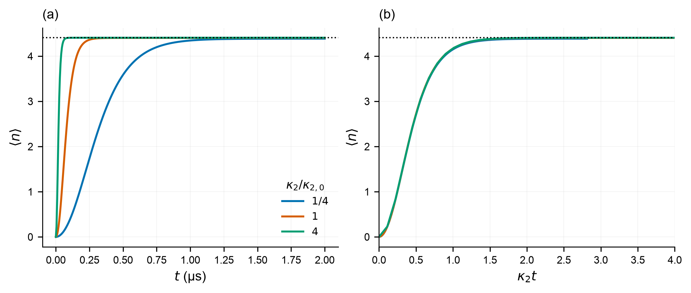
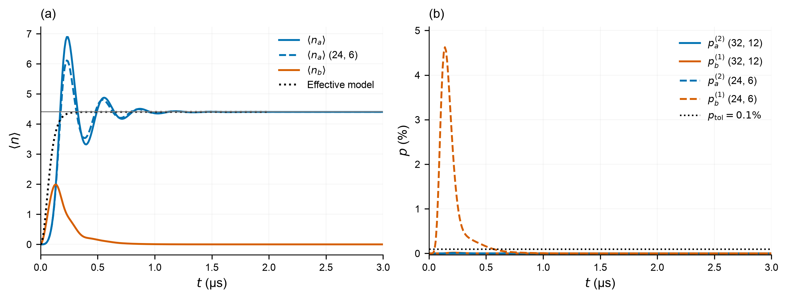
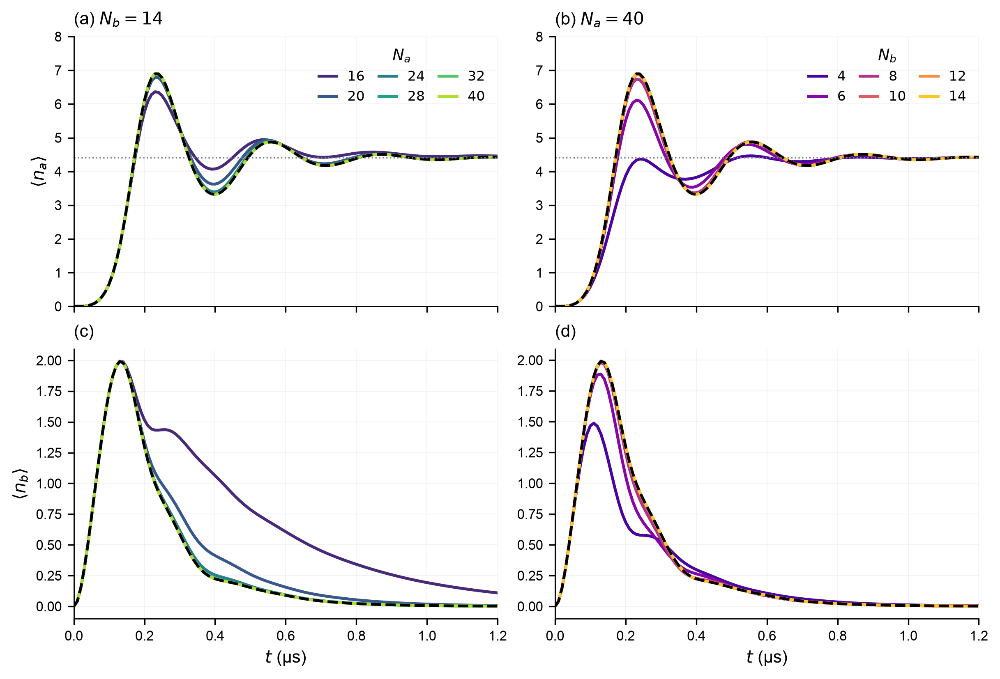
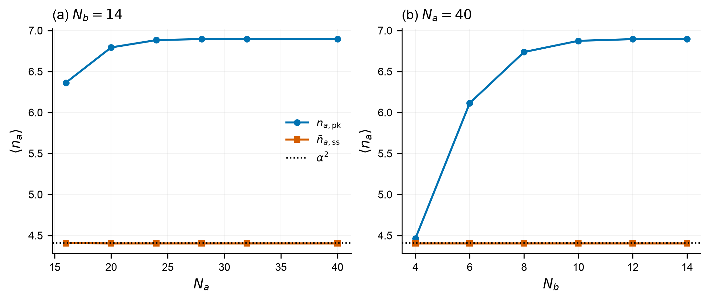
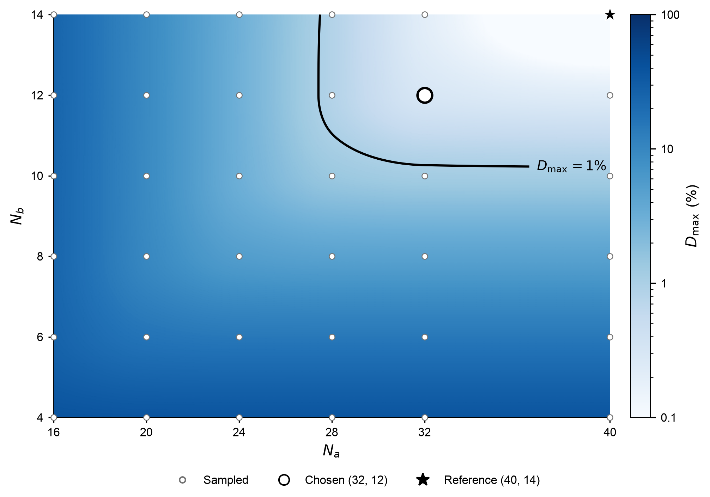
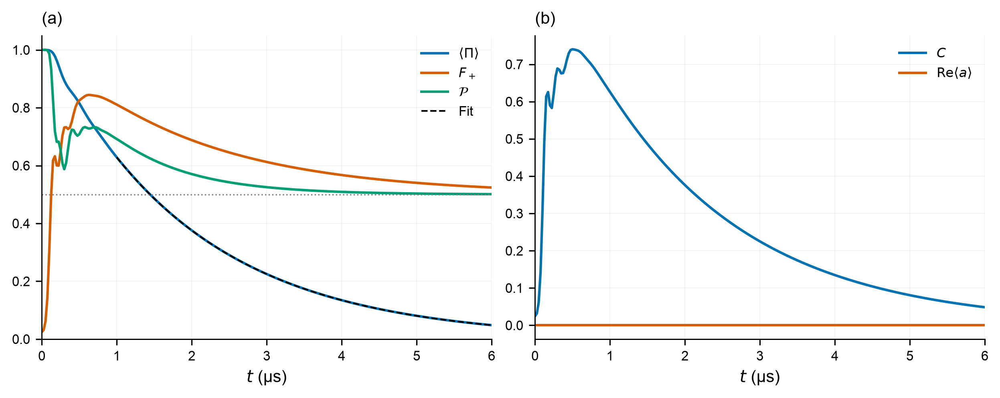
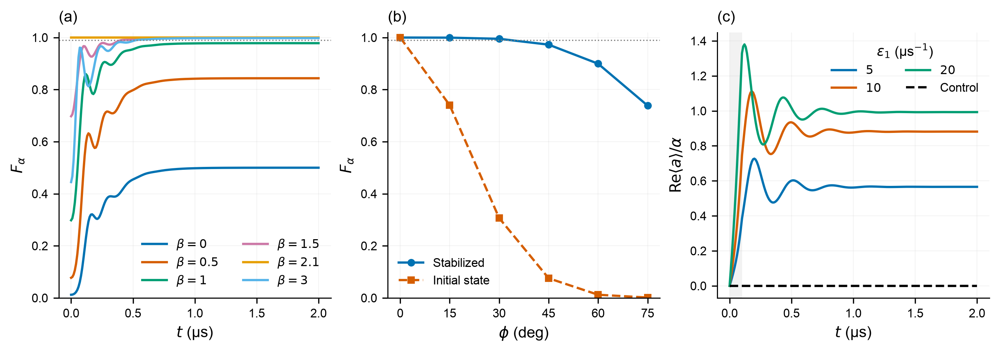

# Stabilizing and preparing a cat qubit

**DuQuantum 2026 · Alice & Bob challenge · Introductory Track**

Team: Pranav

Completed: **Tasks 1.0(a–c), 1.1, 1.2 and 1.3(a–c)**. We use the supplied parameters with $\alpha=2.1$, time in µs, a single-mode cutoff $N=30$, and two-mode cutoffs $(N_a,N_b)=(32,12)$ unless specified otherwise. [Methods and numerical evidence](TECHNICAL.md) · [Challenge prompt](docs/challenge_prompt_v4.md)

## 1.0 — Add dissipation one ingredient at a time

| Task | Prediction | Numerical result |
|---|---|---|
| **(a) Single-photon loss** | $\langle n(t)\rangle=4e^{-2\pi t}$ | Maximum absolute error $9.72\times10^{-12}$. The coherent-state Wigner function contracts while rotating. |
| **(b) Two-photon loss** | $a^2$ leaves $\lvert0\rangle$ and $\lvert1\rangle$ unchanged. Conserved even/odd weights give $\langle n\rangle_\infty=(1-e^{-8})/2$. | $\langle n\rangle_\infty=0.49983227$, with final probabilities $p_0=0.50016773$ and $p_1=0.49983227$. |
| **(c) Two-photon stabilization** | From vacuum, occupation approaches $\alpha^2=4.41$ and the Wigner function develops two lobes with interference. | At nominal $\kappa_{2,0}=4g_2^2/\kappa_b$, $\langle n(2\,\mathrm{\mu s})\rangle=4.404$. |

For $\kappa_2/\kappa_{2,0}=1/4,1,4$, the times to reach 90% of the final occupation are **0.610, 0.155 and 0.040 µs**. If $\kappa_a=0$, the master equation depends only on $\kappa_2t$, giving exact inverse-rate scaling. The fixed nonzero $\kappa_a$ makes the collapse approximate.



**Effective-model stabilization.** Occupation versus (a) time and (b) scaled time. Colors identify $\kappa_2/\kappa_{2,0}$; the dotted line marks $\alpha^2$. [Decay checks and Wigner snapshots](notebooks/01_task_1_0_warmup.ipynb).

## 1.1 — Inflate the memory in the full two-mode model

The memory overshoots and rings down, while the effective model rises smoothly. The adiabatic-elimination condition is poorly satisfied:

$$g_2/\kappa_b=0.293,\qquad \epsilon_d/\kappa_b=1.294.$$

The buffer retains a finite response time: it fills during inflation and exchanges photon pairs with the memory before dissipating them.

| Quantity | Result |
|---|---:|
| Sampled memory peak | 6.894 photons at 0.23 µs; 56.3% above $\alpha^2$ |
| Sampled buffer peak | 1.992 photons at 0.13 µs |
| Time to remain within 1% of $\alpha^2$ | 1.07 µs |
| Late-time memory occupation | 4.4026 photons |



**Two-mode inflation.** (a) Memory and buffer occupations at $(32,12)$, with the memory at $(24,6)$ (start) dashed and the effective model dotted. The horizontal line marks $\alpha^2$. (b) Full-range top-level probabilities over 0–3 µs: $p_a^{(2)}$ sums the highest two memory levels; $p_b^{(1)}$ is the highest buffer level. Solid curves use $(32,12)$ and dashed curves $(24,6)$. The dotted line marks the chosen **0.1% tolerance**. The $(24,6)$ buffer reaches **4.62%**; both $(32,12)$ monitors remain below the tolerance throughout inflation.

[Memory Wigner snapshots](figures/task_1_1_wigner.png) show the initial vacuum stretching and splitting into two lobes with interference. Independent integration and timestep checks reproduce the ringdown; [numerical audit](figures/task_1_1_numerical_checks.png).

## 1.2 — Check semiclassical agreement and convergence

The reference calculation at $(40,14)$ gives a late-time occupation of **4.4026**, only **0.167% below** $\epsilon_d/g_2=4.41$. Steady occupation is much less sensitive to truncation than the transient peak.

Both the trajectory sweeps and the scalar convergence plot use the same slices: vary $N_a$ at **$N_b=14$**, then vary $N_b$ at **$N_a=40$**.



**Cutoff dependence during inflation.** (a,c) Sweep $N_a$ at $N_b=14$; (b,d) sweep $N_b$ at $N_a=40$. Upper and lower rows show memory and buffer occupations. Colors identify the varied cutoff; black dashes show $(40,14)$ and horizontal dotted lines mark $\alpha^2$. The first 1.2 µs of each 3 µs trajectory is shown.

| Observable | Relative tolerance | Smallest tested $N_a$ at $N_b=14$ | Smallest tested $N_b$ at $N_a=40$ |
|---|---:|---:|---:|
| Steady occupation | 0.1% | **16** | **4** |
| Transient peak | 0.5% | **24** | **10** |

Each minimum must pass together with all larger cutoffs in its sweep, relative to $(40,14)$. These are separate-sweep minima. The buffer is almost empty at late times, but reaches about two photons with a substantial tail during inflation; the memory likewise needs room for the overshoot.



**Observable convergence.** Peak occupation $n_{a,\mathrm{pk}}=\max_t\langle n_a(t)\rangle$ and late-time mean $\bar n_{a,\mathrm{ss}}$, averaged over 2.81–3 µs, for the same two sweeps. Dotted lines mark $\alpha^2$.

To check the quantum state as well as occupation, we compare all **36 cutoff pairs** with $(40,14)$ using maximum reduced-memory trace distance, after zero-padding the smaller Fock space. This tests both populations and coherence. Requiring $D_{\max}\leq1\%$, the occupation tolerances above, and both monitored top-level populations below 0.1% gives **$(28,12)$ as the smallest tested passing pair**, with $D_{\max}=0.848\%$. Our **chosen cutoff is $(32,12)$**, used throughout Tasks 1.1 and 1.3, with additional margin at $D_{\max}=0.310\%$. Each passing pair must also have all larger tested pairs pass.



**Joint memory-state convergence.** Axes give the retained memory and buffer dimensions $N_a$ and $N_b$. Blue shading shows $D_{\max}=\max_t\tfrac12\|\rho_a(t)-\rho_{a,\mathrm{ref}}(t)\|_1$ relative to $(40,14)$, where $\rho_a$ is the reduced memory state and smaller states are zero-padded. Lighter shades mean smaller differences; the color bar is logarithmic in percent, with a 0.1% display floor. Small circles mark the 36 computed pairs. The black curve is the **$D_{\max}=1\%$ threshold**; the upper-right side satisfies the state-distance criterion. The black ring marks the chosen cutoff $(32,12)$, used throughout Tasks 1.1 and 1.3; the star marks reference $(40,14)$, where $D_{\max}=0$. Background and contour use the same shape-preserving interpolation; cutoff checks use computed values. Each distance is maximized over 301 saved times from 0 to 3 µs.

## 1.3(a) — Identify the prepared state and its decay

Memory parity $\Pi=(-1)^{a^\dagger a}$ commutes with the two-photon Hamiltonian and buffer loss. Vacuum has parity $+1$, so without single-photon memory loss the stabilized state approaches the even cat $\lvert C_+\rangle\propto\lvert\alpha\rangle+\lvert-\alpha\rangle$. Finite $\kappa_a$ changes parity and produces a progressively mixed state.

| Time (µs) | $\langle\Pi\rangle$ | $F_+=\langle C_+\rvert\rho_a\lvert C_+\rangle$ | Purity $\mathrm{Tr}(\rho_a^2)$ | $C=2\lvert\langle\alpha\rvert\rho_a\lvert-\alpha\rangle\rvert$ |
|---:|---:|---:|---:|---:|
| 1 | 0.629 | 0.811 | 0.692 | 0.626 |
| 6 | 0.0483 | 0.524 | 0.501 | 0.0484 |

At 1 µs, the large matrix element $C$ and [Wigner interference fringes](figures/task_1_3a_wigner_fading.png) demonstrate coherence between the lobes. An equal incoherent mixture has $C=2e^{-2\alpha^2}\approx0.00030$. By 6 µs the state approaches that mixture.



**State diagnostics.** (a) Parity, even-cat fidelity and purity $\mathcal P$; the dashed curve fits $Ae^{-\Gamma t}$ to parity over 1–6 µs and the horizontal guide is $1/2$. (b) Coherent-state matrix element $C$ and mean amplitude. The reduced memory state is $\rho_a=\mathrm{Tr}_b\rho$.

The fitted rate is **$\Gamma=0.5135$ µs⁻¹**, compared with $2\kappa_a\langle n_a\rangle_{\mathrm{ss}}=0.5146$ µs⁻¹. The corresponding parity-decay time is **1.95 µs**; interference weakens continuously over this timescale.

## 1.3(b) — Prepare a definite logical state

A real memory displacement breaks the symmetry between $\pm\alpha$. Starting from $\lvert\beta\rangle_a\lvert0\rangle_b$ with $\beta>0$ and then enabling stabilization selects $\lvert+\alpha\rangle$. Buffer-only control preserves the memory parity symmetry and cannot select a sign from vacuum.

We also apply $i\varepsilon_1(a^\dagger-a)$ during the first 0.1 µs of inflation. The orthogonal drive $\varepsilon_1(a+a^\dagger)$ serves as a control.

| Protocol | $F_\alpha(2\,\mathrm{\mu s})$ | $\mathrm{Re}\langle a\rangle/\alpha$ at 2 µs | $t_{99}$ (µs) |
|---|---:|---:|---:|
| Displace first, $\beta=1.5$ | **0.99878** | 0.99679 | **0.41** |
| Drive during inflation, $\varepsilon_1=20$ µs⁻¹ | 0.99681 | 0.99290 | 0.67 |
| Orthogonal drive, $\varepsilon_1=10$ µs⁻¹ | 0.49999 | 0 | — |

Here $F_\alpha=\langle\alpha\rvert\rho_a\lvert\alpha\rangle$; $t_{99}$ is the first saved time after which fidelity stays above 0.99 through 2 µs. For displaced starts, the clock begins after the idealized displacement pulse.



**Logical-state preparation.** (a) Fidelity from real displaced starts. (b) Stabilized fidelity at 2 µs versus the initial overlap for $\beta=\alpha e^{i\phi}$. Dotted guides mark 0.99. (c) Mean amplitude under the finite-duration drive; shading marks its 0–0.1 µs interval, and legend values give $\varepsilon_1$ in µs⁻¹.

## 1.3(c) — Cost of preparation

- **Control:** a resonant memory drive, adding a control channel or reusing an existing one.
- **Calibration:** amplitude and phase referenced to the stabilization pump. At a tested phase error of 30°, stabilization gives **99.51%** fidelity, versus **30.68%** initial overlap; at 45° the stabilized fidelity falls to 97.27%.
- **Dynamics and time:** displace first, then stabilize to avoid a competing drive during inflation. The $\beta=1.5$ protocol reaches 99% after 0.41 µs of stabilization, in addition to the displacement pulse. Driving during inflation raises the sampled memory peak to 8.51 photons.

## Reproduce the results

```bash
pip install -r requirements.txt
./run_all.sh
python -m unittest discover -s tests -v
```

The full cutoff grid resumes cached calculations. Redraw its figures with `python -m tasks.task_1_2 --plot-only`. [Notebooks](notebooks/) provide one walkthrough per task; notebooks 03 and 05 load saved results by default. [Figure captions](figures/CAPTIONS.md) accompany all 15 PNG/PDF pairs. Reported values are stored in [results/](results/).

## AI use

Claude assisted with background and the initial implementation. Codex assisted with validation, convergence analysis and figure/report preparation. The [independent Gemini review](reviews/gemini-20261024-1632.md) and [technical record](TECHNICAL.md#5-ai-use) document review findings and numerical checks.
