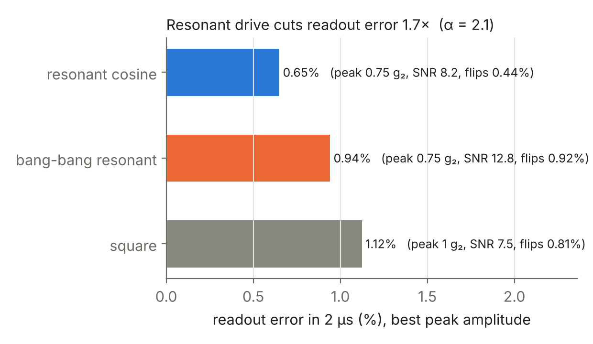

# Cat qubits: bit flips, phase flips and a better readout

**DuQuantum 2026 · Alice & Bob challenge · Standard track**
Team: Pranav Reddy, Harshit Aggarwal, Halo Kwok, Xuanyu Zhu

A cat qubit stores information in light trapped in one of two "valleys" in a microwave resonator. Jumping between valleys (a bit flip) is extremely rare, so only the other error type (a phase flip) needs active correction. We simulated how often each error happens and how to read the qubit out with fewer errors.

**Our approach:** a bit flip takes seconds, far too long to simulate step by step. Instead we compute each error rate directly as the slowest "note" of the system, then confirm it with brute-force simulation wherever that is still possible. The two methods agree to better than one part in ten million.

## Results

| Task | Result |
|---|---|
| **2.1 Bit flips** | About one bit flip every 2.6 seconds at the challenge's cat size. Bigger cats flip exponentially less often, but the trend bends because two different escape routes take turns. |
| **2.2 Phase flips** | Grow in direct proportion to the number of photons, matching the textbook prediction to within 1%. |
| **2.3 Readout** | The readout signal rings for about 1 µs before settling, for the same reason the cat overshoots when it is created. |
| **2.4 Better readout** | Driving at the ringing frequency cuts readout errors 1.7×. A pulse shaped by a gradient optimizer gives 40% more signal with 10% fewer bit flips than a plain square pulse. In the real circuit, the pump must also be retuned by 23 MHz or the photon pairing stops working. |
| **Section 1** | Every warm-up task done: the cat forms, the simulation size is verified, and we prepare a definite logical state with 99.9% fidelity. |


*Bit flip rate against cat size. The fast direct calculation (line) matches brute-force simulation (crosses).*


*Readout error after 2 µs for three pulse shapes. Driving at the ringing frequency wins.*


*The cat forming from empty: one blob of light splits into two, with interference between them.*

## Run it

```bash
pip install -r requirements.txt
./run_all.sh          # Section 1 tasks (~30 min), then rebuilds every Section 2 table from saved results
```

Every number is saved as JSON in `results/`, so checking a claim does not require re-running anything.

## Repo map

| Path | What it is |
|---|---|
| [`docs/SECTION2.md`](docs/SECTION2.md) | Section 2 in full: methods, all numbers, convergence checks |
| [`docs/SECTION1.md`](docs/SECTION1.md), [`docs/TECHNICAL.md`](docs/TECHNICAL.md) | Section 1 write-up and its claim-by-claim evidence |
| `research/s2/`, `src/` | Section 2 code; shared model code |
| `tasks/`, `notebooks/` | Section 1 scripts and one notebook per task |
| `results/`, `figures/` | Every number (JSON) and every figure |
| `cloud/` | Vultr batch launcher and the job lists we ran |
| `tests/` | Unit tests (`python -m unittest discover -s tests`) |

## How we used AI and tools

- **Claude Code** did most of the implementation and drafted the write-ups, under our direction.
- **Codex** helped with Section 1 validation, convergence analysis and figures.
- **Gemini** checked the physics in the code and the plots (`tools/ai_review.py`, logs in `reviews/`) until its free quota ran out.
- **Vultr** ran our large simulation batches in the cloud, for about $5 in total.
- **Cursor** and a **Groq**-powered bot are used for the product layer.

We checked every result against a hand prediction or a second method. Each tool use and its cost is logged in [`docs/tools-log.md`](docs/tools-log.md).
