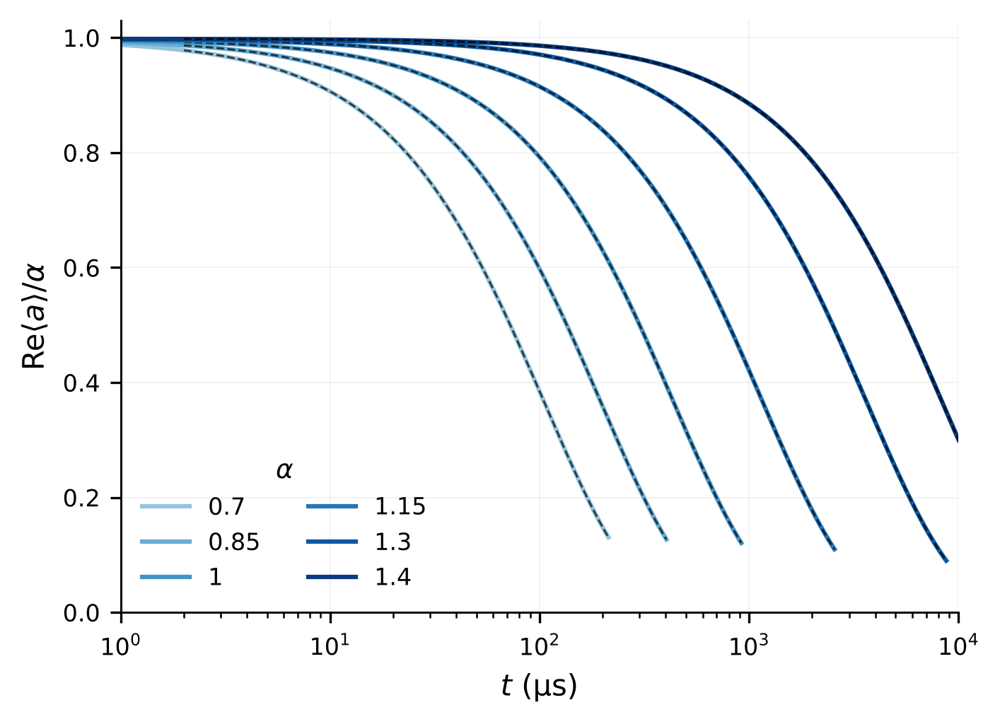
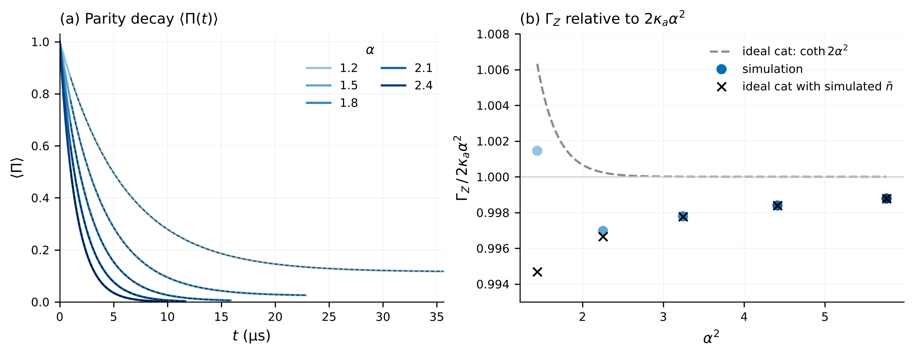
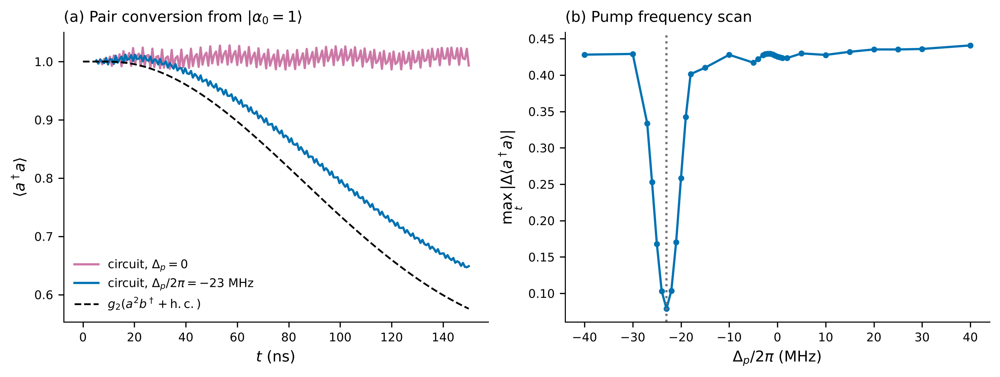
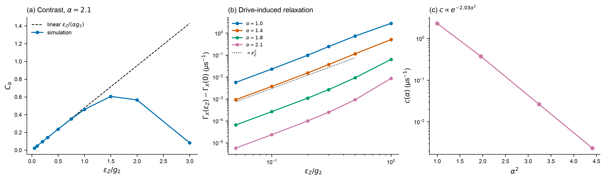
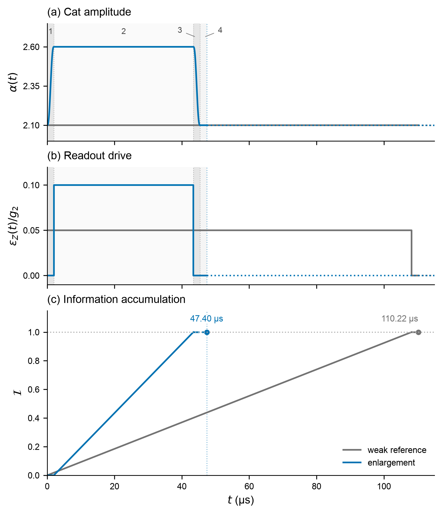
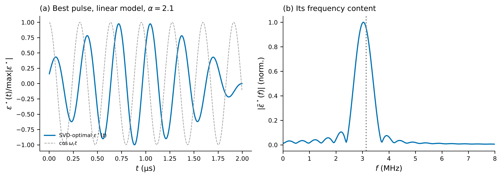

# Task 2: noise bias and protected readout

**DuQuantum 2026 · Alice & Bob challenge · Section 2**  [Model and numerical methods](TECHNICAL.md)

[2.1 Bit flips](#21--measure-bit-flip-relaxation) · [2.2 Phase flips](#22--measure-phase-flip-relaxation) · [2.3 Buffer readout](#23--read-the-memory-bit-through-the-buffer) · [2.4 Improved readout](#24--improve-readout-without-sacrificing-memory-protection)

Increasing the cat size suppresses bit flips exponentially while increasing phase-flip relaxation approximately in proportion to photon number. At the supplied target $\alpha=2.1$, the full memory–buffer model gives

```math
\Gamma_X=3.85\times10^{-7}\ \mathrm{\mu s}^{-1},\qquad
\Gamma_Z=0.5146\ \mathrm{\mu s}^{-1},\qquad
\frac{\Gamma_Z}{\Gamma_X}\simeq1.3\times10^6.
```

The corresponding **observable relaxation times** are $T_X=1/\Gamma_X=2.60$ s and $T_Z=1/\Gamma_Z=1.94$ µs. For symmetric switching at rate $r$ in each direction, an ensemble population difference decays at $2r$; its relaxation time is therefore half the mean waiting time between switches. We use the challenge's observable-decay convention throughout.

Tasks 2.1 and 2.2 retain the full two-mode Hamiltonian and the loss operators $\sqrt{\kappa_a}a$ and $\sqrt{\kappa_b}b$, where $a$ and $b$ annihilate memory and buffer photons. We vary the real target amplitude $\alpha$ by setting $\epsilon_d=g_2\alpha^2$, with $g_2/2\pi=0.763$ MHz, $\kappa_b/2\pi=2.6$ MHz and $\kappa_a/2\pi=9.3$ kHz fixed. No thermal excitation or additional dephasing is included.

## 2.1 — Measure bit-flip relaxation

Starting from $\lvert\alpha\rangle_a\lvert0\rangle_b$, we fit the real memory amplitude after the initial transient:

```math
\mathrm{Re}\langle a(t)\rangle=Ae^{-\Gamma_X(t-t_{\mathrm{fit}})},\qquad t_{\mathrm{fit}}=2\ \mathrm{\mu s}.
```

The asymptotic mean is zero by symmetry. Direct integration resolves at least one relaxation time at each of six amplitudes; at $\alpha=1.4$, the longest trajectory reaches 10,000 µs. At small $\alpha$, the coherent states overlap appreciably, so the measured decay should not be interpreted as a sequence of sharply resolved classical switches.

| $\alpha$ | $\Gamma_X$ (µs⁻¹) | $T_X$ (µs) |
|---:|---:|---:|
| 0.70 | $9.5442\times10^{-3}$ | 104.8 |
| 0.85 | $5.1199\times10^{-3}$ | 195.3 |
| 1.00 | $2.3007\times10^{-3}$ | 434.7 |
| 1.15 | $8.6356\times10^{-4}$ | 1158 |
| 1.30 | $2.7564\times10^{-4}$ | 3628 |
| 1.40 | $1.2020\times10^{-4}$ | 8319 |

A log-linear fit over this interval gives **$\Gamma_X=C_Xe^{-\gamma\alpha^2}$ with $\gamma=2.994$**, $C_X=0.04382$ µs⁻¹ and $R^2=0.99946$. Removing either endpoint gives exponents 3.042 and 2.963; the fitted exponent describes this finite range rather than a universal asymptote.

<p align="center">
  
</p>

**Bit-flip relaxation.** Normalized real memory amplitude from $\lvert\alpha\rangle_a\lvert0\rangle_b$ at $(N_a,N_b)=(20,6)$. Colors identify $\alpha$; black dashes are exponential fits from 2 µs. The logarithmic time axis resolves the growing relaxation time.

### Why the fitted exponent differs from four

The direct coherent-state matrix element is $\langle-\alpha\rvert a\lvert\alpha\rangle=\alpha e^{-2\alpha^2}$. A naive Golden-Rule estimate, converted to the observable-decay convention, gives

```math
\Gamma_X^{\mathrm{GR}}\simeq2\kappa_a\alpha^2e^{-4\alpha^2}.
```

Its $\alpha^2$ prefactor matters: fitting this expression over the same six amplitudes gives exponent **3.087**, rather than four. It captures the exponential suppression but underestimates the simulated rate by **33.3% at $\alpha=1.4$**. Moreover, a loss jump leaves a coherent state unchanged apart from its eigenvalue; a matrix element between nonorthogonal codewords is not, by itself, a complete switching theory.

Projecting weak memory loss onto the orthonormal even/odd cat basis gives the first-order result

```math
\Gamma_X^{(1)}=\frac{2\kappa_a\alpha^2}{e^{4\alpha^2}-1}.
```

Finite stabilization permits excursions outside that basis. Second-order theory for the effective single-mode model predicts an additional contribution scaling as $(\kappa_a^2/\kappa_2)e^{-2\alpha^2}$, where $\kappa_2=4g_2^2/\kappa_b$. Its weaker exponential suppression can dominate for larger cats. The two terms describe perturbative contributions to the open-system decay, rather than two individually observed jump sequences. [Dubovitskii, Phys. Rev. A 111, 012617 (2025)](https://arxiv.org/html/2407.17299v2).

### Larger cats: extend the calculation with the decay eigenmode

At the physical target, direct evolution would need to span seconds while resolving buffer dynamics on a 61-ns timescale. We instead compute the relevant slow eigenmode of the Lindblad generator $\mathcal L$, defined by $\dot\rho=\mathcal L\rho$. Memory-parity conjugation divides operator space into even and odd sectors. The real memory amplitude is odd; its slow decay mode gives $\Gamma_X=-\mathrm{Re}\lambda_X$. Agreement with time evolution at smaller cats checks this identification.

| $\alpha$ | $\Gamma_X$ (µs⁻¹) | $T_X$ (s) | Largest stored cutoff $(N_a,N_b)$ |
|---:|---:|---:|---:|
| 1.4 | $1.2021\times10^{-4}$ | 0.00832 | (22,12) |
| 1.8 | $4.0670\times10^{-6}$ | 0.246 | (26,10) |
| 2.1 | $3.8490\times10^{-7}$ | 2.60 | (28,12) |
| 2.4 | $3.1153\times10^{-8}$ | 32.1 | (32,10) |

<p align="center">
  
</p>

**Bit-flip suppression beyond direct integration.** (a) Time-domain fits (squares), two-mode decay eigenvalues (blue), and first- and second-order single-mode estimates (green and pink). The shaded range is covered by direct integration. (b) Exponent $s$ fitted from $\Gamma_X\propto\kappa_a^s$ while varying the memory-loss rate. The displayed one- and two-loss labels denote perturbative orders. The theoretical curves guide the scaling; their prefactors need not match the two-mode model.

The loss-strength exponent rises from about 1.06 at $\alpha=1$ to **2.00 at $\alpha=2.1$**, supporting the crossover to a second-order contribution. Correspondingly, the local suppression exponent $-\mathrm{d}\ln\Gamma_X/\mathrm{d}\alpha^2$ falls to about **1.9 at $\alpha=2.1$**, consistent with the challenge's approximate $\gamma\lesssim2$ benchmark. At that amplitude, the full model relaxes **3.3 times faster** than the effective single-mode model. The buffer cannot be eliminated quantitatively at the supplied parameters.

Thus the small-cat fit $\gamma\simeq3$ and the larger-cat exponent near two describe different regimes of the same zero-temperature model. Thermal excitation in the reference experiment provides an additional reason not to identify its fitted exponent with the small-cat result here. [Experimental model](https://arxiv.org/html/2307.06617v2).

## 2.2 — Measure phase-flip relaxation

We start from the normalized even cat $\lvert C_+\rangle\propto\lvert\alpha\rangle+\lvert-\alpha\rangle$, with the buffer in vacuum, and fit memory parity after 1 µs:

```math
\langle\Pi(t)\rangle=\Pi_\infty+Ae^{-\Gamma_Z(t-t_{\mathrm{fit}})},\qquad
\Pi=(-1)^{a^\dagger a},\qquad t_{\mathrm{fit}}=1\ \mathrm{\mu s}.
```

The steady offset $\Pi_\infty$ is fitted along with the amplitude and rate. Removing one photon reverses parity. Within the ideal cat space, the even-to-odd and odd-to-even loss rates are $\kappa_a\alpha^2\tanh(\alpha^2)$ and $\kappa_a\alpha^2\coth(\alpha^2)$. Their sum and imbalance give

```math
\Gamma_Z^{(1)}=2\kappa_a\alpha^2\coth(2\alpha^2),\qquad
\Pi_\infty^{(1)}=\mathrm{sech}(2\alpha^2).
```

For well-separated cats, these approach **$\Gamma_Z=2\kappa_a\alpha^2$** and zero offset: a larger cat loses photons faster and therefore loses parity faster.

| $\alpha$ | $\Gamma_Z$ (µs⁻¹) | $T_Z$ (µs) | Fitted $\Pi_\infty$ |
|---:|---:|---:|---:|
| 1.2 | 0.168535 | 5.93 | 0.1150 |
| 1.5 | 0.262159 | 3.81 | 0.02311 |
| 1.8 | 0.377814 | 2.65 | 0.003237 |
| 2.1 | 0.514559 | 1.94 | 0.0003166 |
| 2.4 | 0.672337 | 1.49 | 0.00002047 |

A free-intercept fit $\Gamma_Z=m\alpha^2+c_Z$ gives **$m=0.116685$ µs⁻¹**, only **0.156% below** $2\kappa_a=0.116867$ µs⁻¹, with $R^2=0.999997$. The fitted intercept is $1.68\times10^{-5}$ µs⁻¹. This verifies the predicted approximately linear scaling at the supplied loss rate.

<p align="center">
  
</p>

**Phase-flip relaxation.** Full two-mode dynamics at $(24,8)$ from an even cat. (a) Memory parity, with exponential-plus-offset fits from 1 µs. (b) Fitted rates divided by $2\kappa_a\alpha^2$. Gray dashes show the ideal cat prediction; crosses replace $\alpha^2$ by the simulated late-time mean photon number $\bar n$ in $2\kappa_a\bar n\coth(2\bar n)$.

The finite offset is essential for smaller cats: forcing it to zero underestimates $\Gamma_Z$ by **45% at $\alpha=1.2$**. For $\alpha\ge1.5$, the memory holds about 0.007 fewer photons than $\alpha^2$. Substituting the measured occupation into the ideal formula brings it within $3\times10^{-4}$ of the simulated rates. This is an empirical explanation of the small correction, not a derivation of the occupation shift.

### Rate validation

The time-domain rates are checked against decay eigenvalues, independent Dynamiqs evolution, tighter integration tolerances, alternative fitting windows, and separate memory and buffer cutoff increases. The maximum relative differences across each amplitude sweep are:

| Check | Task 2.1 | Task 2.2 |
|---|---:|---:|
| Larger cutoff | $4.24\times10^{-5}$ | $2.51\times10^{-6}$ |
| Fit versus eigenvalue at the same cutoff | $6.21\times10^{-9}$ | $4.92\times10^{-8}$ |
| Independent integration | $1.85\times10^{-7}$ | $2.51\times10^{-8}$ |
| Fitting-window variation | $6.17\times10^{-9}$ | $1.52\times10^{-6}$ |

The direct calculations use $(20,6)$ in Task 2.1 and $(24,8)$ in Task 2.2; joint reference cutoffs are $(24,8)$ and $(28,10)$, respectively. All monitored top-two memory and top buffer probabilities remain below 0.1%. These code-state initializations avoid the vacuum-inflation overshoot of Task 1.1, allowing smaller cutoffs.

For the separate large-cat eigenvalue study, stored cutoff choices differ by **less than 0.9% at $\alpha=2.1$**, about **1.5% at 2.4**, and about **2.2% at 2.5**. The figure includes 2.5 as the endpoint of the trend; it is not certified to 1%. Results at $\alpha\ge2.6$ are excluded because of inadequate cutoff convergence. These finite-cutoff comparisons are numerical checks rather than bounds on the infinite-dimensional model.

The notebooks contain the individual checks, extended sweeps and executable analysis. [Bit-flip results](../results/task_2_1.json) and [phase-flip results](../results/task_2_2.json) record the fitting and solver settings; the larger-cat calculations are stored in [results/s2](../results/s2/).

## 2.3 — Read the memory bit through the buffer

**A weak memory drive produces opposite real buffer fields for the two codewords.** At $\alpha=2.1$ and $\epsilon_Z=0.05g_2$, the simulated field agrees with the leading prediction to **0.0834%**. The response oscillates with a **0.313-µs period** and remains within a defined 1% settling tolerance from **0.968 µs** through the end of the 4-µs simulation.

### Drive and readout signal

We add the resonant memory drive $H_Z=\epsilon_Z(a+a^\dagger)$ to the supplied two-mode Hamiltonian:

```math
H=g_2(a^2b^\dagger+a^{\dagger2}b)-\epsilon_d(b+b^\dagger)
+\epsilon_Z(a+a^\dagger),\qquad \epsilon_d=g_2\alpha^2.
```

The operators $a$ and $b$ annihilate memory and buffer photons. Both loss channels, $\sqrt{\kappa_a}a$ and $\sqrt{\kappa_b}b$, remain active. Each memory codeword $\lvert\pm\alpha\rangle$ starts with the buffer in vacuum and evolves independently after the drive turns on at $t=0$. We use $(N_a,N_b)=(32,12)$ and retain all supplied couplings and loss rates.

The choice **$\epsilon_Z=0.05g_2$** is twenty times weaker than the exchange coupling, satisfying the task's conservative-drive requirement. It corresponds to $\epsilon_Z/2\pi=38.15$ kHz. The drive perturbs the memory, and two-photon exchange converts the sign of its occupied well into a real buffer field. For a weak drive,

```math
\beta_\pm\simeq\mp b_0,\qquad
\beta_\pm(t)=\langle b(t)\rangle_\pm,\qquad
b_0=\frac{\epsilon_Z}{2\alpha g_2}=0.01190476.
```

Here the subscript identifies the initial memory codeword. A bar denotes the mean over 3–4 µs, after the turn-on transient.

| Initial memory state | $\mathrm{Re}\bar\beta$ | Leading prediction |
|---|---:|---:|
| $\lvert+\alpha\rangle$ | −0.01189484 | −0.01190476 |
| $\lvert-\alpha\rangle$ | +0.01189484 | +0.01190476 |

The real-field separation is **0.02378968**, compared with $2b_0=0.02380952$. Both fields also have the same imaginary component, **$+0.00311514i$**, generated by memory loss. That shared component carries no codeword contrast. For real parameters, the exact antiunitary symmetry of the model gives $\beta_-(t)=-\beta_+^*(t)$; the independently evolved states satisfy this relation numerically. The opposite real fields can be distinguished by measuring the corresponding output-field quadrature, as in [Réglade et al., Supplement S8.5](https://arxiv.org/html/2307.06617v2#S8.SS5).

### Settling time and oscillation

The first signal maximum occurs at **0.158 µs**, **44.3% above** the plateau magnitude. We define settling using the full complex fields:

```math
\Delta b(t)=\max_{s=\pm}\left|\beta_s(t)-\bar\beta_s\right|,
\qquad \Delta b(t)\le0.01b_0.
```

The condition must hold at every remaining saved time through 4 µs. The last threshold crossing lies between **0.966 and 0.968 µs**, so the first saved time that satisfies the criterion is **0.968 µs**. Earlier temporary entries do not count. Tightening the integration tolerance, saving every 1 ns, and extending the calculation to 8 µs with a later plateau window leave this result unchanged.

<p align="center">
  
</p>

**Readout signal and settling.** (a) Real buffer fields divided by $b_0$; dotted lines mark the predicted values $\mp1$. (b) Maximum complex-field distance $\Delta b$ from the respective 3–4 µs means, expressed as a percentage of $b_0$. Shading marks the 1% tolerance. Open circles mark temporary entries; the filled circle and dashed line mark the final entry at 0.968 µs. Saved times are 2 ns apart; the integrator uses adaptive internal steps.

**The oscillation is the coupled response of memory and buffer.** Factorizing the first-moment equations and linearizing around $\langle a\rangle=s\alpha$, $\langle b\rangle=0$, gives coupling $G_s=2sg_2\alpha$. The local decay eigenvalues are

```math
\lambda_\pm=-\frac{\kappa_a+\kappa_b}{4}
\pm i\sqrt{(2g_2\alpha)^2-\left(\frac{\kappa_b-\kappa_a}{4}\right)^2}.
```

The square root is real at the supplied parameters: the response is underdamped. This approximation predicts a **0.319-µs period** and a **0.244-µs amplitude-envelope time**, consistent with the observed ringdown. Its local stationary solution,

```math
\beta_{s,\mathrm{loc}}=
\frac{-\epsilon_ZG_s+i\kappa_as\alpha G_s/2}
{G_s^2+\kappa_a\kappa_b/4},
```

recovers the opposite real signals and the shared imaginary background $\kappa_a/(4g_2)$ to leading order in memory loss. The reported settling time comes from the full density-matrix evolution, without moment factorization.

### Drive dependence

The weak-drive sweep checks the approximation directly:

| $\epsilon_Z/g_2$ | Real-field separation | Difference from $2b_0$ | 1% settling (µs) |
|---:|---:|---:|---:|
| 0 | 0 | — | — |
| 0.025 | 0.01189512 | −0.0810% | 0.976 |
| **0.050** | **0.02378968** | **−0.0834%** | **0.968** |
| 0.100 | 0.04757483 | −0.0929% | 0.966 |

The contrast per unit drive changes by only **0.0119%** over the nonzero sweep. At the chosen drive, fidelity with the initial coherent codeword is **0.99986 at 4 µs**, supporting a small perturbation over this interval.

The notebook extends the sweep to stronger drives and other cat sizes. At $\alpha=2.1$, interpolation between the sampled drives places a 1% reduction from the weak-drive prediction near **$\epsilon_Z=0.6g_2$**, using the end of a 4-µs run. This is a finite-time response criterion, not a bound on the switching probability. Nonlinear displacement and loss of the initial-state population imbalance can both reduce the signal. Task 2.4 evaluates measurement performance together with memory disturbance.

### Numerical checks and measurement scope

The field comparison below uses $\max_{s,t}|\beta_s^{\mathrm{check}}(t)-\beta_s(t)|/b_0$ over both codewords and 0–4 µs, except for the final row, which compares plateau means.

| Check against $(32,12)$ | Difference / $b_0$ |
|---|---:|
| Separate memory increase, $(40,12)$ | $6.53\times10^{-8}$ |
| Separate buffer increase, $(32,14)$ | $3.54\times10^{-7}$ |
| Joint increase, $(40,14)$ | $3.07\times10^{-7}$ |
| Tighter integration, 1-ns saved spacing | $1.27\times10^{-8}$ |
| Independent QuTiP BDF, same cutoff | $1.31\times10^{-7}$ |
| Plateau mean: 3–4 versus 7–8 µs | $2.44\times10^{-5}$ |

All 15 recorded acceptance checks pass, including zero-drive contrast, symmetry, cutoff dependence and density-matrix diagnostics. The notebook gives the additional smaller-cutoff comparison and [validation figure](../figures/task_2_3_validation.png); [saved results](../results/task_2_3.json) specify tolerances and individual checks.

The **0.968-µs settling time describes the conditional mean field**, not the duration of a single-shot measurement. A detector must distinguish noisy output records; neither readout fidelity nor the required integration time follows from mean-field contrast alone. Likewise, agreement between the 3–4 and 7–8 µs plateaus establishes stability over those windows, not infinite-time contrast: eventual switching erases the initial-state dependence.

## 2.4 — Improve readout without sacrificing memory protection

A stronger memory drive increases the buffer signal but also accelerates bit-flip relaxation. We investigate two controls: **resonant modulation** to extract more signal for a given memory disturbance, and **temporary cat enlargement** to accelerate readout while retaining the undriven storage rate. The numerical protocol results below use the supplied cubic two-mode model. A separate circuit calculation tests the approximation that produces it.

### (a) Derive the readout control and the surviving circuit terms

At the supplied ATS bias, $\varphi_\Delta=\pi/2$ and $\varphi_\Sigma=-\pi/2+\epsilon_p\cos\omega_pt$, the nonlinear interaction is

```math
H_{\mathrm{ATS}}\simeq2E_J\epsilon_p\cos\omega_pt\sin\hat\varphi,
\qquad \hat\varphi=\varphi_a(a+a^\dagger)+\varphi_b(b+b^\dagger).
```

Here $\varphi_a=0.06$ and $\varphi_b=0.30$ are zero-point phase fluctuations. The illustrative parameters are $E_J/2\pi=40$ GHz and $(\omega_a,\omega_b,\omega_p)/2\pi=(4.0,4.8,3.2)$ GHz. Expanding the sine to cubic order produces $-E_J\epsilon_p\varphi_a^2\varphi_b\cos\omega_pt(a+a^\dagger)^2(b+b^\dagger)$. At $\omega_p=2\omega_a-\omega_b$, one pump harmonic cancels the rotating-frame phase of $a^2b^\dagger$, giving the exchange coefficient

```math
|g_2^{(3)}|=\tfrac12E_J\epsilon_p\varphi_a^2\varphi_b.
```

A pump-phase choice makes $g_2\gt0$. A **separate resonant memory microwave**, $2\epsilon_Z(t)\cos\omega_at(a+a^\dagger)$, supplies $H_Z=\epsilon_Z(t)(a+a^\dagger)$ after the rotating-wave approximation (RWA). The independent buffer microwave supplies $-\epsilon_d(b+b^\dagger)$. This gives the Hamiltonian used in Task 2.3; the readout drive is an added physical control.

Through fifth order in the phases, the resonant exchange is

```math
H_{\mathrm{ex}}^{(\le5)}=g_2^{(3)}\left[
\left(1-\frac{\varphi_a^2+\varphi_b^2}{2}\right)a^2b^\dagger
-\frac{\varphi_a^2}{3}a^\dagger a^3b^\dagger
-\frac{\varphi_b^2}{2}a^2b^{\dagger2}b\right]+\mathrm{h.c.}
```

The additional terms reduce the exchange amplitude and make it occupation dependent. The full normal-ordered sine multiplies the leading coefficient by $e^{-(\varphi_a^2+\varphi_b^2)/2}=0.9543$. Matching this coefficient to $g_2/2\pi=0.763$ MHz requires $\epsilon_p=0.0370$, compared with $0.0353$ at cubic order. A memory-frequency flux tone on the ATS is another possible drive, but it also introduces occupation-dependent corrections; [notebook 09](../notebooks/09_task_2_4_better_readout.ipynb) enumerates them.

The odd sine potential has no static Kerr term at first pump order. Off-resonant processes can generate frequency shifts and Kerr interactions at higher order. To test their importance, we retain the full mode-phase sine, to first order in pump amplitude, and simulate 150 ns, starting from $|\alpha_0=1\rangle_a|0\rangle_b$, with a 20-ns pump ramp and no loss, buffer drive or readout. For the illustrative circuit parameters, changing the pump frequency by **−23 MHz** reduces the maximum averaged memory-occupation mismatch with the exchange model from **0.43 to 0.07 photons**. Larger cutoffs support this local calibration. This short pair-conversion test does not establish the correction required during a stabilized readout. [ATS calibration in experiment](https://arxiv.org/html/2307.06617v2#S4).

<p align="center">
  
</p>

**Circuit calibration.** (a) Memory occupation at $(14,6)$ for the nominal pump (pink), a pump detuned by $\Delta_p/2\pi=-23$ MHz (blue), and the cubic exchange model (black dashes). Circuit curves use a 6-ns display average. (b) Maximum occupation mismatch after a 5-ns average, scanned at $(10,4)$; the dotted line marks $-23$ MHz. Larger-cutoff checks and resonant-term enumeration are in [notebook 09](../notebooks/09_task_2_4_better_readout.ipynb).

### (b) Quantify the contrast–relaxation trade-off

We compare the real-field separation $C_b=|\mathrm{Re}(\bar\beta_+-\bar\beta_-)|$ with the imbalance decay rate $\Gamma_X$. The bars denote a finite-time plateau; eventual switching erases the initial-state contrast. At $\alpha=2.1$, representative stored results are:

| $\epsilon_Z/g_2$ | $C_b$ | $\Gamma_X$ (µs⁻¹) |
|---:|---:|---:|
| 0 | 0 | $3.85\times10^{-7}$ |
| 0.10 | 0.0476 | $2.38\times10^{-5}$ |
| 0.50 | 0.237 | $9.24\times10^{-4}$ |
| 1.00 | 0.460 | $8.61\times10^{-3}$ |

The field remains close to its linear prediction $C_b\simeq|\epsilon_Z|/(\alpha g_2)$ through $0.5g_2$, while the decay rate rises by orders of magnitude. At weak drive, the added rate is approximately

```math
\Delta\Gamma_X=c(\alpha)(\epsilon_Z/g_2)^2,
\qquad c(\alpha)\propto e^{-2.03\alpha^2}
```

over the four sampled cat sizes. Signal power and added relaxation therefore both increase quadratically: changing drive strength alone does not improve their ratio in this regime. The cat-size dependence is consistent with excitation outside the logical subspace followed by relaxation into the opposite state. [Second-order theory](https://arxiv.org/html/2407.17299v2#A4).

<p align="center">
  
</p>

**Drive trade-off.** (a) Field separation from $(32,8)$ trajectories at $\alpha=2.1$, averaged over the last 5% of a 4-µs run; dashes show the weak-drive prediction. (b) Added relaxation for four cat sizes, using the largest stored cutoff at each point. Only real slow-mode estimates through $\epsilon_Z/g_2=1$ are shown; the dotted guide is quadratic. (c) $c(\alpha)=[\Gamma_X(0.1g_2)-\Gamma_X(0)]/0.1^2$, with its fitted exponential dependence. The notebook gives the numerical tables and spectral-method qualifications. These trends motivate two controls: shape the pulse to use the buffer response, or increase cat separation to reduce the switching penalty.

### (c) Test resonant modulation and temporary enlargement

**Resonant modulation at fixed cat size.**

The memory and buffer form an underdamped system. Neglecting the small memory loss in the frequency estimate gives

```math
\omega_r=\sqrt{(2g_2\alpha)^2-\kappa_b^2/16},\qquad
\omega_r/2\pi=3.14\ \mathrm{MHz}\quad(\alpha=2.1).
```

We compare a square drive with a cosine at $\omega_r$ and an alternating-sign drive proportional to $\mathrm{sgn}(\cos\omega_rt)$. The pulses last **2 µs**, followed by **2.5 µs of recovery during which output is still collected**. The observation window is therefore 4.5 µs. A shorter, jointly checked 0.5-µs comparison is reported below.

For each pulse we calculate conditional-mean information and recovered amplitude loss:

```math
\mathcal I=\kappa_b\int_0^{T_{\mathrm{obs}}}[\mathrm{Re}(\beta_+-\beta_-)]^2\mathrm{d}t,
\qquad \delta_X=\frac{A_{\mathrm{ref}}-A_{\mathrm{pulse}}}{2A_{\mathrm{ref}}}.
```

Here $A=\mathrm{Re}\langle a(T_{\mathrm{obs}})\rangle_+$ for the positive initial codeword and the reference evolves without a memory pulse. $\delta_X$ measures amplitude loss relative to idle. It approximates excess wrong-state population only after the logical branches recover their amplitudes; it is not a direct logical-projector measurement. $\mathcal I$ measures mean output-field separation, not single-shot fidelity.

| Pulse | Peak $\epsilon_Z/g_2$ | $\mathcal I$ | $\delta_X$ |
|---|---:|---:|---:|
| Square | 1.00 | 7.469 | $8.10\times10^{-3}$ |
| **Resonant cosine** | **0.75** | **8.178** | **$4.38\times10^{-3}$** |
| Alternating sign | 0.75 | 12.844 | $9.24\times10^{-3}$ |

The cosine produces **9.5% more information with 45.9% less amplitude loss** than the square example. Combined into a readout-error estimate $\epsilon_{\mathrm{ro}}=\frac{1}{2}\mathrm{erfc}(\sqrt{\mathcal I/2})+\delta_X$ for ideal detection, these give **1.12%** for the square pulse and **0.65%** for the cosine, the figures in our presentation. Because $\delta_X$ is an amplitude-loss proxy, both are estimates. The alternating-sign drive gives more signal but also greater disturbance. These comparisons concern driven protocols; they do not establish preservation of the undriven storage lifetime.

<p align="center">
  
</p>

**Resonant pulse shaping.** (a) $\mathcal I$ versus $\delta_X$ at $(30,8)$ for peaks $0.5$, $0.75$ and $1.0g_2$; lines connect sampled amplitudes and open markers identify the table's examples. (b) A separate 0.5-µs, 40-bin optimization at $(30,8)$, initialized with an alternating-sign resonant pulse. The objective is $\mathcal I-\mu\delta_X$, with $\mu$ fixed by the square pulse's ratio.

A matched check at **0.5-µs pulse duration**, equal peak $g_2$ and 2.5-µs recovery supports the same mechanism:

| Pulse | $\mathcal I$ at $(36,10)$ | $\delta_X$ at $(36,10)$ | Cutoff change in $\mathcal I$ | Cutoff change in $\delta_X$ |
|---|---:|---:|---:|---:|
| Square | 2.11147 | $1.7215\times10^{-3}$ | 0.00084% | 0.708% |
| Resonant cosine | 2.67434 | $1.4102\times10^{-3}$ | 0.00183% | 0.456% |

**Matched pulse validation.** Relative changes compare $(32,8)$ with $(36,10)$, divided by the larger-cutoff result. At $(36,10)$, the cosine gives **26.7% more information and 18.1% less amplitude loss** than the square. The gains exceed the tested cutoff changes. These shorter-pulse checks do not certify convergence of the 2-µs examples.

**Temporary enlargement to preserve the storage rate.** The second objective is to keep the readout-stage relaxation rate below **undriven storage**, $\Gamma_X=3.847\times10^{-7}$ µs⁻¹ at $\alpha=2.1$. Resonant shaping alone has not established that criterion. We therefore increase the cat amplitude from 2.1 to 2.6 and double the weak readout drive from $0.05g_2$ to $0.1g_2$. This uses the scaling found in part (b): greater cat separation suppresses switching exponentially, while the weak-drive field decreases only as $1/\alpha$. The stronger drive can then increase the signal without increasing the plateau rate above storage.

The complete sequence is **2 µs enlargement → 41.40 µs readout → 2 µs return → 2 µs recovery**. Cat size is controlled through $\epsilon_d(t)=g_2\alpha(t)^2$ with smooth quintic ramps. The weak reference reads for 108.22 µs and recovers for 2 µs, without ramps. Both cycles target $\mathcal I=1$. For ideal homodyne detection of coherent Gaussian output, that target corresponds to a 15.9% assignment-error estimate; it is a common signal benchmark, not a high-fidelity claim. Signal is counted only through the end of the readout drive; all ramps and recovery count in the duration.

| Quantity | Weak reference | Enlarge, read, restore |
|---|---:|---:|
| Complete cycle (µs) | 110.22 | **47.40** |
| Readout-stage $\Gamma_X$ (µs⁻¹) | $6.105\times10^{-6}$ | **$2.035\times10^{-7}$** |
| Information at drive end | 1.000000 | 0.999992 |
| Final wrong-logical population $p_X$ | $3.306\times10^{-4}$ | **$7.948\times10^{-6}$** |
| Final code-space leakage | $8.110\times10^{-6}$ | $8.110\times10^{-6}$ |

Here $p_X$ is evaluated directly in the original storage basis after recovery, without postselection. Using normalized even and odd cats at $\alpha=2.1$, the orthonormal logical states are $|0_L\rangle=(|C_+\rangle+|C_-\rangle)/\sqrt2$ and $|1_L\rangle=(|C_+\rangle-|C_-\rangle)/\sqrt2$. Leakage is population outside their span. These populations are distinct from the pulse study's amplitude-loss proxy $\delta_X$.

<p align="center">
  
</p>

**Temporary enlargement.** All three panels share elapsed time from the protocol start; blue denotes enlargement and gray the weak reference. (a) Target cat amplitude. (b) Readout drive. Solid lines show the controls during each cycle. Shaded stages 1–4 belong to enlargement: enlargement (2 µs), readout (41.40 µs), return (2 µs) and recovery (2 µs). The weak reference keeps $\alpha=2.1$, reads for 108.22 µs and recovers for 2 µs. Dotted horizontal continuations show the prescribed idle controls, $\alpha=2.1$ and $\epsilon_Z=0$, after each cycle; coincident controls overlap. (c) Counted information reconstructed from the buffer fields. Solid curves end with readout; dashed segments cover return/recovery without counting further emission. Labeled dots mark complete cycles at 47.40 and 110.22 µs; no later state evolution is plotted. The blue vertical guide aligns the enlargement endpoint. Cycle cutoffs $(N_a,N_b)$ are $(32,12)$ and $(38,16)$ for the weak reference and enlargement; plateau rates use $(32,12)$ and $(40,16)$.

The cycle is **2.33 times faster** at the same signal target. Its estimated readout-stage rate, **$\Gamma_X=2.035\times10^{-7}$ µs⁻¹**, is below undriven storage's **$3.847\times10^{-7}$ µs⁻¹**. The last separate memory and buffer increments change that rate by 0.70% and 0.53%; the final cycle cutoff increment changes $p_X$ by 0.78%. An earlier joint rate-cutoff increase changed the estimate by 2.12%. These empirical checks support the gain but are not rigorous error bounds. [Selected data, numerical checks and source provenance](../results/task_2_4_enlargement.json).

### (d) Explain the improvement and assess its scope

**Why resonance helps.** In the linearized model, a sampled pulse $\epsilon$ produces $\Delta b=K\epsilon$, where $K$ is the causal memory–buffer response. Maximizing signal at fixed pulse energy selects the leading right singular vector of $K$. Its spectrum peaks near $\omega_r$: driving this mode increases the measured buffer response.

<p align="center">
  
</p>

**Linear-response optimum.** (a) Leading singular-vector pulse (blue), normalized to its maximum magnitude, for a 2-µs window at $\alpha=2.1$; gray dashes show a resonant cosine. (b) Normalized Fourier magnitude; the dotted line marks $\omega_r/2\pi=3.14$ MHz. The finite pulse window limits frequency resolution. This optimum maximizes the linear signal objective at fixed pulse energy; it does not optimize logical error.

**Nonlinear optimization.** The full-model optimizer varies 40 bounded pulse bins to maximize $\mathcal I-\mu\delta_X$, initialized with the alternating-sign resonant pulse. Here $\mu$ is the square pulse's $\mathcal I/\delta_X$. The nine completed runs give:

| $\alpha$ | Gain in $\mathcal I/\delta_X$ over square | Gain over the initial resonant pulse |
|---:|---:|---:|
| 1.4 | 1.55–1.66 | 1.020–1.024 |
| 1.8 | 1.32–1.71 | 0.985–1.135 |
| 2.1 | 1.26–1.56 | 1.047–1.158 |

**Optimization across settings.** Each row spans $(T,\epsilon_{\max}/g_2)=(0.5,0.5),(0.5,1.0),(1.0,0.5)$, with $T$ in µs and 2 µs recovery. The respective cutoffs are $(22,8)$, $(26,8)$ and $(30,8)$ for increasing $\alpha$. The objective is the weighted difference $\mathcal I-\mu\delta_X$, so improvement in the ratio itself is not guaranteed. Most of the advantage over a square pulse is already present in the resonant starting shape. The result supports resonant control locally, without establishing a global optimum. [Individual runs and executable analysis](../notebooks/09_task_2_4_better_readout.ipynb).

**Why enlargement helps.** Doubling the memory drive while changing $\alpha$ from 2.1 to 2.6 predicts a field gain $2(2.1/2.6)=1.615$. The simulated gain is 1.616, giving 2.61 times the plateau information rate. The complete-cycle speedup is 2.33 after ramp and recovery overhead; the increased cat separation suppresses switching. Evaluating logical populations after return tests that the benefit survives restoration of the storage basis.

The two controls address different comparisons: resonant shaping improves a short driven pulse, while enlargement meets an undriven-storage rate constraint at a common signal target. Their quoted durations are not directly comparable. Both improvements are established within the ideal cubic two-mode model. Neither the full protocol under circuit corrections nor single-shot assignment fidelity has been validated. The buffer's role in logical information and control-induced errors is also analyzed by [Gautier, Mirrahimi and Sarlette](https://arxiv.org/abs/2303.00760).
