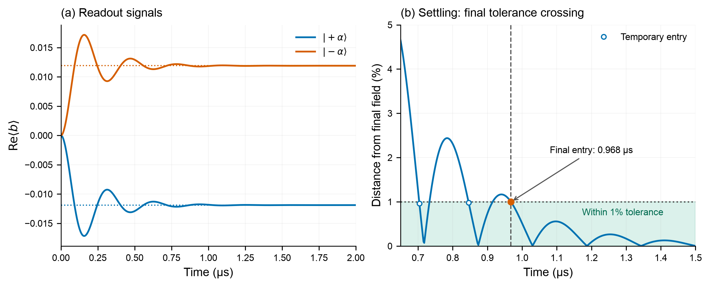
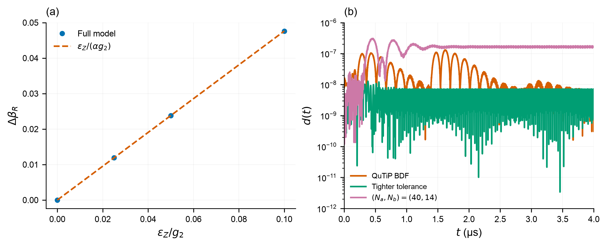

# Task 2.3: transmon-free memory-bit readout

The task has three requirements. Each has a direct numerical answer:

| Requirement | Result |
|---|---|
| Show that the two memory states give distinguishable buffer fields | Their final real fields are **−0.01189484** and **+0.01189484**. |
| Use a drive well below $g_2$ | We choose **$\epsilon_Z=0.05g_2$**, twenty times smaller. |
| Determine the settling time and whether the approach oscillates | The response oscillates, then stays within the specified 1% tolerance from **0.968 µs** through 4 µs. |

## Simulation and drive choice

Let $a$ and $b$ annihilate a photon in the memory and buffer. We use the supplied
full two-mode Hamiltonian, adding the real, constant memory drive:

$$
H=g_2(a^2b^\dagger+a^{\dagger2}b)-\epsilon_d(b+b^\dagger)
+\epsilon_Z(a+a^\dagger),\qquad \epsilon_d=g_2\alpha^2.
$$

Both photon-loss channels, $\sqrt{\kappa_a}a$ and $\sqrt{\kappa_b}b$, are
retained. Each initial memory state $\lvert\pm\alpha\rangle$, with $\alpha=2.1$,
is evolved independently with the buffer in vacuum. Preparation errors are excluded.
All [supplied physical parameters](../TECHNICAL.md#1-model-and-conventions) are retained.
Production uses $(N_a,N_b)=(32,12)$ retained Fock levels and double-precision
Tsit5 integration with relative/absolute tolerances $10^{-10}/10^{-12}$.
The 0–4 µs simulation saves results every 2 ns; this spacing is distinct from
the solver's adaptive integration steps.

We choose $\epsilon_Z=0.05g_2=0.23970352$ µs⁻¹ to keep the displacement about
each occupied memory state small. Its frequency scale is
$\epsilon_Z/(2\pi)=38.15$ kHz, compared with $g_2/(2\pi)=763$ kHz.
The drive sweep below checks that the response remains approximately proportional
to this weak drive. This is a conservative working choice, not an optimized readout.

## What signal distinguishes the memory states?

The drive slightly displaces the memory. The two-photon coupling converts the
sign of the occupied memory state into the sign of the real buffer field.
The leading estimate is

$$
\langle b\rangle_+\simeq-\frac{\epsilon_Z}{2\alpha g_2},\qquad
\langle b\rangle_-\simeq+\frac{\epsilon_Z}{2\alpha g_2}.
$$

The subscripts identify the initial memory state. Final values below are estimated
by averaging 3–4 µs; they describe the observed interval, rather than an
infinite-time stationary state.

| Initial memory | Simulated real field | Predicted real field |
|---|---:|---:|
| $\lvert+\alpha\rangle$ | −0.01189484 | −0.01190476 |
| $\lvert-\alpha\rangle$ | +0.01189484 | +0.01190476 |

The real-field separation is **0.02378968**, **0.0834% below** the predicted
$\epsilon_Z/(\alpha g_2)=0.02380952$. A phase-referenced measurement of this
real field can therefore distinguish the two memory states.

## How long does the response take to settle?

The response **oscillates before settling**. Its first maximum occurs at
0.158 µs, **44.3% above** the final signal magnitude. The oscillation period
measured from successive maxima is approximately **0.313 µs**.

We call the response settled when **both complex buffer fields stay within
0.00011905 of their respective final values at every remaining saved time
through 4 µs**. This absolute tolerance is 1% of the predicted field magnitude
$\epsilon_Z/(2\alpha g_2)=0.01190476$. Including both real and imaginary parts
checks that the whole field has settled. The final values are the 3–4 µs means.

Both fields meet this criterion from **0.968 µs** onward. The last threshold
crossing lies in **[0.966, 0.968] µs**. Earlier crossings followed by further
oscillation do not count. Tighter integration with 1-ns saved spacing and an
8-µs run using a later 7–8 µs mean give the same settling time.

  

**Readout signals and settling.** Each memory codeword $\lvert\pm\alpha\rangle$ starts with the buffer in vacuum. The full two-mode model includes both loss channels, $\alpha=2.1$, $(N_a,N_b)=(32,12)$ and $\epsilon_Z=0.05g_2$. (a) Real buffer fields over 0–2 µs; dotted lines show the predicted values $\mp\epsilon_Z/(2\alpha g_2)$. Their opposite signs distinguish the memory states. (b) A linear-scale zoom of the larger distance of the two complex fields from their respective final values. Percentages use the predicted field magnitude $\epsilon_Z/(2\alpha g_2)=0.01190476$; final values average 3–4 µs. The shaded region is within the 1% tolerance. Open circles mark temporary entries followed by renewed excursions above tolerance. The filled orange circle and dashed line mark the final entry, at the first saved time inside tolerance after the last violation: 0.968 µs. Both fields remain inside through 4 µs. Saved times are 2 ns apart.

The figure answers the task directly: panel (a) shows opposite signals and
oscillation; panel (b) shows when the response stays within the chosen tolerance.

## Checks on the weak-drive choice

| $\epsilon_Z/g_2$ | Real-field separation | Leading estimate | Relative difference | 1% settling (µs) |
|---:|---:|---:|---:|---:|
| 0 | 0 | 0 | — | — |
| 0.025 | 0.01189512 | 0.01190476 | −0.0810% | 0.976 |
| **0.050** | **0.02378968** | **0.02380952** | **−0.0834%** | **0.968** |
| 0.100 | 0.04757483 | 0.04761905 | −0.0929% | 0.966 |

The separation per unit drive varies by only 0.0119% over the nonzero sweep.
At 4 µs, fidelity with the initial coherent codeword is 0.99986 and the signed
real memory amplitude divided by $\alpha$ is 0.99916 for either initial state.
These checks support a small perturbation over the simulated interval; they
do not establish a long-time switching rate.

## Supporting physics: the imaginary field and the oscillation

The buffer-fluorescence readout mechanism and leading local estimate follow
[Réglade et al., Supplement S8.5](https://arxiv.org/html/2307.06617v2).
The following details explain the physics but are not additional Task 2.3
requirements. They are separate from the two plots needed to show the readout
signal and its settling time.

Write $\beta_s(t)=\langle b\rangle_s(t)$ and $A_s(t)=\langle a\rangle_s(t)$,
where $s=\pm1$ labels the initial memory state. Write $\bar\beta_s$ for the
3–4 µs mean of $\beta_s(t)$. The simulated final buffer fields are
$-0.01189484+0.00311514i$ and $+0.01189484+0.00311514i$.
The imaginary part describes the field component 90° out of phase with the real
part. It has the same value for both states, so it does not distinguish the
memory bit. Memory loss generates this background. With zero memory drive it
remains $0.00304907i$, while the real-field separation vanishes.

The exact symmetry and local approximation below explain that shared background
and why the response oscillates. Neither introduces a new readout observable.

For this real-parameter model, the antiunitary transformation
$\rho\mapsto\Pi_a\Pi_b\rho^*\Pi_b\Pi_a$, where $\Pi_a$ and $\Pi_b$ are the
mode-parity operators and the star denotes complex conjugation in the Fock
basis, maps the two initial conditions into each other while leaving the
evolution invariant. It therefore gives the exact relation

$$
\beta_-(t)=-\beta_+^*(t).
$$

This accounts for opposite real fields and equal imaginary fields. The
independent codeword evolutions test this symmetry numerically.

The exact first-moment equations are

$$
\dot A_s=-2ig_2\langle a^\dagger b\rangle_s-i\epsilon_Z
-\frac{\kappa_a}{2}A_s,\qquad
\dot\beta_s=-ig_2(\langle a^2\rangle_s-\alpha^2)-\frac{\kappa_b}{2}\beta_s.
$$

Factorizing the moments and linearizing about $A_s=s\alpha$, $\beta_s=0$,
define the **complex amplitude deviations**

$$
\delta a_s=A_s-s\alpha,\qquad \delta b_s=\beta_s,\qquad G_s=2sg_2\alpha.
$$

Here $G_s$ is the local exchange coupling. The deviations are semiclassical
amplitudes; the full simulation evolves the density matrix without moment
factorization. To first order,

$$
\delta\dot a_s=-\frac{\kappa_a}{2}\delta a_s-iG_s\delta b_s-i\epsilon_Z
-\frac{\kappa_a s\alpha}{2},\qquad
\delta\dot b_s=-iG_s\delta a_s-\frac{\kappa_b}{2}\delta b_s.
$$

Setting these derivatives to zero gives the local stationary buffer field

$$
\beta_{s,\mathrm{loc}}=
\frac{-\epsilon_ZG_s+i\kappa_as\alpha G_s/2}
{G_s^2+\kappa_a\kappa_b/4}.
$$

To leading order in memory loss, its imaginary part is
$\kappa_a/(4g_2)=0.00304718$, independent of the well sign. The zero-drive
control confirms this background separately from the real readout contrast.

The local linear system has eigenvalues

$$
\lambda_\pm=-\frac{\kappa_a+\kappa_b}{4}
\pm i\sqrt{(2g_2\alpha)^2-\left(\frac{\kappa_b-\kappa_a}{4}\right)^2}.
$$

They predict an underdamped response with a **0.319-µs** oscillation period
and a **0.244-µs** amplitude-envelope time. The local step response is tested
against a matrix-exponential solution. Its approximate period agrees closely
with the full quantum result, while the full quantum trajectory determines the
reported settling time.

## Validation and reproduction

The task script runs these checks before reporting success:

- Positive and negative real buffer fields, exact conjugation symmetry, and
  zero real contrast in the zero-drive control.
- Weak-drive response at $\epsilon_Z/g_2=0.025,0.05,0.10$.
- Separate memory and buffer increases to $(40,12)$ and $(32,14)$, followed by
  their joint increase to $(40,14)$. A smaller $(24,8)$ case is also checked.
- Tighter integration at relative/absolute tolerances $10^{-11}/10^{-13}$,
  with 1-ns saved spacing; an 8-µs horizon at the production tolerances.
- Independent QuTiP BDF integration with separately constructed operators at
  the production cutoff $(32,12)$, isolating integration error from cutoff error.
- Trace throughout the trajectory, final-state Hermiticity and minimum
  eigenvalue. Small signed numerical residuals are retained.

Field differences are divided by the predicted field magnitude,
$\epsilon_Z/(2\alpha g_2)$. The required maximum differences are 0.1% for cutoff
and horizon comparisons and 0.001% for solver comparisons. These are numerical
criteria, not detector performance specifications. The exact thresholds and
all pass/fail results are stored with the data.

| Comparison against $(32,12)$ production | Difference / predicted field magnitude |
|---|---:|
| Smaller cutoff $(24,8)$ | $1.02\times10^{-5}$ |
| Memory increase $(40,12)$ | $6.53\times10^{-8}$ |
| Buffer increase $(32,14)$ | $3.54\times10^{-7}$ |
| Joint increase $(40,14)$ | $3.07\times10^{-7}$ |
| Tighter Tsit5 tolerances, 1-ns saves | $1.27\times10^{-8}$ |
| Independent QuTiP BDF, same $(32,12)$ | $1.31\times10^{-7}$ |
| Change from 3–4 to 7–8 µs plateau | $2.44\times10^{-5}$ |

Trajectory comparisons use the maximum complex-field difference over both
codewords and the full 0–4 µs interval. The last row instead compares the
complex plateau means.

All **15 numerical acceptance checks pass**. The maximum trace error is
$4.00\times10^{-15}$, final Hermiticity error is zero, and the smallest final
eigenvalue over the production sweep is $-5.76\times10^{-9}$. This small
negative integration residual is recorded without clipping; the accepted
state-health tolerance is $-10^{-7}$. The small numerical differences in the
logarithmic diagnostic are not evidence of additional physical oscillations.

  

**Supporting checks: drive strength and numerical accuracy.** (a) Real-field separation between the two memory states, averaged over 3–4 µs, versus $\epsilon_Z/g_2$. Dashes show the prediction $\epsilon_Z/(\alpha g_2)$. This checks that the chosen weak drive gives approximately proportional response. (b) Largest complex-field difference between each reference calculation and the production result, over both initial memory states, divided by the nominal predicted field magnitude $\epsilon_Z/(2\alpha g_2)$. References use independent QuTiP BDF and tighter Tsit5 integration at $(32,12)$, and a larger $(40,14)$ cutoff. These check that the reported signal and settling are numerically reliable. Separate memory/buffer cutoff increases and an 8-µs run are recorded in the numerical table.

~~~bash
pip install -r requirements.txt
python -m tasks.task_2_3
python -m unittest discover -s tests -v
python -m tasks.task_2_3 --plot-only
python -m tasks.task_2_3 --reanalyze
~~~

The script writes [JSON metrics](../results/task_2_3.json), a
[trajectory archive](../results/task_2_3_trajectories.npz), and PNG/PDF figures.
Parameters, library versions, observable ordering, thresholds and source hashes
accompany the results. `--reanalyze` refreshes the summaries, plateau-window
metadata, derived flux and checks together, retaining the original simulation
hashes. Physical parameters and cutoffs must match the archive; references must
cover the required comparison interval. `--plot-only` redraws using archived
parameters. The [notebook](../notebooks/08_task_2_3_readout.ipynb) loads the saved
results by default and can rerun the calculation.

## Measurement interpretation

Let $\Delta\beta_R=\mathrm{Re}(\bar\beta_--\bar\beta_+)$ denote the separation between the two final real fields. The coherent signal flux carried by these opposite fields is
$\kappa_b(\Delta\beta_R/2)^2=0.002311$ photons/µs. It excludes the shared imaginary component
and incoherent emission, and sets the scale of the coherent readout signal.

The reported time is the turn-on settling time of the conditional **mean**
buffer response. A practical measurement must also integrate a noisy output
record. Detector efficiency, amplifier noise, measurement records and
single-shot classification are outside this master-equation calculation.
Consequently, mean-field contrast does not establish a readout fidelity or an
integration time.

Likewise, the settled values describe local responses during a finite
observation window. Eventual memory-bit switching can erase their initial-state
dependence. The 8-µs check tests plateau stability over that interval; it does
not establish an infinite-time stationary contrast or a protected bit-flip
lifetime. Increasing the readout strength and quantifying that trade-off
belong to Task 2.4.
