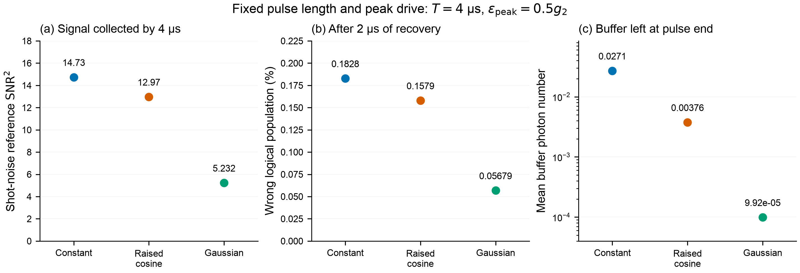

<!-- Generated from task_2_4_final.md by tools/export_task_2_4_markdown.py. -->

# Task 2.4: supporting appendices

[Main report: parts (a)-(d)](task_2_4_report.md)

## Appendix A: circuit corrections

Off-resonant terms contribute at second pump order. For $H(t)=H_0+\sum_{\Omega>0}(H_\Omega e^{i\Omega t}+H_\Omega^\dagger e^{-i\Omega t})$, the leading effective contribution is

$$
\delta H=\sum_{\Omega>0}\frac{[H_\Omega,H_\Omega^\dagger]}{\Omega}.
$$

Consistency through sixth order in zero-point phases requires both cubic-cubic and linear-fifth-order products. Keeping only cubic products would miss terms at the same formal order. Frequency shifts occur at fourth phase order; sixth order also produces $K_an_a(n_a-1)+K_bn_b(n_b-1)+\chi n_an_b$.

A separate sine-exchange model retains all zero-point phase orders in the selected resonant exchange channel, rather than every circuit resonance. Its buffer drive is recalibrated to cancel the coherent mean force. This does not restore exact coherent dark states. Corrected-model rates are compared with that same hardware's own idle reference.

### Circuit calibration and separate numerical evidence

The retained sixth-phase-order effective coefficients before compensation are $K_a=-0.01754$, $K_b=-9.63496$ and $\chi=-1.43430\,\mathrm{µs}^{-1}$. Their size makes an unqualified ideal-circuit extrapolation inappropriate. Constant frequency shifts and local Kerr slopes require retuning the memory, buffer and pump frequencies. The illustrative frequency shifts are approximately 0.922 and 22.87 MHz for memory and buffer.

A deliberate junction imbalance adds $C\cos\hat\varphi$ with $C=-2\Delta E_JJ_0(\epsilon_p)$. Choosing

$$
C=-\frac{\chi}{\varphi_a^2\varphi_b^2}=4426.84\,\mathrm{µs}^{-1}
$$

cancels the retained cross-Kerr, requiring $\Delta E_J/E_J=-0.00881$ in this convention. It also changes both self-Kerrs; their retained residuals are approximately $-0.00320$ and $-0.67061\,\mathrm{µs}^{-1}$. This is a concrete hardware/calibration proposal, not a free numerical cancellation.

With this compensation, static conservative-point rates in the phase-six model remain below that corrected hardware's own idle reference $8.39\times10^{-7}\,\mathrm{µs}^{-1}$ over the tested cutoffs. However, the last separate memory and buffer variations are 2.49% and 4.69%, and there is no joint $(38,12)$ point or corresponding idle buffer sweep. This is a cutoff-qualified feasibility witness, not a 1%-converged corrected-device certificate.

The earlier diagonal-only correction is retained as a restricted diagnostic. A separate full fundamental-pump van-Vleck matrix includes off-diagonal two-pump processes for finite-time signal sensitivity. Neither calculation supplies an exact Floquet open-system solution. No corrected full enlargement/read/restore cycle or fully corrected rare switching spectrum is delivered. Mixed pump-microwave counter-rotating terms, bath dressing, flux noise and fabrication uncertainty remain untested. Small spectral residuals cannot remove these physical model uncertainties.

**Figure 3.** Circuit-model sensitivity after junction-imbalance compensation and frequency retuning. Left: phase-six and full fundamental-pump corrected field contrast. Right: phase-six selected relaxation rates versus memory cutoff, with a separate buffer increment and matched corrected idle guide. These are qualified partial-model results.

## Appendix B: definitions and numerical validation

### Logical populations and homodyne convention

Finite-$\alpha$ coherent states are not orthogonal. We use normalized even and odd cats $|C_\pm\rangle\propto|\alpha\rangle\pm|-\alpha\rangle$ and

$$
P_{\rm code}=|C_+\rangle\langle C_+|+|C_-\rangle\langle C_-|,
\qquad |0_L,1_L\rangle=(|C_+\rangle\pm|C_-\rangle)/\sqrt2.
$$

For an initially positive codeword, $p_X=\langle1_L|\rho_a|1_L\rangle$ after the stated recovery; the reverse branch is evaluated independently. We report the worse branch, without postselection. Leakage is $1-\operatorname{Tr}(P_{\rm code}\rho_a)$. The initial coherent-state population in the opposite exact logical basis is $5.46\times10^{-9}$ at $\alpha_0$ and is retained. These populations are not counts of detected switching events.

For $B_s(t)=\langle b\rangle_s$ and $\Delta B=B_+-B_-$, input-output theory gives $b_{\rm out}=b_{\rm in}+\sqrt{\kappa_b}b$. Under the unit-Wiener homodyne convention,

$$
dY_s=2\sqrt{\eta\kappa_b}\operatorname{Re}(e^{-i\vartheta}B_s)dt+dW,
\qquad
\mathcal I_\vartheta(T)=\eta\kappa_b\int_0^T[\operatorname{Re}(e^{-i\vartheta}\Delta B)]^2dt.
$$

Optimal temporal weighting then gives $\mathrm{SNR}^2=4\mathcal I_\vartheta$. The local-oscillator phase $\vartheta$ is fixed during a record and optimized as stated; no time-dependent quadrature tracking is presumed. With coherent Gaussian outputs and equal priors, the ideal classification error is $\Phi_{\rm N}(-\sqrt{\mathcal I})$, where $\Phi_{\rm N}$ is the standard normal cumulative distribution. Thus **$\mathcal I=1$ means 15.9% ideal Gaussian error, not 1% error**. The delivered $\mathcal I$ is a mean-signal shot-noise reference. Actual single-shot fidelity requires record statistics, including switching and non-Gaussian noise, which are not simulated here.

### Rate extraction

Here $\Gamma_X$ is the logical population-imbalance decay exponent used in Task 2.1. In a two-state model, $\Gamma_X=r_{01}+r_{10}$; each one-way rate equals $\Gamma_X/2$ only for symmetric switching. We identify a near-zero real Liouvillian mode that couples to the initial codeword difference and $\operatorname{Re}\langle a\rangle$. Independent time-domain cases check the method where decay is resolvable. This avoids fitting the drive's initial displacement as a bit flip; it does not provide a full-spectrum proof that no other relevant slower mode exists.

### Information-induced dephasing is a different effect

If the conditional emitted fields are coherent, their distinguishability causes an output-induced **coherence-decay exponent** $\gamma_{\rm coh,out}\simeq\kappa_b|\Delta B|^2/2$. This grows quadratically with weak readout strength even when neither logical branch switches. Under these assumptions it describes measurement dephasing, not $\Gamma_X$.

For an initial superposition, distinguishable output fields remove coherence even if neither logical branch switches. In fixed-size runs with $\kappa_a=0$, normalized reduced-memory coherence at 4 µs is 1 without readout, 0.5346 at ratio 0.25, and 0.08565 at ratio 0.5. This attenuation includes residual entanglement with the buffer as well as information already emitted. It cannot all be identified with irreversible environmental dephasing at that instant.

Recovered wrong-logical populations in the pulse campaign are only of order $10^{-4}$-$10^{-3}$. Setting $\kappa_a=0$ reduces them by approximately 2-3%, leaving readout-induced population transfer. Thus strong loss of superposition coherence and much smaller unwanted switching can coexist. Temporary leakage, useful information gain, photon-loss phase errors and final logical transfer remain separate observables.

### Weak-drive complex-field check

The leading response including memory loss is

$$
B_s\simeq-s\frac{\epsilon_Z}{2\alpha g_2}+i\frac{\kappa_a}{4g_2}.
$$

The imaginary offset is the same for both initial codewords and carries no bit contrast.

**Figure 4.** Weak-drive buffer response for both initial coherent codewords at $\alpha=2.1$ and $\epsilon_Z/g_2=0.05$. Dashed real guides show the leading opposite pointers; the dotted imaginary guide shows the common photon-loss offset. The imaginary branch curves overlap.

### Independent checks of the retained derivation

Direct laboratory-period averaging reproduces the fifth-order resonant Hamiltonian on a low-Fock block to $8.59\times10^{-13}\,\mathrm{µs}^{-1}$. A separate emitted-coherent-state overlap verifies the coherence-decay normalization. These check retained algebra, rather than the physical adequacy of the approximation. The source and saved outputs are linked in the [reference review](../reviews/task_2_4_reference_review.md).

### Cutoff and independent-solver checks

All headline numbers are backed by saved JSON/NPZ outputs. Physical checks include Hermiticity, angular units, tensor ordering, ideal dark-state cancellation, exact logical projectors, trace conservation and upper-Fock populations. Numerical checks change memory and buffer cutoffs separately, tighten tolerances and time sampling, and compare independently implemented QuTiP and Dynamiqs solvers.

| Evidence | Observed change / result | What it supports |
|:--|:--|:--|
| Conservative rare rate, $(38,16)\to(40,16)$ | 0.699% | Last memory increment |
| Same rate, separate buffer increment | 0.530% | Last buffer increment |
| Same rate, joint $(36,14)\to(40,16)$ | 2.117% | Earlier joint increment fails 1% target |
| Conservative cycle, $(36,14)\to(38,16)$ | 0.775% in final $p_X$ | Empirical finite-cycle stability |
| Tighter integration of that cycle | $5.1\times10^{-14}$ absolute in $p_X$ | Integration error below cutoff effect |
| Pulse campaign, same-cutoff independent solvers | Both selected pulses pass | Independent integration check |
| Campaign joint $(32,12)\to(40,14)$ plus backend change | About 0.0172% in final $p_X$ | Supplemental cutoff/backend consistency |

For the conservative rare mode, left/right eigen-residuals are $2.0\times10^{-13}$ and $9.7\times10^{-11}\,\mathrm{µs}^{-1}$; the observable loading is 5.197 versus the initial branch separation 5.2. Small algebraic residuals alone do not certify the infinite-Fock rate or identify the globally slowest relevant mode. The 0.699% increment is not a rigorous error bar. The optional fast point's static rate is less well converged, with about 4.6% last memory variation; its separate finite-cycle population check must not be substituted for rate convergence.

For the fixed-size pulses, the same-cutoff independent integrations compare all ten recorded observables on identical grids and pulse boundaries. Maximum wrong-population discrepancies are $1.0\times10^{-13}$ for constant and $5.9\times10^{-12}$ for raised cosine. The supplemental $(40,14)$ Dynamiqs runs give final $p_X=0.0018280291$ and 0.0015797447. Maximum all-time wrong-population differences from the original $(32,12)$ runs are $3.63\times10^{-7}$ and $3.19\times10^{-7}$. Trace errors stay below $5.2\times10^{-15}$ and final minimum eigenvalues are approximately $-6.5\times10^{-9}$, consistent with small integration negativity. These checks support the measured waveform differences, which are much larger than the observed numerical changes; they do not prove infinite-dimensional error bounds.

**Figure 5.** Curated numerical checks. Left: final wrong population and leakage; black mark: equal-clock idle at $(28,10)$. Right: buffer-field differences normalized by the leading single-pointer amplitude, evaluated at common saved switch and final times. Tolerance and cutoff checks use the conservative cycle; QuTiP tests the fast cycle at the same $(32,12)$ cutoff. Rate and complete-trajectory checks are reported separately.

### Equal-duration idle check

An equal-duration undriven control gives $p_X=9.0588\times10^{-6}$ over 47.3997 µs, versus $7.9483\times10^{-6}$ for the selected cycle, a 12.3% lower population. The control uses $(28,10)$ and the selected cycle $(38,16)$; the control's static rate differs by 0.18% from $(32,12)$. This is empirical support, not a same-cutoff inequality bound.

### Robustness and interpretation of residual excitation

The fixed-size pulse campaign at $\alpha=2.1$ varies drive amplitude, phase, exchange coupling and buffer damping. These are sensitivity tests of those pulses, not robustness certificates for the enlarged complete cycle. A ±5% drive-amplitude error changes information by approximately ±10% and wrong population by larger fractions; the Gaussian point ranges from $4.97\times10^{-4}$ to $6.46\times10^{-4}$ in recovered $p_X$. A $\pm0.05$ rad drive phase error splits the logical branches and increases its worst-branch population by about 9.75%. A reoptimized homodyne phase is a recalibrated measurement, so nominal- and optimized-quadrature results are retained separately.

Coupling errors at fixed buffer pump change the stabilized cat itself. The approximately $2.7\times10^{-3}$ leakage observed under ±5% coupling mismatch is already present in matched zero-readout controls; attributing it all to measurement would be incorrect. Corrected circuit runs also break branch symmetry: for the constant example, the two recovered wrong populations are approximately 0.001676 and 0.002154. We report the worse branch rather than hiding asymmetry by averaging.

Enlarging the cat raises the leading photon-loss phase-dephasing scale by $2.6^2/2.1^2=1.53$ during readout. This is a cost in superposition coherence, even though the computational bit is better protected.

The enlargement-study cycles end near $1.75\times10^{-5}$ buffer photons, not literal vacuum. Their excluded post-readout information is 0.000571, 0.001459 and 0.009148 for weak, conservative and fast cycles. This explicitly accounts for continued information leakage after switching off the memory drive. The small stationary buffer background is compatible with physical memory loss and does not constitute an exact reset proof.

A local stationary output-noise diagnostic is near the vacuum reference at the conservative operating point, but this does not establish white Gaussian noise across the full cycle. The report consequently makes no claim of experimentally achievable single-shot assignment fidelity.

## Appendix C: additional controls and diagnostic checks

These calculations explain the selection of the main protocol and retain useful negative findings. They do not form part of the proposed enlargement/read/restore sequence.

### Faster enlargement option

At $\alpha=2.6$ and $\epsilon_Z/g_2=0.25$, 1-µs ramps and a 6.604-µs readout give a 10.604-µs cycle with $p_X=1.2334\times10^{-5}$. Its static rate exceeds undriven storage and has about 4.6% last memory-cutoff variation. It is therefore not the selected storage-rate-preserving point.

### Fixed-size pulse shaping

A separate frozen-source campaign explored constant, raised-cosine, Gaussian and build/hold/deplete envelopes, including signed termination segments and separate drive-phase perturbations. Semiclassical dynamics generated inexpensive candidates; full quantum evolution determined the results. A bounded differential-evolution search varied three interpretable parameters: peak ratio in $[0.05,0.5]$, hold fraction in $[0.2,1]$, and termination fraction in $[-1,0]$. It maximized classical information minus a weighted end-buffer mean-field population, using several penalty weights, deterministic seeds and a six-iteration cap with population multiplier four. This was economical candidate generation, not an unconstrained or globally converged quantum optimization. Neither an optimizer's convergence nor a visually smooth pulse is evidence of scientific improvement.

For the three checked fixed-size pulses, the readout interval is 4 µs, recovery is 2 µs, peak ratio is 0.5, and the primary cutoff is $(N_a,N_b)=(32,12)$:

| Waveform | $\mathcal I$ in readout | Recovered $p_X$ | Buffer photons at switch-off |
|:--|--:|--:|--:|
| Constant | 3.6836 | $1.8277\times10^{-3}$ | $2.7065\times10^{-2}$ |
| Raised cosine | 3.2416 | $1.5795\times10^{-3}$ | $3.7637\times10^{-3}$ |
| Gaussian | 1.3080 | $5.6791\times10^{-4}$ | $9.918\times10^{-5}$ |

Raised-cosine shaping reduces end-buffer photons by 86.1%, recovered wrong population by 13.6%, and information by 12.0%. Gaussian shaping reduces the same quantities by 99.63%, 68.9% and 64.5%. These are **common-duration, common-peak comparisons**. They do not establish matched-information gains. Gaussian, rather than the proposed build/hold/deplete family, was selected by the low-residual-buffer criterion. The attractive depletion hypothesis therefore remains a trade-off, not a demonstrated universal winner.

An executed discovery pair illustrates the speed/error frontier more directly. Constant drives at ratio 0.5 for 2 µs and ratio 0.25 for 8 µs deliver nearly equal information, 1.84838 and 1.84741 (0.053% difference). Including recovery, their cycles are 4 and 10 µs, with final $p_X=9.10\times10^{-4}$ and $6.56\times10^{-4}$. Faster acquisition costs about 38.7% more wrong population. This pair used the discovery cutoff $(24,8)$ and is not promoted as a final converged optimum.

**Figure 6.** Executed waveform trade-offs at a common duration and peak drive. Information, recovered logical population and residual buffer excitation must be read together.

### Why mean-field depletion failed the quantum test

For the same executed 2-µs candidate, classical information is 1.467 and quantum information is 1.423. Yet the predicted end-buffer population $|B(T)|^2=1.03\times10^{-4}$ is far below the quantum value $\langle n_b(T)\rangle=3.61\times10^{-3}$. The reason is visible in the exact identity

$$
\langle n_b\rangle=|\langle b\rangle|^2+
\langle(b-\langle b\rangle)^\dagger(b-\langle b\rangle)\rangle.
$$

The quantum mean-field contribution is only $1.93\times10^{-5}$; fluctuations account for **99.47%** of the remaining photon population. Here fluctuations mean energy beyond the mean amplitude, not a claim of nonclassical photon statistics. The candidate was tested at discovery cutoff $(24,8)$, so this is a demonstrated failure of its reset prediction rather than a precisely converged optimized protocol. A future depletion objective must constrain total photon population, as well as mean-field contrast and recovered logical error.

**Figure 7.** The same depletion candidate evaluated classically and quantum mechanically. Left: the integrated mean-signal prediction agrees within 3%. Right: actual photon population greatly exceeds both the classical prediction and the quantum mean-amplitude contribution. Readout lasts 2 µs; the quantum cutoff is $(24,8)$.

Matched-information prefixes of a longer trajectory can locate information arrival, but do not simulate terminating that pulse and recovering. We therefore do not turn those prefixes into unexecuted counterfactual error claims. A separate two-step input-shaping test shortened settling from 0.968 to 0.666 µs while reducing $\mathcal I(4\,\mathrm{µs})$ from 0.03705 to 0.03598. Suppressing ringing alone did not increase information over that fixed window.

### Plateau information and population diagnostic

For additional interpretation, the rate and finite-pulse data can be connected: for symmetric rare switching during a settled plateau,

$$
p_X(t)\simeq\frac{1-e^{-\Gamma_Xt}}{2},\qquad
\mathcal I(t)\simeq\dot{\mathcal I}t,\qquad
q_X\equiv\frac{\Gamma_X}{2\dot{\mathcal I}}.
$$

Thus $q_X$ estimates switching probability per unit information in that limited regime. The supplied two-mode results give $q_X=3.30\times10^{-4}$ for weak readout and $4.22\times10^{-6}$ for enlarged readout: an approximately **78-fold lower plateau penalty per unit information**. The actual equal-information complete-cycle populations improve by **41.6-fold**, which is the relevant executed result; plateau estimates do not include the full transient, ramps and recovery.

This connects the independent efforts without treating them as identical calculations. For example, the local static rate at ratio 0.5 predicts $p_X(4\,\mathrm{µs})=1.845\times10^{-3}$, while the cloud's recovered constant-pulse result is $1.828\times10^{-3}$, about 1% lower. This is a consistency diagnostic, using rate cutoff $(28,10)$ and pulse cutoff $(32,12)$, not a replacement for either convergence study or a general rate-to-pulse conversion.

## Deliverables, reproduction and provenance

The [dedicated Task 2.4 README](task_2_4_README.md) is the single entry point for the final PDF, executed synthesis notebook, detailed calculations and exact reproduction commands. [Notebook 10](../notebooks/10_task_2_4_final_synthesis.ipynb) rebuilds this synthesis from saved outputs; [notebook 09](../notebooks/09_task_2_4_optimization.ipynb) retains the detailed enlargement study. Modular source and simulation drivers remain separate from the frozen cloud implementation so that independent evidence is preserved.

The circuit and error mechanisms have prior treatments [2-4]; the present numerical results are indexed separately. The final evidence index records input hashes, exact derived metrics and source job identifiers. All 66 archived cloud source records match the execution manifest. The main campaign completed 104 of 106 jobs; its two historical joint-cutoff timeouts are preserved, and both supplemental checks passed separately. The final synthesis uses raw rate trajectories rather than the retained normalized legacy archive. PDF page renders and build checks accompany the report. Reconstructing the analysis requires no new quantum simulation.

### AI-assistance disclosure

AI agents assisted with the circuit derivation, code, candidate design, numerical execution, independent audits and report synthesis. Independent implementations, saved trajectories, explicit convergence checks and adversarial review were used to test the results. This disclosure follows the challenge's allowance for AI-assisted code and explanation; it does not substitute for the submitting team's ability to explain and defend the work. No claim of human scientific approval is implied.

### References

1. DuQuantum 2026 Alice & Bob challenge, supplied prompt v4, Task 2.4 and provided tutorials. Local source: `docs/challenge_prompt_v4.md`.
2. K. S. Dubovitskii, *Bit-flip errors in dissipative cat qubits: Second-order perturbation theory*, Physical Review A 111, 012617 (2025). [Primary manuscript](https://arxiv.org/html/2407.17299v2). Context for leakage-mediated errors; not a replacement for the present two-mode calculations.
3. U. Réglade et al., *Quantum control of a cat-qubit with bit-flip times exceeding ten seconds* (2024). [Primary manuscript and supplementary derivations](https://arxiv.org/html/2307.06617v2). Context for ATS pumping, semiclassical dynamics and calibration.

4. R. Gautier, M. Mirrahimi and A. Sarlette, *Designing High-Fidelity Zeno Gates for Dissipative Cat Qubits*, PRX Quantum 4, 040316 (2023). [Primary manuscript](https://arxiv.org/abs/2303.00760). Prior analysis of buffer-mediated logical information and gate errors.
