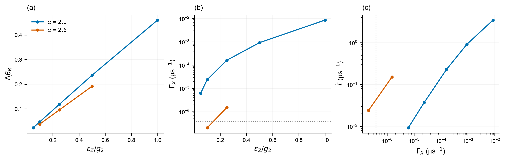
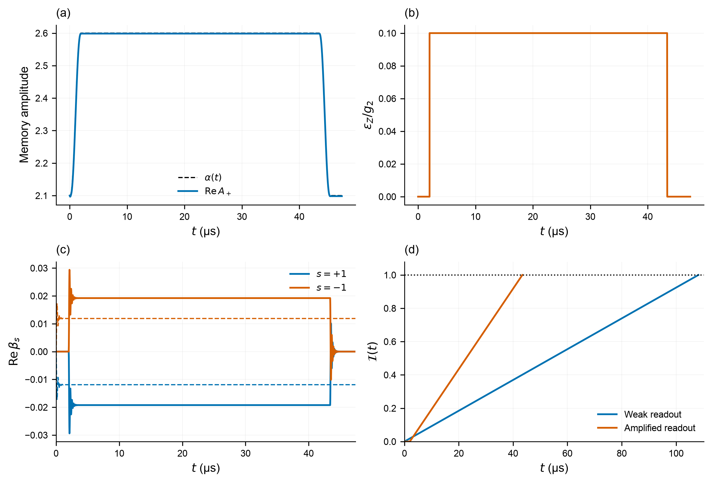
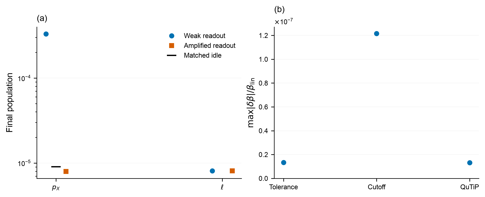
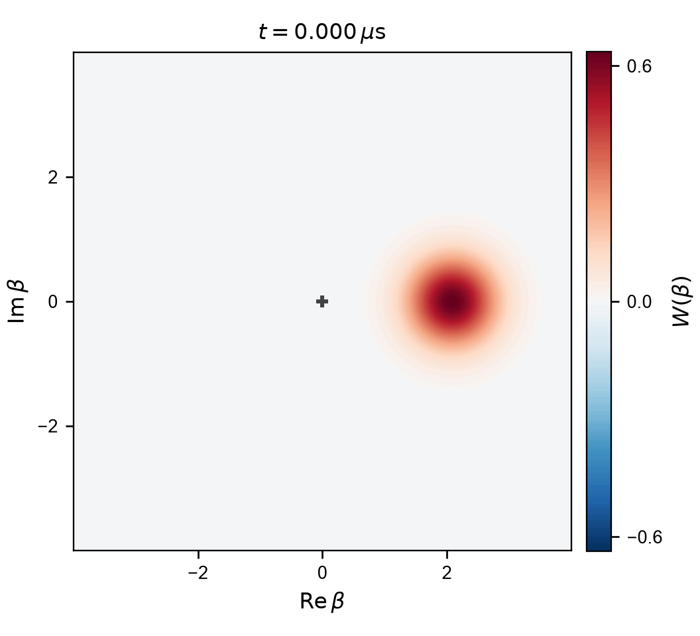
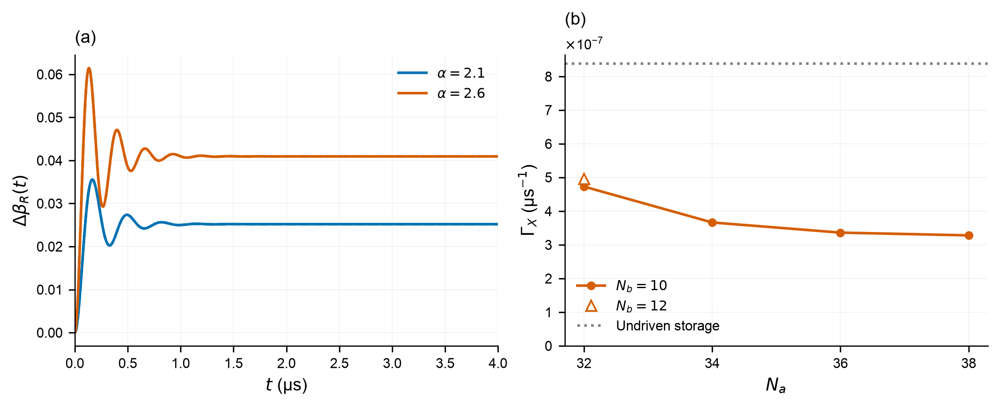
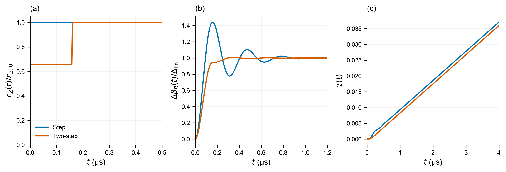

# Task 2.4: circuit-aware readout optimization

This is the detailed enlargement-study record. The [merged final report](task_2_4_final.md) selects and interprets evidence from both this study and the fixed-size cloud campaign. Use the [dedicated README](task_2_4_README.md) for submission artifacts and reproduction.

**Result.** Temporarily increasing the target amplitude from 2.1 to 2.6 and
using $\epsilon_Z=0.1g_2$ raises the buffer contrast by **1.62×** while lowering
the ideal cubic two-mode switching rate below undriven storage. Including both ramps
and return, the tested cycle reaches the same signal-information target in
**47.40 µs rather than 110.22 µs**. Its final wrong-logical-state population is
approximately $8\times10^{-6}$, below the directly integrated idle control over
the same clock. The corrected-circuit study is pump-only and has not tested
mixed pump/control terms at the same formal order; circuit-level preservation
remains unestablished.

## Purpose and comparison

Increasing the memory drive makes the buffer signal larger, but it can also
cause the memory to change codeword. We test that trade-off in the full
memory–buffer master equation, then enlarge the cat during readout so that a
stronger signal can coexist with stronger protection. The memory is returned
to its original size after measurement.

Two reference rates are kept distinct: undriven storage at the supplied
$\alpha_0=2.1$, and the existing Task 2.3 readout at
$\epsilon_Z/g_2=0.05$. A reduction relative to weak readout does not, by itself,
mean that the undriven storage rate is preserved.

## 2.4(a): physical drive and surviving circuit terms

We use $\hbar=1$, time in µs, and angular frequencies in µs⁻¹. The operators
$a$ and $b$ annihilate a memory and buffer photon. The illustrative circuit is

$$
H_{\mathrm{circuit}}=\omega_a a^\dagger a+\omega_b b^\dagger b
-2E_J\cos\varphi_\Sigma\cos(\Phi+\varphi_\Delta),\qquad
\Phi=\varphi_a(a+a^\dagger)+\varphi_b(b+b^\dagger).
$$

The zero-point phases are $\varphi_a=0.06$, $\varphi_b=0.30$;
$E_J/(2\pi)=40$ GHz, $\omega_a/(2\pi)=4$ GHz and
$\omega_b/(2\pi)=4.8$ GHz. The pump frequency is
$\omega_p=2\omega_a-\omega_b$, with
$\epsilon_p=0.0353241$ rad fixed by
$g_2=E_J\epsilon_p\varphi_a^2\varphi_b/2$.
These are the challenge's illustrative parameters, rather than a fit to a
particular fabricated device.

### A physical memory-drive port

A calibrated microwave force coupled to the memory adds

$$
H_{Z,\mathrm{lab}}=2\epsilon_Z(t)\cos(\omega_a t+\theta)(a+a^\dagger).
$$

The voltage-to-force conversion is absorbed into $\epsilon_Z$. In the frame
rotating at $\omega_a$, its resonant part is

$$
H_Z=\epsilon_Z(t)(e^{i\theta}a+e^{-i\theta}a^\dagger).
$$

Thus $\theta=0$ gives the real drive used in Task 2.3. Its counter-rotating
terms oscillate at $2\omega_a$. A capacitive port couples to the charge
quadrature; shifting its microwave phase gives the convention above.
The buffer drive is supplied through its own microwave port. The memory
readout drive is an external control term in the circuit Hamiltonian, rather
than a consequence of changing the two-photon pump amplitude alone.

### First-order pump rotating-wave approximation

The ATS bias and common-mode pump are

$$
\varphi_\Delta=\frac{\pi}{2},\qquad
\varphi_\Sigma(t)=-\frac{\pi}{2}+\epsilon_p\cos(\omega_pt).
$$

At this operating point, the first-order pump interaction is
$2E_J\epsilon_p\cos(\omega_p t)\sin\Phi$. Expanding
$\sin\Phi=\Phi-\Phi^3/6+\Phi^5/120-\cdots$ produces a negative cubic exchange
at the printed pump phase. We shift that phase by π and choose the buffer
phase consistently, obtaining the positive $g_2$ convention used throughout
this repository:

$$
H_{\mathrm{RWA}}=g_2(a^2b^\dagger+a^{\dagger2}b)
-\epsilon_d(b+b^\dagger)+H_Z.
$$

The linear pump forces and the other cubic monomials are off resonance.
There is no static Kerr term at this first-order, odd-potential operating
point. Fifth-order phase terms do survive at the same exchange resonance:

$$
H_{\mathrm{ex}}^{(5)}=
 g_2\left(1-\frac{\varphi_a^2+\varphi_b^2}{2}\right)a^2b^\dagger
-\frac{g_2\varphi_a^2}{3}a^\dagger a^3b^\dagger
-\frac{g_2\varphi_b^2}{2}a^2b^{\dagger2}b+\mathrm{h.c.}
$$

They renormalize the exchange and make it occupation dependent. We also
retain all powers of $\Phi$ within this two-photon exchange family at the
fundamental pump harmonic. For the Fock
transition $|n,m\rangle\to|n-2,m+1\rangle$, write its matrix element as
$g_2\sqrt{n(n-1)(m+1)}F_{n,m}$. Then

$$
F_{n,m}=\frac{2J_1(\epsilon_p)}{\epsilon_p}
 e^{-(\varphi_a^2+\varphi_b^2)/2}
 \frac{2L_{n-2}^{(2)}(\varphi_a^2)}{n(n-1)}
 \frac{L_m^{(1)}(\varphi_b^2)}{m+1}.
$$

Here $J_1$ is a Bessel function and $L_n^{(k)}$ is an associated Laguerre
polynomial. Direct matrix polynomials and matrix sines independently check
these coefficients. The buffer drive is recalibrated so that the coherent
mean force on the buffer vanishes at $\langle a\rangle=\alpha$, $\langle b\rangle=0$; retaining
the cubic value $\epsilon_d=g_2\alpha^2$ after changing the exchange would
silently change the target cat size.

### Off-resonant pump terms

Fast terms can have a small amplitude relative to GHz frequencies yet produce
important corrections on the MHz and rare-switching scales. For
$H(t)=H_0+\sum_{\Omega\gt0}(H_\Omega e^{i\Omega t}+\mathrm{h.c.})$, the leading
van-Vleck correction is

$$
H_{\mathrm{VV}}^{(2)}=
\sum_{\Omega\gt0}\frac{[H_\Omega,H_\Omega^\dagger]}{\Omega}.
$$

For the ATS pump interaction alone, we retain all contributions at second
order in $\epsilon_p$ through sixth order in the zero-point phases. External
microwave ports are inserted after their separate rotating-wave approximations.
In particular, cubic×cubic and linear×fifth terms must both be included;
keeping only the former gives inconsistent Kerr coefficients. Fourth phase
order produces frequency shifts. Sixth order additionally produces

$$
H_K=K_a n_a(n_a-1)+K_b n_b(n_b-1)+\chi n_a n_b,
\qquad n_a=a^\dagger a,\quad n_b=b^\dagger b.
$$

The constant and linear frequency shifts are calibrated away. To preserve the
local target wells, the memory and buffer frequencies also track the mean
Kerr shifts $2K_a\alpha^2$ and $\chi\alpha^2$. The pump is retuned with the
mode frequencies to maintain $\omega_p=2\omega_a-\omega_b$. Their residual fluctuations remain
in the simulation. All terms in this pump-only sixth-order correction are
diagonal; a resonant two-pump exchange requires higher phase order.

| Coefficient | Before compensation (µs⁻¹) | After leading cross-Kerr cancellation (µs⁻¹) |
|---|---:|---:|
| $K_a$ | −0.01754 | −0.003198 |
| $K_b$ | −9.635 | −0.6706 |
| $\chi$ | −1.434 | 0 at retained order |

The uncompensated linear shifts are $\delta_a/(2\pi)=0.9224$ MHz and
$\delta_b/(2\pi)=22.87$ MHz. These coefficients are large enough to matter;
they cannot be discarded merely because the pump is far detuned. Coefficients
multiply the operators exactly as defined above; no additional factor of two
is absorbed into $K_a$ or $K_b$.

This is a systematically truncated effective-Hamiltonian calculation at the stated order,
not an exact open-system simulation of the GHz circuit. Higher-order
Hamiltonian terms, bath dressing, flux noise and fabrication uncertainties
are not silently included. The earlier diagonal-only van-Vleck calculation is
retained as a restricted diagnostic. The promoted full-phase finite-time
sensitivity calculation includes the complete fundamental-pump van-Vleck matrix,
including off-diagonal two-pump processes. Neither calculation certifies the
exact driven open circuit or its rare-switching rate.

The external ports introduce an additional limitation. Mixed commutators
between ATS-pump harmonics and the counter-rotating microwave drives produce,
at leading order and the drive phases used here,

$$
\Delta H_{\rm mixed}=
-\frac{g_2\epsilon_Z}{\omega_a}(a^\dagger b+ab^\dagger)
+\frac{g_2\epsilon_d}{2\omega_b}(a^2+a^{\dagger2}).
$$

The matching harmonics follow from $\omega_p=2\omega_a-\omega_b$, so preserving
the exchange resonance during retuning also preserves these coincidences.
With controls proportional to $g_2$, these contributions have the same combined
second-pump/sixth-phase order as the retained Kerr terms. Their coefficients at
the calibrated conservative point are approximately
$-9.14\times10^{-5}$ and $+2.44\times10^{-3}$ µs⁻¹. They are **not included** in
the reported pump-only corrected simulations. Their effect on exponentially
small switching rates has not been established. Thus the corrected results
below are sensitivity tests of that partial effective model, rather than a
complete circuit-plus-control expansion at this order.

The circuit and drive conventions follow the supplied challenge; the fuller
ATS Hamiltonian and pump calibration are documented in
[Réglade et al., Supplement S3–S4](https://arxiv.org/html/2307.06617v2#S4).

## 2.4(b): drive-strength trade-off

Let $\rho_s(t)$ be the joint state initialized in
$|s\alpha\rangle_a|0\rangle_b$, $s=\pm1$, and
$\beta_s(t)=\mathrm{Tr}[b\rho_s(t)]$ and $A_s(t)=\mathrm{Tr}[a\rho_s(t)]$. Contrast is the real separation of the
3–4 µs means, $\Delta\beta_R=\mathrm{Re}(\bar\beta_--\bar\beta_+)$.
These are finite-window, initial-codeword-dependent signals.

We define $\Gamma_X$ from the slow decay of the difference between the two
initial-codeword evolutions, using the same observable-rate convention as
Task 2.1. In a two-state description,
$\Gamma_X=k_{+\to-}+k_{-\to+}$; it equals twice either one-way rate only when
those rates are equal. Kerr corrections can break that symmetry.

| $\alpha$ | $\epsilon_Z/g_2$ | $\Delta\beta_R$ | $\dot{\mathcal{I}}$ (µs⁻¹) | $\Gamma_X$ (µs⁻¹) |
|---:|---:|---:|---:|---:|
| 2.1 | 0.05 | 0.02379 | 0.009245 | $6.12\times10^{-6}$ |
| 2.1 | 0.10 | 0.04757 | 0.03697 | $2.37\times10^{-5}$ |
| 2.1 | 0.25 | 0.11885 | 0.23076 | $1.62\times10^{-4}$ |
| 2.1 | 0.50 | 0.23689 | 0.91674 | $9.24\times10^{-4}$ |
| 2.1 | 1.00 | 0.46037 | 3.46235 | $8.61\times10^{-3}$ |
| 2.6 | 0.10 | 0.03844 | 0.02414 | $2.04\times10^{-7}$ |
| 2.6 | 0.25 | 0.09610 | 0.15086 | $\approx1.5\times10^{-6}$ |

The initial $\alpha=2.1$ rate sweep uses $(28,10)$; its nominal weak-drive
point changes to $6.105\times10^{-6}$ at $(32,12)$. Signal trajectories use
$(32,12)$. The enlarged-cat rates require substantially larger cutoffs and
are quoted approximately here; their separate checks are given below.
A 3–4 µs mean at strong drive is a conditional finite-window response, rather
than an infinite-time steady contrast: eventual switching erases the initial
bit signal.

<p align="center">
  
</p>

**Signal and protection.** (a) Real buffer-field separation versus memory drive;
(b) observable switching rate; (c) mean-field information rate versus switching
rate. Colors identify the target cat amplitude. Markers denote computed points;
connecting lines guide the eye. The grey dotted guide is undriven storage at
$\alpha=2.1$, $\Gamma_{X,0}\simeq3.85\times10^{-7}$ µs⁻¹. The information rate
is $\dot{\mathcal{I}}=\kappa_b(\Delta\beta_R)^2$, with the measurement convention
defined below. The enlarged-cat point at $\epsilon_Z/g_2=0.5$ is shown only in
the contrast panel because its rare rate has not received the promoted-point
cutoff checks.

At weak drive, the added switching rate is approximately quadratic in
$\epsilon_Z$. The physical mechanism is leakage from the protected manifold
followed by stabilization into either well. Acting on a coherent codeword,
$H_Z$ gives both the logical phase term and fluctuations about its well; the
creation operator does not leave that coherent state invariant. Stabilization
and loss convert a small part of this excitation into unwanted switching.
Increasing the drive therefore
increases signal at a cost in switching. The one-mode second-order theory of
[Dubovitskii, Table I](https://arxiv.org/html/2407.17299v2#S2.T1) explains the
$\epsilon_Z^2e^{-2\alpha^2}$ dependence; its prefactor is not substituted for
the full two-mode numerical rate. In that adiabatic weak-drive limit,

$$
\dot{\mathcal{I}}\simeq\frac{4\epsilon_Z^2}{\kappa_2\alpha^2},\qquad
\Gamma_{X,\mathrm{drive}}\simeq
\frac{4\epsilon_Z^2}{\kappa_2\alpha^2}e^{-2\alpha^2}.
$$

Here $\kappa_2=4g_2^2/\kappa_b$, and the second expression uses the observable
relaxation convention, twice the symmetric one-way rate. Increasing drive
alone therefore leaves the leading information-per-flip ratio unchanged;
increasing cat separation improves it exponentially. The supplied parameters
are not in the fast-buffer limit, so this motivates the strategy while the
full two-mode calculations determine its performance.

## 2.4(c): enlarge, read, restore

Enlarging the cat alone reduces the buffer contrast, since
$\Delta\beta_R\simeq\epsilon_Z/(\alpha g_2)$. The useful combination is to
increase the separation and then apply a stronger readout drive. The larger
separation suppresses switching while the stronger drive increases the signal.

The storage amplitude is $\alpha_0=2.1$. The tested sequence is:

1. With the memory drive off, smoothly increase the buffer drive so that the
   target amplitude rises to $\alpha_{\mathrm{ro}}=2.6$.
2. Apply the readout drive at the enlarged amplitude.
3. Turn off the memory drive, return the target to $\alpha_0$, and allow the
   same final relaxation interval as the reference protocol.

The ramps use $f(u)=10u^3-15u^4+6u^5$, $0\leq u\leq1$, so their first two
endpoint derivatives vanish. For the cubic model,
$\epsilon_d(t)=g_2\alpha(t)^2$; the corrected static calculations instead recalibrate the buffer drive to
cancel the coherent mean buffer force. The complete enlargement/readout/return cycles below
use the cubic two-mode model. All supplied loss channels remain active throughout.

### A common information target

For an ideal vacuum-limited homodyne reference, define

$$
\mathcal{I}(T)=\kappa_b\int_0^T
 [\mathrm{Re}(\beta_-(t)-\beta_+(t))]^2 \mathrm{d}t.
$$

We require $\mathcal{I}=\mathcal{I}_*=1$ at the end of the readout-drive interval.
The reported total cycle duration additionally includes amplification, return
and final relaxation. Post-switch-off emission is excluded from the information
budget. This is a **conditional-mean signal functional**, not a claim
of measured classification fidelity. Under coherent Gaussian output and
unit efficiency and equal codeword priors it corresponds to an error of 15.9%, not 1%. Detector
inefficiency and complete measurement-record statistics are not inferred from
mean fields. A quantum-regression calculation separately checks the local
output-noise covariance. Circuit cases can optimize a fixed homodyne phase
rather than assuming the signal remains in the original real quadrature.

### Memory disturbance after return

We use an orthonormal logical basis built from normalized even and odd cats,
$|0_L\rangle=(|C_+\rangle+|C_-\rangle)/\sqrt2$ and
$|1_L\rangle=(|C_+\rangle-|C_-\rangle)/\sqrt2$, at $\alpha_0$.
For each initial sign we report the final wrong-codeword population and the
population outside this two-dimensional code space. Neither is renormalized
by postselection. The worse of the two initial signs is used for comparisons.
These quantities measure stored-bit disturbance; they are distinct from the
readout's classification error.

The conservative point uses $\epsilon_Z/g_2=0.1$ and 2-µs ramps; the
optional fast point uses 0.25 and 1-µs ramps. Both enlarge to 2.6 and return to
2.1. The weak reference holds $\alpha=2.1$ with $\epsilon_Z/g_2=0.05$.
All three information budgets agree with $\mathcal I_*=1$ within **0.0008%**.
Probabilities below are absolute fractions; both initial signs give equal
values in this ideal model.

| Protocol | Ramp, each (µs) | Read (µs) | Total (µs) | Final $p_X$ | Final $\ell$ |
|---|---:|---:|---:|---:|---:|
| Weak reference | 0 | 108.221 | 110.221 | $3.306\times10^{-4}$ | $8.110\times10^{-6}$ |
| Conservative enlarged cat | 2 | 41.400 | 47.400 | $7.948\times10^{-6}$ | $8.110\times10^{-6}$ |
| Optional fast enlarged cat | 1 | 6.604 | 10.604 | $1.233\times10^{-5}$ | $8.109\times10^{-6}$ |

The conservative cycle is **2.33× faster overall** than the weak reference,
with final wrong-logical-state population $7.948\times10^{-6}$. Direct undriven
storage over the same **47.400 µs** gives $9.059\times10^{-6}$: the complete
readout sequence is **12.3% below** that idle population. The idle trajectory
uses $(28,10)$, whose static idle rate differs by 0.18% from $(32,12)$; the
conservative cycle uses $(38,16)$. Increasing the cycle cutoffs from $(36,14)$
to $(38,16)$ changes its wrong population by **0.775%**. These are comparisons
of the stored bit, independent of a detector classification model.

Ramp and switch transients contribute to the final error, so the finite-cycle
benefit is smaller than the 47% reduction of the static plateau rate. Direct
integration captures those contributions. Final code leakage is close to the
always-on idle background in every protocol; it is reported separately from
wrong-codeword population.

The fast cycle is **10.39× faster overall** than weak readout, with final
$p_X=1.233\times10^{-5}$. Its static switching rate is below the weak-readout
rate but above undriven storage. It is therefore an optional throughput choice,
whereas the conservative point addresses the stricter storage comparator.
Neither point is claimed to be a global optimum over all controls.

<p align="center">
  
</p>

**Conservative protocol.** (a) Target $\alpha(t)$ and actual real memory
amplitude $\mathrm{Re}A_+(t)$. (b) Memory-drive envelope. (c) Buffer real fields
for initial signs $s=\pm1$; solid curves use the conservative cycle and dashed
curves the weak reference. (d) Information accumulated through each drive's end;
the dotted line is $\mathcal I_*=1$. The weak cycle uses $(32,12)$ and the
conservative cycle $(38,16)$. Time is linear in every panel. Total durations
include amplification, return and the common 2-µs final relaxation; information
after switch-off is excluded from the budget.

<p align="center">
  
</p>

**Disturbance and numerical checks.** (a) Wrong logical population $p_X$ and
code leakage $\ell$ after the complete cycles. The black mark is matched-clock
idle storage. Populations are absolute and have no postselection. (b) Maximum
buffer-field differences at shared, exactly saved switch times and the final
time, normalized by the single-pointer estimate
$\beta_{\rm lin}=\epsilon_Z/(2\alpha g_2)$. “Tolerance” compares conservative
integration at $(36,14)$ with tolerances $(10^{-10},10^{-12})$ and
$(10^{-11},10^{-13})$; “Cutoff” compares $(36,14)$ with $(38,16)$;
“QuTiP” compares independent solvers for the optional fast cycle at the same
$(32,12)$ cutoff. Full-trace interpolation sensitivity is saved separately.

<p align="center">
  
</p>

**Memory expansion and return.** The animation follows the positive initial
state through the optional fast sequence. Its 304 frames are uniformly spaced
solved reduced-memory states over 0–10.604 µs, at approximately 35 ns per frame.
Axes give the complex memory phase-space coordinate $\beta$; the origin is marked
and the scale remains $-2/\pi\leq W\leq2/\pi$.
[Static panels for both initial signs](../figures/task_2_4_wigner.png) show
$t=0$, 4 and 10.604 µs. These visualizations use $(32,12)$; the rare-error
values above use larger-cutoff calculations.


### Circuit mitigation

The static mitigation test uses the same hardware and the same retained
Hamiltonian for driven and undriven comparisons. With the imbalance below,
undriven storage at $\alpha_0=2.1$ gives
$\Gamma_X=8.388\times10^{-7}$ µs⁻¹. Enlarged readout at
$(\alpha,\epsilon_Z/g_2)=(2.6,0.1)$ gives the following phase-six results:

| $N_a$ | $N_b$ | $\Gamma_X$ (µs⁻¹) |
|---:|---:|---:|
| 32 | 10 | $4.731\times10^{-7}$ |
| 34 | 10 | $3.665\times10^{-7}$ |
| 36 | 10 | $3.363\times10^{-7}$ |
| 38 | 10 | $3.281\times10^{-7}$ |
| 32 | 12 | $4.963\times10^{-7}$ |

The last memory increment changes the rate by **2.49%**; the separate buffer
check changes it by **4.69%**. All these driven estimates remain below the
matched idle rate, with a broad margin, but this is a **cutoff-qualified design
witness**, not a 1% circuit-rate certificate. No combined $(38,12)$ result or
idle buffer sweep is claimed. The final physical bit mode has normalized
loading 0.9991 and left/right residuals near $10^{-14}$ µs⁻¹, so the visible
cutoff variation dominates eigenpair error.

We also compute the complete **fundamental-pump, full-phase van-Vleck matrix**,
including higher-order off-diagonal two-pump processes and the exact resonant
static cosine. Increasing virtual padding from 12 to 16 states per mode
changes that matrix by zero at displayed double precision for $(32,12)$;
this checks the projected virtual sum, rather than omitted pump/bath physics.
The leading $a^{\dagger4}b^2+\mathrm{h.c.}$ coefficient is about
$2.91\times10^{-4}$ µs⁻¹. The previously used diagonal-only sum is retained
as an earlier diagnostic, with its restricted scope labelled in the data.

With the same hardware imbalance and recalibration, full-phase trajectories
preserve a **2.65-fold** improvement of $\mathcal{I}(4)$ over weak readout:
0.109952 versus 0.0414483, optimizing one fixed homodyne quadrature in each case.
This is evidence for signal improvement. A full-phase switching rate and a
corrected full enlargement/return cycle have not been computed. In particular,
the local low-Fock cross-Kerr shifts from zero at phase-six order to about
$+0.116$ µs⁻¹ in the full-phase sensitivity calculation. Cancellation therefore
requires further circuit calibration; the phase-six switching benefit must not
be promoted into a device guarantee.

<p align="center">
  
</p>

**Circuit sensitivity.** (a) Instantaneous real buffer-field separation in the
balanced circuit model. Blue uses $(\alpha,\epsilon_Z/g_2)=(2.1,0.05)$; orange
uses $(2.6,0.1)$. Solid curves retain the pump-only phase-six correction;
dashed curves retain the full-phase fundamental-pump correction. All field
trajectories use $(32,12)$. (b) Phase-six enlarged-readout switching rates versus
memory cutoff, with filled circles at $N_b=10$ and a hollow triangle at $N_b=12$.
The dotted guide is matched balanced undriven storage at $(32,10)$. Panel (b)
does not give full-phase switching rates.

A small intentional junction imbalance supplies a circuit-native static
cosine potential. Define $E_J=(E_{J1}+E_{J2})/2$ and
$\Delta E_J=(E_{J1}-E_{J2})/2$. Writing the extra ATS term as
$2\Delta E_J\sin\varphi_\Sigma\sin(\Phi+\varphi_\Delta)$ gives a mean term
$C\cos\Phi$, with $C=-2\Delta E_JJ_0(\epsilon_p)$ at the chosen bias. J₀ is the
zeroth-order Bessel function.
Its leading Kerr additions are

$$
\delta K_a=\frac{C\varphi_a^4}{4},\qquad
\delta K_b=\frac{C\varphi_b^4}{4},\qquad
\delta\chi=C\varphi_a^2\varphi_b^2.
$$

Choosing $C=-\chi/(\varphi_a^2\varphi_b^2)$ cancels the leading cross-Kerr.
This is an explicit hardware modification with frequency recalibration,
rather than a free compensating Hamiltonian. Its usefulness is tested with the retained pump-only corrected dynamics and its
cutoff/model sensitivity. Here $C=4426.84$ µs⁻¹ and
$\Delta E_J/E_J=-0.008810$, an approximately 0.88% half-difference relative to
the mean junction energy. The corresponding local frequency offsets are about
−1.50 MHz for memory and −37.57 MHz for buffer; the pump must track their
resonance combination. These are explicit calibration costs.

## What did not solve the whole problem

A two-step input shaper can cancel an underdamped signal mode without raising
the peak memory drive. It does not remove the common memory-loss transient,
and reduced ringing does not automatically increase accumulated information.
We therefore distinguish field settling from measurement speed and use the
complete information-and-disturbance comparison above to choose a strategy.

We use a two-step zero-vibration shaper derived from the linearized poles,
with a first drive fraction 0.65768 for 0.15931 µs and the full drive afterward.
The peak remains $0.05g_2$. In the full two-mode simulation, the 1% complex-field
settling time falls from **0.968 to 0.666 µs**. However,
$\mathcal{I}(4)$ falls from **0.0370483 to 0.0359843**, a **2.87% decrease**.
The early reduction in signal outweighs the settling benefit in this window.
This pulse therefore does not demonstrate faster measurement at fixed
information. The control construction follows
[Singer and Seering's input-shaping method](https://dspace.mit.edu/entities/publication/371b3f3d-732b-4769-9e3b-ad0c88553e2c).

<p align="center">
  
</p>

**Input shaping.** (a) Memory drive as a fraction of its final value. (b) Real
buffer-field separation divided by $\Delta_{\rm lin}=0.05/2.1$.
(c) Integrated mean-field information. Blue denotes the abrupt step; orange
denotes the two-step pulse. Both start from the same two coherent codewords,
use the same peak drive and retain $(N_a,N_b)=(32,12)$. Settling uses the full
complex fields and the same 1% criterion as Task 2.3; the numerical curves are
unsmoothed.

## 2.4(d): physical explanation and numerical verification

The leading weak-drive scaling above predicts why the combination works:
doubling the drive compensates the signal reduction from the larger cat, while
the extra separation suppresses drive-induced switching. The simulated contrast
ratio is 1.616 and the information-rate ratio is 2.611. The promoted static
rate is **0.529 times undriven storage** and **0.0333 times weak readout**.
These improvements are checked in the full two-mode model, rather than obtained
by substituting its parameters into the adiabatically eliminated formula.
The finite cycles then test whether ramp and recovery costs erase the advantage.

Rates come from full two-mode Liouvillian eigenmodes. Selected resolvable cases
are cross-checked with independent full-complex QuTiP time-domain fits; the rare
enlarged-cat rates use eigenmode certificates and cutoff checks. Both codeword initial conditions are
integrated for the readout and complete cycles. Cutoff tests include rare
switching rates themselves: small top-level populations alone do not certify
an exponentially small error rate. Numerical residuals and cutoff differences
are retained in the saved data.

The selected spectral result is a nearest-shift real eigenmode with strong
codeword-difference and observable loading. Left/right checks and representative
time-domain comparisons support its interpretation as logical-population
relaxation. A single-eigenpair solve does not prove global spectral dominance
or exclude every slower mode; no full-spectrum certificate is claimed.

For the real cubic and number-dependent exchange models, a π/2 rotation of
both modes makes the Hamiltonian imaginary and the initial codeword difference
imaginary antisymmetric. Packing that invariant sector is an exact change of
representation. Kerr corrections couple it to the real symmetric sector, so
the corrected calculation retains the complete traceless Hermitian density
matrix. Tests compare both representations with independently constructed
full-complex generators.

| Numerical question | Executed check | Result |
|---|---|---|
| Rare conservative rate: memory cutoff | $(38,16)\to(40,16)$ | 0.6992% change |
| Rare conservative rate: buffer cutoff | $(36,14)\to(36,16)$ | 0.5301% change |
| Physical slow mode | Left/right eigenpairs, initial-state and $\mathrm{Re}a$ loading | Real decay; mode amplitude 5.19724 versus initial separation 5.2 |
| Rate interpretation | Independent full-complex time fits at three resolvable points | Latest-window spectral agreement within $1.5\times10^{-9}$ relative |
| Fast cycle: independent integrator | QuTiP BDF versus Dynamiqs, both $(32,12)$ | Final wrong population agrees within $4.2\times10^{-13}$ absolute |
| Fast cycle: larger cutoff | $(36,14)\to(38,16)$ | Final wrong population changes about 0.57% |
| Conservative cycle: larger cutoff | $(36,14)\to(38,16)$ | Final wrong population changes 0.775% |
| Conservative cycle: tighter integration | $(10^{-10},10^{-12})\to(10^{-11},10^{-13})$ at $(36,14)$ | Final wrong population changes $5.1\times10^{-14}$ absolute |
| Local output noise at conservative point | Quantum-regression covariance, 1- and 2-µs boxcars | Variance differs from vacuum reference by about 0.15% |

The final conservative rate is $2.0351\times10^{-7}$ µs⁻¹ at $(40,16)$;
undriven storage and nominal weak readout at $(32,12)$ give
$3.8475\times10^{-7}$ and $6.1050\times10^{-6}$ µs⁻¹.
Although the two separate last dimension increments are below 1%, the earlier
joint increase from $(36,14)$ to $(40,16)$ changes this rate by **2.117%**.
The 0.6992% last memory increment is therefore an empirical stability check,
not a rigorous 0.7% error bar or a uniform 1% cutoff bound.
The selected rare mode has right/left residuals
$2.03\times10^{-13}$ and $9.66\times10^{-11}$ µs⁻¹ and conditioning estimate
11.71. These, independent matrix representations, ordering/shift checks and
physical mode loading support its identification. The sparse search returns
a candidate nearest the chosen shift; certification now rejects a candidate
with negligible memory-signal loading. A single eigenpair does not establish
global spectral dominance. The five reported initial drive-sweep points have
also been recertified with strong physical loading. The finite cutoff increments
are empirical stability checks, rather than rigorous bounds on infinite-Fock
error. The finite-cycle observables receive their own comparisons below.

The optional fast point's static rate is approximately $1.5\times10^{-6}$ µs⁻¹.
Its latest reported memory-cutoff variation is about 4.6%, so it does **not**
receive a 1% static-rate convergence claim even though its final pulse-error
increment is much smaller. The initial $(32,12)$ fast-cycle estimate is $1.322\times10^{-5}$,
falling to $1.240\times10^{-5}$ at $(36,14)$ and $1.233\times10^{-5}$ at
$(38,16)$. The initial cutoff would overstate the final error.
This is another reason to test the rare quantity itself.

Raw trace, Hermiticity and minimum-eigenvalue diagnostics are saved, including
small negative integration residuals. No density matrix, population or error
curve is clipped or renormalized to conceal them. Exact switch times are saved
explicitly. Comparisons at those shared times avoid interpolation; complete
mean-field traces also have a separate piecewise interpolation check, including
cubic-versus-quintic resampling sensitivity. Wigner movies use solved density
matrices only.

The local quantum-regression noise check is near vacuum in all three tested
operating points. It assumes a locally stationary finite-time branch reference;
it does not establish full-cycle Gaussian statistics or single-shot fidelity.

## Costs and scope

The proposed control requires a calibrated buffer-drive ramp, a stronger
memory-drive pulse and a return ramp. Larger cats store more photons and
increase the leading memory-loss phase-flip rate by a factor
$2.6^2/2.1^2=1.53$ during the enlarged plateau. During a measurement of the
codeword sign, that dephasing is expected; it is nevertheless a physical cost.
The corrected hardware proposal additionally requires controlled junction
imbalance and frequency calibration. It is a proof of principle within the
explicit effective models, rather than a fabrication-ready device guarantee.

## Reproduction and saved evidence

Use the repository requirements and Python 3.12 from its root:

```bash
python -m tasks.task_2_4
python -m tasks.task_2_4 --plot-only
python -m src.readout_rate_validation --output /tmp/task_2_4_rate_checks.json --traces /tmp/task_2_4_rate_traces.npz
python -m unittest discover -s tests -v
```

The first command runs the curated ideal study, resuming exact cached cases;
an empty cache requires the long weak-readout reference and rare-mode cutoff
solves. The second redraws the delivered artifacts without solving. Independent
cycle, noise and circuit validation archives retain their explicit numerical
configurations and source identities; they support the curated study separately
from the broader pulse-search campaign in the
[execution guide](task_2_4_README.md).

- [Main metrics and provenance](../results/task_2_4.json) and
  [main trajectories](../results/task_2_4_trajectories.npz).
- [Rate certificates and cutoff comparisons](../results/task_2_4_spectral_validation.json),
  [independent rate traces](../results/task_2_4_rate_trajectories.npz),
  [measurement checks](../results/task_2_4_measurement_validation.json) and
  [independent cycle/noise traces](../results/task_2_4_independent_trajectories.npz).
- [Circuit coefficients, model definitions and numerical evidence](../results/task_2_4_circuit_validation.json).
- [Executed notebook](../notebooks/09_task_2_4_optimization.ipynb),
  [figure captions](../figures/CAPTIONS.md#task_2_4_tradeoff), and
  [modular implementation](../tasks/task_2_4.py).

Metadata-only cache imports preserve the original execution record and numerical
array hashes; a later reporting-source hash is not presented as retrospective
execution provenance. Codex assisted with derivations, implementation, parallel
numerical checks and scientific presentation. Conclusions above come from the
saved executed calculations, with unsuccessful controls and approximation limits
retained.
